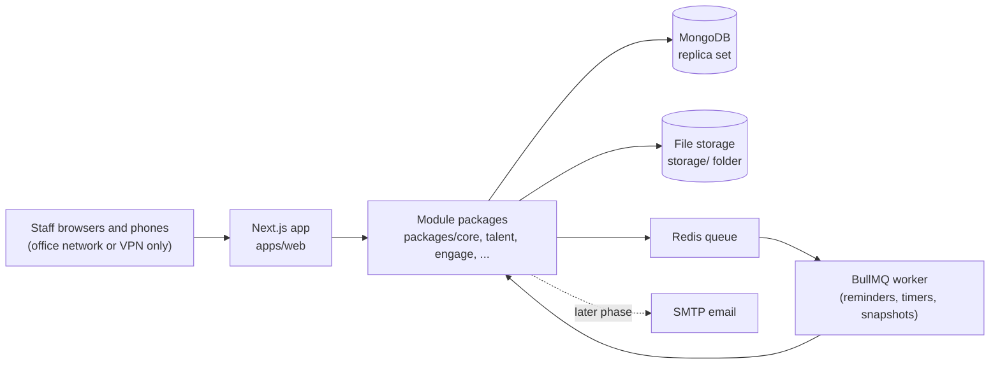
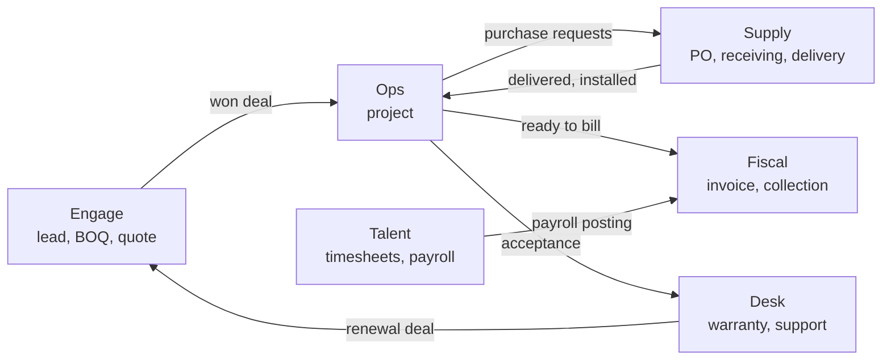

# Architecture

How Xtreme Pulse is put together: one Next.js application split into module packages, a MongoDB replica set, a background worker, and private file storage. What each module does is in the [module specs](modules/README.md). Why the main choices were made is in the [decision records](adr/README.md).

## System overview



Nothing is reachable from the public internet (see [Network exposure](../SECURITY.md#network-exposure)).

## One application

- Every module is part of **one application, Xtreme Pulse**. There are no separate apps per module.
- Users sign in once at the Pulse Core login, land on the Pulse Core home page, and open each module from the sidebar as a section of the app (`/engage`, `/ops`, `/supply`, `/desk`, `/fiscal`, `/talent`, `/insight`).
- The sidebar lists only the modules the user has at least Read access to (see [Module access](../SECURITY.md#module-access-rwo)). From build step 1.6 it adds an Administration group for HR and the System Administrator only, with the entries their role opens ([Administration area](modules/core.md#administration-area)); an empty group is hidden. The command bar's navigation items follow the same filtered list.
- A blocked page shows the designed no-access state inside the shell, with HTTP 403; an unknown URL gets the designed not-found page, with HTTP 404 ([Resolving and enforcing](../SECURITY.md#resolving-and-enforcing-build-step-16), [Feedback & motion](DESIGN_SYSTEM.md#feedback--motion)).
- Every module, including Pulse Talent, is built new inside Xtreme Pulse. There is no existing application to migrate.

## Modules and packages

| Module | Route | Package | Spec |
|---|---|---|---|
| Pulse Core | `/`, `/admin`, login | `packages/core` | [core.md](modules/core.md) |
| Pulse Talent | `/talent` | `packages/talent` | [talent.md](modules/talent.md) |
| Pulse Engage | `/engage` | `packages/engage` | [engage.md](modules/engage.md) |
| Pulse Ops | `/ops` | `packages/ops` | [ops.md](modules/ops.md) |
| Pulse Supply | `/supply` | `packages/supply` | [supply.md](modules/supply.md) |
| Pulse Fiscal | `/fiscal` | `packages/fiscal` | [fiscal.md](modules/fiscal.md) |
| Pulse Desk | `/desk` | `packages/desk` | [desk.md](modules/desk.md) |
| Pulse Insight | `/insight` | `packages/insight` | [insight.md](modules/insight.md) |

Shared packages: `packages/db` (connection, transactions and model helpers) and `packages/ui` (design tokens and components). Every schema lives in its module's package, Core's own included (`users`, `employees`, `departments`, `positions`, `companySettings`, `allowedEmailDomains`, `employeeNumberCounters`, and from build step 1.8 the shared master data `clients`, `clientSites`, `clientContacts`, `brands`, `catalogItems` and `suppliers` in `packages/core`; see [ADR 0013](adr/0013-master-data-schemas-in-core.md)).

**A module package** (from build step 2.1, `packages/talent` first) follows `packages/core`'s layout:
- **Pure code** (validation schemas, fixed sets, formatters) in `src/`, exported as `@pulse/<module>`, safe in the browser.
- **Models, services and registrations** in `src/server/`, exported as `@pulse/<module>/server`. The `browser` condition points to a client guard, so a client import fails.
- **Exports** are services only, never models.
- **Dependencies** are `@pulse/core`, `@pulse/db`, `mongoose`, `zod` and `server-only`.
- **Registrations** (sensitive reveals, file access, approval types, command bar providers) are explicit `register<Module>…()` functions that the web app's actions and routes call before use, never import side effects.
- **Append-only models** use Core's `guardWrites`, which `@pulse/core/server` exports from step 2.1.

## Tech stack

- Next.js (App Router), full-stack, TypeScript (strict)
- MongoDB (replica set required for transactions), Mongoose
- Zod for all input validation (Server Actions, Route Handlers, forms)
- Auth.js with the Credentials provider (email + password); authorization lives in `packages/core`
- Tailwind CSS + shadcn/ui; TanStack Table for data grids
- Charts: Recharts (SVG), styled with the design tokens
- Background jobs (SLA timers, timesheet and remittance reminders, Ops reminders (site reports, assignment changes), Fiscal reminders (tax due dates, missing 2307s, month-end close), Insight month-end snapshots and the weekly Board summary, renewal, expiry, probation and holiday alerts, reports): BullMQ + Redis
- File storage: a `storage/` folder with the app, outside `public/` (receipts, medical certificates, 201 files, generated PDFs); see [File storage](#file-storage)
- PDF generation for payslips, HR documents and reports (e.g. `@react-pdf/renderer`)
- Excel export for reports (e.g. `exceljs`)
- Email (later phase, for password reset and email notifications): Nodemailer over SMTP

## Repository layout

```
apps/web/                         the single Xtreme Pulse Next.js app
  app/(auth)/login/               Pulse Core login (the only public page; forgot/reset password later)
  app/(pulse)/layout.tsx          signed-in shell: sidebar with the user's modules, session + status check
  app/(pulse)/page.tsx            Pulse Core home
  app/(pulse)/approvals/          Pulse Core Approvals list, open to every signed-in user (step 1.9)
  app/(pulse)/admin/              system administration (HR and System Administrator), e.g. /admin/access for user access,
                                  and the basic master data screens (/admin/clients and others, step 1.8)
  app/(pulse)/<module>/           one folder per module: engage, ops, supply, desk, fiscal, talent, insight
  app/files/[fileId]/             the one file route: checks access, then streams a stored file
  app/company-logo/               public route for the company logo only (the one exception, step 1.4)
apps/worker/                      the BullMQ worker process (background and scheduled jobs)
packages/core/                    auth, module access, audit log, approvals, notifications, directory, org chart, holidays,
                                  shared master data (schemas and services, step 1.8)
packages/db/                      Mongo connection, transactions, model helpers
packages/<module>/                models, services and validation for each module
packages/ui/                      shared components
scripts/                          seed scripts (e.g. seed-admin.ts)
storage/                          uploaded and generated files (git-ignored, never under public/)
```

The documentation lives alongside the code:

```
README.md, AGENTS.md, CLAUDE.md   entry points for people and coding agents
SECURITY.md, CONTRIBUTING.md, CHANGELOG.md
.env.example                      every environment variable, without values
docs/                             architecture, data model, design system, code style, testing,
                                  compliance, glossary, deployment, runbook, roadmap, build plan
docs/modules/                     one spec per module
docs/adr/                         architecture decision records
```

## Architecture rules

- Modular monolith. Each module owns its collections.
- A module **never writes to another module's collections**. Call the owning module's service functions instead.
- Pages and Server Actions stay thin: validate with Zod, check module access and permissions, call a service in `packages/<module>`.
- Every create/update/delete on business records writes an audit log entry via `packages/core`. The mutating service does it, not the Server Action: inside its `withTransaction`, it makes the change and calls `recordAudit(…, { session })` with the actor and redacted `before`/`after` snapshots (`snapshotsForAudit` for an update, `snapshotForAudit` for a create or delete), so the change and its entry commit or abort together. A failed audit write fails the change. Modules call Core's audit and notification service functions, never their models ([Audit log](modules/core.md#audit-log), [Notifications](modules/core.md#notifications)).
- Pulse Insight never changes other modules' data. It only reads them (through their service functions or read-only queries) and writes its own month-end snapshots and targets.
- Use Server Components by default; add `"use client"` only where interactivity requires it.

## File storage

Uploaded and generated files live in a folder with the app, not in a separate storage service (see [ADR 0011](adr/0011-file-storage-in-project-folder.md)). That covers receipts, medical certificates, 201 files, e-signatures, profile and site photos, attachments and generated PDFs.

- **One folder.** Files go under `storage/` at the repo root by default. The path comes from `FILE_STORAGE_DIR`, so production can use another folder without a code change.
- **Never public.** The folder sits outside `apps/web/public/`, and nothing serves it directly. A file opens only through one Route Handler, which checks that the viewer may see the record the file belongs to and then streams it. A copied link is useless to anyone who couldn't open the record.
- **Access by owner type** (build step 1.6). Each stored file has an owner type (`ownerType`, the record it belongs to), and the module that owns that record registers the check with Core's `registerFileAccess(ownerType, check(user, file))`. The route needs a signed-in, active user, then runs the registered check. An unregistered owner type is refused. A refused file and a missing one both get 404 "File not found.", so ids can't be probed. Registered so far: `core.companySettings` (the current company logo only, the file whose id equals `companySettings.logoFileId`, for any signed-in active user) and `dev.sample` (development only, signed in). There is no production-wide refusal.
  - From build step 2.2:
    - `core.employee`: the employee's current profile photo only (`employees.photoFileId`), for any signed-in active user.
    - `talent.employeeDocument`: a 201 document. Talent Read plus the reveal rule for its category (`file201`, or `medical` for a medical certificate, which Accounting doesn't see), or the employee's own. Views are audit-logged.
    - `talent.eSignature`: the owner (any version) and the System Administrator only.
    - `talent.certification`: a certification's attachment, for the employee, Talent Read and the System Administrator.
  - From build step 2.5: `talent.reimbursement`, a reimbursement line's receipt, for whoever may open the timesheet (the employee, Talent Read or a `reportingTo` supervisor), only through a live line that points at that file. Views aren't audit-logged ([Reimbursements](modules/talent.md#reimbursements-build-step-25)).
  - From build step 2.8: `talent.timeOffRequest`, a leave request's attachment (medical certificate or other supporting file, category `medical`), for the employee, HR and the System Administrator with Talent Read, and the request's approvers, never Accounting; only the file the request points at; every view audit-logged (`auditView`) ([Leave, offset time off and opening balances](modules/talent.md#leave-offset-time-off-and-opening-balances-build-step-28)).

  - From build step 2.10: `talent.payslip`, a payslip PDF (generated), for the employee (their own) and for Talent Read with HR, Accounting or the System Administrator, only the file a finalized line points at; every view audit-logged (`auditView`) ([Payroll review, approval and payslips](modules/talent.md#payroll-review-approval-and-payslips-build-step-210)).

    The route calls `registerTalentFileAccess()` beside `registerCoreFileAccess()`.
  - Registrations are explicit calls, not import side effects: the route calls Core's `registerCoreFileAccess()`, which registers once per process, before it checks a file. A later module adds its own `register<Module>FileAccess()` beside it. Registering an owner type again replaces its check in development (a hot reload runs the registration again) and throws in production.
  - The proxy redirects a signed-out request to sign-in, and a temporary password to the change-password page, before the route runs, so the route's 401 "Sign in to open this file." is never reached today. It is kept as defence in depth, so the route doesn't rely on the proxy.
- **Sensitive file views are audit-logged** (build step 2.2). A registration can pass `auditView`, which names the record for the entry. The route then opens the file through `openAccessibleFile`, which writes and commits a `reveal` entry with `fields: ["file"]` before any content is read, and sends nothing if the entry can't be written. The 201 documents (`talent.employeeDocument`) use it, and every open is logged ([Sensitive data](../SECURITY.md#sensitive-data)).
- **One exception: the company logo.** The login page is public, so `/company-logo` (build step 1.4) serves the company logo without a sign-in. It serves only the file whose id equals `companySettings.logoFileId`, PNG, JPEG or WebP only, with the same hardening headers as the file route, and never takes a file id from the request; `?v=<fileId>` is only a cache buster. The rule is in [Exceptions to module access](../SECURITY.md#exceptions-to-module-access).
- **Never committed.** `storage/` is in `.gitignore`, so employee files never end up in Git.
- **One storage service.** Modules save and read files only through the storage service built in step 0.7. Moving to S3 or a network drive later means changing that service alone.
- **Safe names.** Files are saved under generated IDs, never under the uploaded name or a path taken from the user. The original name, type, size and owning record are kept in the database. Uploads are checked against allowed file types and a maximum size, both settings. From build step 2.2, `saveUpload` takes an optional `transform`. Profile photos and e-signatures use it to re-encode the image with `sharp`: auto-rotated, metadata such as EXIF and GPS stripped, resized to WebP of at most 1024 px for a photo and to PNG of at most 1200 px for a signature. Other uploads, such as 201 documents, are stored byte for byte. From build step 2.5, `saveUpload` also takes `transformImages`, which re-encodes an image and stores any other allowed type (a PDF) byte for byte. Reimbursement receipts use it with the `receipt` transform: WebP of at most 2000 px, auto-rotated, metadata stripped.
- **Kept across deploys and backed up.** A deploy must never replace or empty `storage/`. Backups must include it along with the database and the encryption key (see [DEPLOYMENT.md](DEPLOYMENT.md#still-to-decide)).

## Cross-module integration

Modules talk to each other only through the owning module's service functions. This table lists the calls the specs require, so each service is built with its callers in mind.

| Caller | Calls | For | Spec |
|---|---|---|---|
| Every module | Core | Access checks, approvals, notifications, audit log, master data | [core.md](modules/core.md) |
| Every module | Core | Add its records and actions to the command bar (`registerCommandProvider`, filtered by access; from build step 1.11) | [Command bar](modules/core.md#command-bar) |
| Engage | Core | Create and edit clients, sites, contacts and products | [Clients, sites and contacts](modules/engage.md#clients-sites-and-contacts) |
| Engage | Ops | Create the project when a deal is won | [Won deals → Pulse Ops](modules/engage.md#won-deals--pulse-ops) |
| Engage, Ops | Talent | Read certifications for presales and assignments (`listCertifications`, `countCertifiedEmployeesByBrand`; from build step 2.2) | [Skills & certifications](modules/talent.md#skills--certifications) |
| Ops | Talent | Read approved leave and offset time off (availability) and overtime hours (project costs) | [Scheduling](modules/ops.md#scheduling), [Project costs](modules/ops.md#project-costs) |
| Ops | Supply | Delivery status, equipment per site, purchase requests from quotation lines | [Equipment installed](modules/ops.md#equipment-installed-with-pulse-supply) |
| Ops | Fiscal | Ready-to-bill milestones become invoices | [Billing milestones](modules/ops.md#billing-milestones-from-payment-terms) |
| Ops | Desk | Start warranties at acceptance | [Handover and acceptance](modules/ops.md#handover-and-acceptance) |
| Ops, Desk | Core | Create sites during rollout and fleet imports | [Multi-site rollouts](modules/ops.md#multi-site-rollouts) |
| Supply | Core | Manage suppliers and catalog items | [Suppliers](modules/supply.md#suppliers) |
| Supply | Fiscal | Post equipment cost of deliveries and issues to projects | [Project costs](modules/ops.md#project-costs) |
| Talent | Core | Read employee identity (`listEmployeeIdentities`, `getEmployeeIdentity`) and the reveal subject (`getSensitiveSubject`) for the employee record (build step 2.1) | [People data ownership](modules/core.md#people-data-ownership), [The employee record](modules/talent.md#the-employee-record-build-step-21) |
| Talent | Core | Set and remove the profile photo (`setEmployeePhoto`, `removeEmployeePhoto`), and read alert recipients for jobs (`employeeNotificationContacts`, `activeHrUserIds`) (build step 2.2) | [Documents, photo, e-signature and certifications](modules/talent.md#documents-photo-e-signature-and-certifications-build-step-22) |
| Talent | Core | Read a team member's identity as their supervisor (`getEmployeeIdentity`, `listDirectReportIdentities`), confirmed holidays for a cut-off (`listConfirmedHolidays`) and the client picker options (`listClientOptions`) for timesheets (build step 2.4) | [Work schedules and daily time entries](modules/talent.md#work-schedules-and-daily-time-entries-build-step-24), [People data ownership](modules/core.md#people-data-ownership) |
| Core (approvals) | Talent | Apply the approver's e-signature on an approve decision, through the signer Talent registers (`registerApprovalSigner`; build step 2.2). From build step 2.6 the signer refuses an approver with an employee but no signature (the onboarding gate) | [Approvals](modules/core.md#approvals), [Onboarding checklist and change requests](modules/talent.md#onboarding-checklist-and-change-requests-build-step-26) |
| Talent | Core | Send change requests for approval (`registerApprovalType('talent.changeRequest')`, `submitApproval`, approvers from `employeeNotificationContacts` and `activeHrUserIds`), apply them in the `onSettled` hook, and read the checklist's account facts (`employeeOnboardingFacts`) (build step 2.6) | [Onboarding checklist and change requests](modules/talent.md#onboarding-checklist-and-change-requests-build-step-26), [People data ownership](modules/core.md#people-data-ownership) |
| Talent | Core | Listen for holidays-changed (`registerHolidaysChangedListener('talent.recomputeDtr', …)`, registered by the worker, from build step 2.7). The DTR is derived when read, so periods not yet finalized are always current; the listener reconciles the offset credits of approved timesheets covering the dates | [Holiday calendar](modules/core.md#holiday-calendar), [Timesheet approval, the DTR and the offset balance](modules/talent.md#timesheet-approval-the-dtr-and-the-offset-balance-build-step-27) |
| Talent | Core | Send timesheets for approval (`registerApprovalType('talent.timesheet')`: the `reportingTo` step, then any one HR user; `submitApproval`, `onStepApproved`, `onSettled`), let approvers open the timesheet (`isApproverFor`), and send reminders (`notify`, `activeHrUserIds`) (build step 2.7) | [Timesheet approval, the DTR and the offset balance](modules/talent.md#timesheet-approval-the-dtr-and-the-offset-balance-build-step-27) |
| Talent | Core | Send leave and offset time off for approval (`registerApprovalType('talent.leave')` and `('talent.offsetTimeOff')`, one `reportingTo` step passed at submit with `whenEmpty` HR, or the System Administrator for an HR requester; HR only for a confidential type), number requests (`nextDocumentNumber`, `LV-` and `OFS-`), register the attachment's file access (`talent.timeOffRequest`, `auditView`) and the year-to-date pay reveals, and extend the `talent.recomputeDtr` listener to reconcile approved requests (build step 2.8). No Core change | [Leave, offset time off and opening balances](modules/talent.md#leave-offset-time-off-and-opening-balances-build-step-28) |
| Later Talent steps | Talent | Read leave balances (`getLeaveBalances`), the offset balance with the available balance (`getOffsetBalance`), approved time off on the DTR (`getDtr`) and year-to-date pay at go-live, from build step 2.8: steps 2.9, 2.10, 2.12, 2.13 and 2.16 | [Leave, offset time off and opening balances](modules/talent.md#leave-offset-time-off-and-opening-balances-build-step-28) |
| Ops, later Talent steps | Talent | Read the DTR (`getDtr`) and the offset balance (`getOffsetBalance`), from build step 2.7: steps 2.8, 2.9 and 2.13, and Pulse Ops' approved overtime in Phase 4 | [Timesheet approval, the DTR and the offset balance](modules/talent.md#timesheet-approval-the-dtr-and-the-offset-balance-build-step-27) |
| Talent | Supply | Show each employee's assigned assets | [Company-issued assets](modules/supply.md#company-issued-assets) |
| Talent | Core | Compute draft payroll runs (build step 2.9): number them (`nextDocumentNumber`, `PAY-`), read confirmed holidays, notify HR (`notify`, `activeHrUserIds`, `talent.payrollDraftReady`), audit the amount views (`recordAudit` with `reveal`) and register the line reveals (`registerSensitiveReveal`), and extend the `talent.recomputeDtr` holidays-changed listener to recompute draft runs. No Core change | [Payroll run computation](modules/talent.md#payroll-run-computation-build-step-29) |
| Talent | Core | Send payroll runs for approval (`registerApprovalType('talent.payrollRun')`: one `anyOf` step to the Board set, approve and return, no `whenEmpty`; `submitApproval`, `onSettled`, `outcomeRecipients`), check the Board's view (`listApprovalsForRecord`, `isApproverFor`), register the payslip file access (`talent.payslip`, `auditView`), render and save payslip PDFs (`renderPdf`, `saveGeneratedFile`) with the company details (`getCompanySettings`, the logo), and notify employees (`notify`, `talent.payslipReady`) (build step 2.10). No Core change | [Payroll review, approval and payslips](modules/talent.md#payroll-review-approval-and-payslips-build-step-210) |
| Later Talent steps | Talent | Read a finalized line's frozen payslip figures (`getPayslip`, from build step 2.10): step 2.12 (year-to-date, annualization) and step 2.14 (final pay) | [Payroll review, approval and payslips](modules/talent.md#payroll-review-approval-and-payslips-build-step-210) |
| Later Talent steps | Talent | Read draft and finalized payroll run lines and their stored figures (from build step 2.9): step 2.10 (review, manual lines, payslips, year-to-date), 2.11 (remittances), 2.12 (basic salary earned, annualization) and 2.14 (final pay) | [Payroll run computation](modules/talent.md#payroll-run-computation-build-step-29) |
| Talent | Fiscal | Post payroll runs and final pay, record remittances | [Payroll run & payslips](modules/talent.md#payroll-run--payslips) |
| Fiscal | Talent | Duplicate-receipt check for petty cash: Talent's `claimReceipt` and `releaseReceiptClaim` in Fiscal's transaction, on the register of claimed receipts built in step 2.5 ([Reimbursements](modules/talent.md#reimbursements-build-step-25)); list the compensation tax forms | [Reimbursements](modules/talent.md#reimbursements), [BIR tax reports](modules/fiscal.md#bir-tax-reports) |
| Fiscal | Ops | Mark milestones Invoiced and Paid | [Sales invoices (AR)](modules/fiscal.md#sales-invoices-ar) |
| Fiscal | Insight | Snapshot key figures at month-end close | [Data freshness](modules/insight.md#data-freshness) |
| Desk | Engage | Create renewal deals | [Renewals](modules/desk.md#renewals) |
| Desk | Supply | Issue parts to tickets, swaps and pull-outs, serials for imported terminals | [POS terminal fleet](modules/desk.md#pos-terminal-fleet) |
| Desk | Ops | Schedule site visits on the Ops calendar | [On-site visits and service reports](modules/desk.md#on-site-visits-and-service-reports) |
| Desk | Fiscal | Invoice support contracts and chargeable work | [Chargeable work](modules/desk.md#chargeable-work) |
| Insight | Every module | Read-only figures | [Pulse Insight](modules/insight.md) |

**Approvals** (build step 1.9). A module that sends records for approval registers each approval type with Core's `registerApprovalType` (name `<module>.<name>`, steps, allowed decisions, what an empty step does, and its hooks: `onSettled`, optionally `onStepApproved` and `outcomeRecipients`). Registrations are explicit calls, like the [file access registrations](#file-storage); an unregistered type is refused. The module calls `submitApproval()` inside its own transaction, so the request commits or rolls back with the module's change. Decisions run in the engine's transaction, which calls the module's hooks in it: the hook updates and audits the module's own record in that transaction, so the decision, both audit entries and the notifications commit together, and a hook that throws rolls them all back. Core reaches the module only through the hooks it registered and never writes the module's collections, and the module never writes `approvalRequests` ([Approvals](modules/core.md#approvals)).

**E-signatures on approvals** (build step 2.2). Core can't import Talent, so Talent registers the one signer with Core's `registerApprovalSigner`. It is an explicit call, like the other registrations: the approvals Server Action calls `registerTalentApprovalSigner()`. An approve decision calls the signer in the decision's transaction. Talent's `applyESignature` then records which signature version was applied and returns a stamp, which the engine stores on the decision. With no signer registered an approve is refused, and a signer that throws rolls the decision back ([Approvals](modules/core.md#approvals)).

**Holidays changed** (build step 1.10). After a change to confirmed holidays commits, Core enqueues the BullMQ job `core.holidaysChanged` with the affected dates. The worker runs every listener a module registered with `registerHolidaysChangedListener`, an explicit call like the other registrations. Pulse Talent registers one in Phase 2 (`talent.recomputeDtr`, build step 2.7, which the worker registers at start-up); until then there are none and the job does nothing. Because the job is enqueued after the commit, a crash in between can lose it; this is accepted, and Phase 2 reconciles at payroll finalize ([Holiday calendar](modules/core.md#holiday-calendar)).

The business lifecycle these calls support:



## Placeholders during the staged build

Modules are built in order (see [Build order](ROADMAP.md#build-order)), so some handoffs point at modules that don't exist yet. Until the later module ships, the earlier one shows a placeholder:

| Until this ships | This placeholder is shown | Spec |
|---|---|---|
| Pulse Ops | "Ready for project" handoff list in Engage | [Won deals → Pulse Ops](modules/engage.md#won-deals--pulse-ops) |
| Pulse Fiscal | "Ready to bill" list in Ops, manual subcontractor costs, Talent posting placeholders (from build step 2.10, a finalized payroll run's `fiscalPosting.status` `notPosted` and "Pulse Fiscal posting: waiting for Pulse Fiscal (Phase 5)."; step 5.8 posts) | [Billing milestones](modules/ops.md#billing-milestones-from-payment-terms), [Project costs](modules/ops.md#project-costs) |
| Pulse Desk | "Warranty to start" on accepted projects | [Handover and acceptance](modules/ops.md#handover-and-acceptance) |
| Pulse Ops, Pulse Desk | Project and ticket pickers on timesheet entries: shown disabled, with "Available when Pulse Ops (Pulse Desk) is set up", and nothing stored (build step 2.4) | [Daily time entries](modules/talent.md#daily-time-entries), [Work schedules and daily time entries](modules/talent.md#work-schedules-and-daily-time-entries-build-step-24) |
| Pulse Supply | Company-issued assets item in onboarding | [Onboarding (first sign-in)](modules/talent.md#onboarding-first-sign-in) |

## Background jobs

All scheduled work runs in the BullMQ worker on Asia/Manila time. Where the spec doesn't give a cadence, the table says so. Settle it in the build step.

| Job | When | Spec |
|---|---|---|
| Next year's holidays drafted (`core.holidayAutoDraft`), with the optional online source | Every October 1 at 8:00 AM (cron `0 8 1 10 *`); HR or a System Administrator can also run the same service from `/holidays` for the current or next year | [Holiday calendar](modules/core.md#holiday-calendar) |
| Unconfirmed holidays reminder (`core.holidayReminder`) to HR and the System Administrator | December 1, 8, 15, 22 and 29 at 8:00 AM for next year (cron `0 8 1,8,15,22,29 12 *`), and Mondays at 8:00 AM in January and February for the current year (cron `0 8 * 1,2 1`), while that year has no confirmed holidays; at most once per recipient per year per Manila day (`notify()`'s `dedupeKey`) | [Holiday calendar](modules/core.md#holiday-calendar) |
| Holidays changed (`core.holidaysChanged`, with `{ dates }`) | Enqueued after a change to confirmed holidays commits, not scheduled; runs the listeners registered with `registerHolidaysChangedListener` (none until Phase 2) | [Holiday calendar](modules/core.md#holiday-calendar) |
| Users still needing access (`core.accessReminder`) to HR and the System Administrator | Daily at 8:00 AM, weekends included, while any user needs access; at most once per recipient per Manila day (`notify()`'s `dedupeKey`) | [User access page](modules/core.md#user-access-page) |
| Company details reminder (`core.companyDetailsReminder`) to HR and the System Administrator | Weekly, Mondays 8:00 AM, while any company detail is a placeholder; at most once per recipient per Manila day | [Company settings page](modules/core.md#company-settings-page) |
| Current cut-off timesheets opened (`talent.openTimesheets`; build step 2.4) | Daily at 00:05 AM, weekends included (cron `5 0 * * *`). Creates the current cut-off's timesheet for every active employee who has none, storing their position's timesheet type; idempotent (unique employee and period start) | [Work schedules and daily time entries](modules/talent.md#work-schedules-and-daily-time-entries-build-step-24) |
| Timesheet reminders and missing list (`talent.timesheetReminders`; build step 2.7) | Daily at 8:00 AM, weekends included (cron `0 8 * * *`). Reads only timesheets whose deadline is yesterday, today or tomorrow. `talent.timesheetDue` to the employee of an `open` or `returned` timesheet on the day submission opens, the deadline day and the day after, at most once per timesheet per Manila day; `talent.timesheetsMissing` to HR (the System Administrators when no HR user is active) the day after the deadline, once per period (`notify()`'s `dedupeKey`). `pnpm dev:timesheet-reminders` runs it once in development | [Timesheet approval, the DTR and the offset balance](modules/talent.md#timesheet-approval-the-dtr-and-the-offset-balance-build-step-27) |
| Draft payroll runs (`talent.payrollDraftRuns`; build step 2.9) | Daily at 5:00 AM, weekends included (cron `0 5 * * *`). While `talent.leaveSettings.goLiveDate` is set: creates the draft run of the latest ended cut-off on or after the first payroll cut-off when it has no run and every included timesheet is approved or its submission deadline has passed, notifying HR once per run (`talent.payrollDraftReady`, `dedupeKey`); then recomputes every draft run in cut-off order. Idempotent: one run per cut-off (unique index). Logs counts only. `pnpm dev:payroll-drafts [--date YYYY-MM-DD]` runs it once in development | [Payroll run computation](modules/talent.md#payroll-run-computation-build-step-29) |
| Payslip PDFs (`talent.payslipPdfs`; build step 2.10) | Every 10 minutes (cron `*/10 * * * *`). Renders the missing payslip PDF of each line of every finalized run with `payslipsPending`, saves it (`saveGeneratedFile`, `idempotencyKey` `talent.payslip:<line id>`), sets the line's file id, then clears `payslipsPending`. Idempotent; logs counts only. Opening a payslip not yet rendered renders it through the same service | [Payroll review, approval and payslips](modules/talent.md#payroll-review-approval-and-payslips-build-step-210) |
| Leave credits and carry-over (`talent.leaveCredits`; build step 2.8) | Daily at 12:30 AM, weekends included (cron `30 0 * * *`). For every active Regular employee with a regularization date on or before today and every active `credited` leave type: the prorated regularization credit, then on the annual credit date (seeded January 1) the `carryOver` and the full `credit`. Current year only, nothing dated before `talent.leaveSettings.goLiveDate` and nothing while it is null; idempotent through a unique index per employee, type, kind and year. No notification. `pnpm dev:leave-credits [--date YYYY-MM-DD]` runs it once in development | [Leave, offset time off and opening balances](modules/talent.md#leave-offset-time-off-and-opening-balances-build-step-28) |
| 201 document and certification expiry (`talent.expiryAlerts`; build step 2.2) | Daily at 8:00 AM, weekends included (cron `0 8 * * *`). An "expiring" alert once within the lead days (setting `talent.expiryAlerts`, default 30) and an "expired" alert on or after the expiry date, each once per item per expiry date (`notify()`'s `dedupeKey`). Documents to HR and the employee; certifications also to the employee's `reportingTo` supervisors; the System Administrators when no HR user is active. Archived documents, removed certifications and separated employees are skipped. `pnpm dev:expiry-alerts` runs it once in development | [Documents, photo, e-signature and certifications](modules/talent.md#documents-photo-e-signature-and-certifications-build-step-22), [Skills & certifications](modules/talent.md#skills--certifications) |
| Probation and contract alerts | 30 days ahead; daily escalation after an undecided probation ends | [Probation & contract tracking](modules/talent.md#probation--contract-tracking) |
| Remittance due dates | Before each agency's due date | [Employer contributions & monthly remittances](modules/talent.md#employer-contributions--monthly-remittances) |
| Final pay due date | As the 30-day due date approaches | [Final pay](modules/talent.md#separation-final-pay--certificate-of-employment) |
| Deal registration expiry | Daily; alerts 30 and 7 days ahead | [Deal registration](modules/engage.md#deal-registration) |
| Quotation expiry | Daily; alert 3 days ahead | [Quotations](modules/engage.md#quotations) |
| Set-date billing milestones | Daily | [Billing milestones](modules/ops.md#billing-milestones-from-payment-terms) |
| Site reports not filed, pending deliveries, overdue POs | Not specified | [Pulse Ops notifications](modules/ops.md#notifications), [Pulse Supply notifications](modules/supply.md#notifications) |
| Overdue invoices, missing 2307s, tax due dates, bank reconciliation, month-end close | Not specified | [Pulse Fiscal notifications](modules/fiscal.md#notifications) |
| SLA timers | Continuously per open ticket; alerts at 75% and at breach | [SLA and escalation](modules/desk.md#sla-and-escalation) |
| Renewal alerts and renewal deals | Daily; 90, 60 and 30 days ahead | [Renewals](modules/desk.md#renewals) |
| Support contract billing, preventive visits | When due | [Warranties, support contracts and subscriptions](modules/desk.md#warranties-support-contracts-and-subscriptions) |
| Month-end snapshot | When a Fiscal Owner closes a month | [Data freshness](modules/insight.md#data-freshness) |
| Weekly Board summary | Mondays, 8:00 AM | [Weekly Board summary](modules/insight.md#weekly-board-summary) |

## Data

Money, ledger, stock and general data rules, collection ownership and document numbering are in [DATA_MODEL.md](DATA_MODEL.md).
