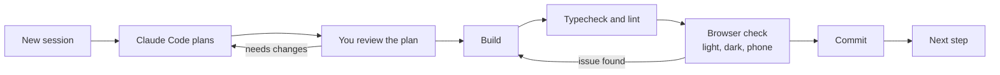

# Xtreme Pulse Build Plan

Sep 24, 2026 · @Klyde

A phase-by-phase plan for building Xtreme Pulse with Claude Code, following the [build order](ROADMAP.md#build-order).

## How to use this plan

Each step is one Claude Code session, and the phases follow the [build order](ROADMAP.md#build-order). Work through the steps in order.

**Setup:** `CLAUDE.md` and `AGENTS.md` sit at the repo root and the specs live in `docs/` (see the [documentation map](../README.md#documentation)). Claude Code loads `CLAUDE.md` automatically, which imports `AGENTS.md`. At the start of every step it reads this plan and the docs linked in that step's **Spec** line.

**Start every step with this prompt.** Replace `<N.M>` with the step number, for example `1.3`.

```text
Read docs/BUILD_PLAN.md, then build step <N.M> only. Before planning, read the docs linked in that step's Spec line.

1. Plan first. Show me the plan and wait for my go-ahead before writing any code.
2. When the build is done, run pnpm typecheck and pnpm lint, and fix anything they report.
3. Tell me how to check this step in the browser, in light and dark appearance and at phone width.
4. List anything in the docs that was unclear, and what you assumed.
```



Nothing is built until you approve the plan, and nothing is committed until you have checked it yourself.

- **Keep steps small.** Push back if a plan goes beyond the step. Ask Claude Code to drop anything from a later step or outside the specs.
- **Spec first.** When something in the spec must change, or Claude Code lists something unclear, update the doc that owns the rule first, then continue (see [CONTRIBUTING.md](../CONTRIBUTING.md#change-the-spec-first)).
- **Phase review.** At the end of each phase, ask Claude Code to review the whole phase against the docs with a review sub-agent. Fix what it finds, then do the phase check.
- **Commit often.** Commit after every checked step, so any step can be rolled back.
- **Few automated tests.** The only automated tests are the [sensitive-data guard tests](TESTING.md#sensitive-data-guard-tests), the [audit, notification and reveal tests](TESTING.md#audit-notification-and-reveal-tests), the [Core administration tests](TESTING.md#core-administration-tests) and the [user account tests](TESTING.md#user-account-tests), so each step is checked with typecheck, lint, `pnpm test` and your browser check. More tests can be added later (see [TESTING.md](TESTING.md)).
- **UI reference.** The [Xtreme Pulse screens](https://claude.ai/artifact/REqSjEy78c7ZQUGwy3dQ9e) design canvas shows the approved look. Point Claude Code to it for any screen it covers.
- **Data first.** When a step builds a module's main screen, that screen leads with small charts and trend tiles from the user's own data ([Data-rich](DESIGN_SYSTEM.md#data-rich)).

## Before you start

The tools to install, the local setup and the environment variables have moved out of this plan:

- **Tools to install and first run:** [README.md › Getting started](../README.md#getting-started)
- **Environment variables:** [DEPLOYMENT.md › Environment variables](DEPLOYMENT.md#environment-variables), with every name listed in `.env.example`
- **Field encryption and the MongoDB edition:** [ADR 0005](adr/0005-field-level-encryption.md), settled in step 0.8

## Phase 0: Foundation

When Phase 0 is done, an empty Xtreme Pulse app runs on your computer with its design system, app shell and shared building blocks. There are no module features yet; every later phase builds on this.

### Steps

1. **0.1 Monorepo and tooling.** Set up pnpm workspaces for `apps/web` (Next.js App Router), `packages/core`, `db`, `ui`, one package per module, and `scripts/`. Add TypeScript strict, ESLint, Prettier, and the `pnpm dev`, `lint`, `typecheck` and `seed:admin` (placeholder) scripts. Document the local MongoDB (single-node replica set) and Redis setup in [README.md › Getting started](../README.md#getting-started), and add `.env.example` and a `.gitignore` that excludes `.env.local` and `storage/`. Spec: [Tech stack](ARCHITECTURE.md#tech-stack); [Repository layout](ARCHITECTURE.md#repository-layout); [File storage](ARCHITECTURE.md#file-storage); [Commands](../AGENTS.md#commands); [Conventions](CODE_STYLE.md#naming) ([data naming](DATA_MODEL.md#naming), [document numbers](DATA_MODEL.md#document-numbers)).
   - Done when: the local MongoDB replica set (`rs0`) and Redis are running, and `pnpm dev` shows a starter page in the browser.
2. **0.2 Design tokens and theme.** In `packages/ui`, define the Cobalt palette, type scale (in `rem`), radii, spacing, glass, shadow and motion values as CSS variables in the Tailwind theme. Set up shadcn/ui and the font stack on these tokens, with light and dark following the OS. Add fallbacks for reduced motion, reduced transparency and no `backdrop-filter`, and a development-only `/dev/ui` page (never served in production builds) that shows every token. Spec: [UI & design](DESIGN_SYSTEM.md) ([Typography](DESIGN_SYSTEM.md#typography), [Color: Cobalt palette](DESIGN_SYSTEM.md#color-cobalt-palette), [Advanced look](DESIGN_SYSTEM.md#advanced-look-approved-direction), [Feedback & motion](DESIGN_SYSTEM.md#feedback--motion), [Accessibility](DESIGN_SYSTEM.md#accessibility)).
   - Done when: `/dev/ui` shows every color and type style, and switches between light and dark with the OS setting.
3. **0.3 App shell and routes.** Build the macOS-style glass sidebar, listing every module for now (Phase 1 filters it by module access). Add the top toolbar with the ⌘K / Ctrl+K command bar shell, notification and help buttons, and the large-title page header. Use them in the `app/(pulse)` layout with placeholder pages (home, each module, `/admin`), plus the `app/(auth)/login` placeholder and skeleton, empty and error states. Spec: [One application](ARCHITECTURE.md#one-application); [Repository layout](ARCHITECTURE.md#repository-layout); [UI & design](DESIGN_SYSTEM.md) ([Layout & components](DESIGN_SYSTEM.md#layout--components), [Advanced look](DESIGN_SYSTEM.md#advanced-look-approved-direction), [Feedback & motion](DESIGN_SYSTEM.md#feedback--motion)).
   - Done when: every module opens from the sidebar inside the shell, ⌘K / Ctrl+K opens the command bar, and the layout holds at phone width.
4. **0.4 Shared components.** On shadcn/ui and Lucide, build the sheet, the inspector panel (a full-height sheet on phones) and the segmented control. Add inset grouped form sections with inline validation, the data table on TanStack Table, and a Recharts wrapper that requires an accessible name. Add the destructive confirm dialog and shortcut hints (⌘↵ / Ctrl+Enter), give every control a 44×44px touch target, and show each component on `/dev/ui`. Spec: [UI & design](DESIGN_SYSTEM.md) ([Layout & components](DESIGN_SYSTEM.md#layout--components), [Advanced look](DESIGN_SYSTEM.md#advanced-look-approved-direction), [Feedback & motion](DESIGN_SYSTEM.md#feedback--motion), [Accessibility](DESIGN_SYSTEM.md#accessibility)).
   - Done when: every component on `/dev/ui` works by keyboard and looks right in light, dark and at phone width.
5. **0.5 Database package.** In `packages/db`, add the Mongoose connection and a transaction helper built on `session.withTransaction`. Add a base schema plugin for `createdAt`, `updatedAt`, `createdBy`, `updatedBy` and soft delete (`deletedAt`), leaving soft-deleted records out of normal queries. Follow the naming conventions, and add a development-only `/dev/health` page that checks the database. Spec: [Architecture rules](ARCHITECTURE.md#architecture-rules); [Data rules](DATA_MODEL.md#data-rules-critical) ([Money](DATA_MODEL.md#money), [General](DATA_MODEL.md#general)); [Conventions](CODE_STYLE.md#naming) ([data naming](DATA_MODEL.md#naming), [document numbers](DATA_MODEL.md#document-numbers)).
   - Done when: `/dev/health` shows MongoDB connected and a test transaction committed on the replica set.
6. **0.6 Shared helpers.** Add money helpers (integer centavos, half-up rounding at the line level, PHP display) and date helpers (store UTC, display Asia/Manila). Add atomic document number counters (`PREFIX-YYYY-NNNN`) and an effective-dated, versioned configuration store for rates and tables. Add the Zod pattern for Server Actions that returns field errors for inline validation, with a slot for the access check Phase 1 adds. Spec: [Data rules](DATA_MODEL.md#data-rules-critical) ([Money](DATA_MODEL.md#money), [General](DATA_MODEL.md#general)); [Architecture rules](ARCHITECTURE.md#architecture-rules); [Conventions](CODE_STYLE.md#naming) ([data naming](DATA_MODEL.md#naming), [document numbers](DATA_MODEL.md#document-numbers)); [Tech stack](ARCHITECTURE.md#tech-stack); [Payroll](modules/talent.md#payroll).
   - Done when: `/dev/health` issues two numbers in sequence, resolves a setting by date, and shows correct half-up rounding and Manila time.
7. **0.7 Files, jobs and exports.** Add file storage in the `storage/` folder (path from `FILE_STORAGE_DIR`, outside `public/`): one storage service that saves files under generated names, and one Route Handler that serves them, with a slot for the access check Phase 1 adds. Add a BullMQ worker process, started by `pnpm dev`, and a scheduler skeleton that runs jobs on Asia/Manila time. Add PDF (`@react-pdf/renderer`) and Excel (`exceljs`) export helpers, and extend `/dev/health` to check storage, Redis and the worker. Spec: [Tech stack](ARCHITECTURE.md#tech-stack); [File storage](ARCHITECTURE.md#file-storage); [Sensitive data](../SECURITY.md#sensitive-data).
   - Done when: a test upload lands in `storage/` under a generated name and opens only through the file route (never by a direct URL), a test job runs, and sample PDF and Excel files download.
8. **0.8 Sensitive data helper.** Add field encryption at rest with a key vault and the local master key, choosing automatic or explicit encryption to match your MongoDB edition. Record the choice in [ADR 0005](adr/0005-field-level-encryption.md) and the [Sensitive data](../SECURITY.md#sensitive-data) section of SECURITY.md. Add a masked field component that shows the last 4 digits and fetches the full value only on reveal, ready for Phase 1's audit log. Enforce the supported field shapes, install the `$jsonSchema` validators, and commit the guard tests. Spec: [Sensitive data (Data Privacy Act of 2012, RA 10173)](../SECURITY.md#sensitive-data); [ADR 0012](adr/0012-fail-closed-sensitive-fields.md); [Sensitive-data guard tests](TESTING.md#sensitive-data-guard-tests).
   - Done when: `/dev/health` shows a sample value stored as ciphertext, and `/dev/ui` shows it masked to the last 4 digits until revealed. Unsupported sensitive field shapes throw when the schema or model is defined. Every collection with sensitive paths has its `$jsonSchema` validator. The guard test suite is committed and passes with `pnpm test`, covering `bulkWrite`, `replaceOne` and `findOneAndReplace`, update pipelines, `$setOnInsert`, `$merge` and `$out`, raw `Model.collection` calls, `$rename`, upserts with a sensitive filter, `strict: false`, and array `$push`, `$addToSet`, `$pull` and `$pop`.

**Phase check:** Run the phase review, fix what it finds, then confirm the foundation works end to end.

- With the local MongoDB replica set and Redis running, `pnpm dev` starts the app and the worker without errors.
- The shell, the placeholder pages and `/dev/ui` look right in light and dark appearance and at phone width.
- `/dev/health` reports MongoDB (with a transaction), Redis, the worker, storage and encryption as working.
- `pnpm typecheck`, `pnpm lint` and `pnpm test` pass.

## Phase 1: Pulse Core

When Phase 1 is done, HR and the System Administrator can sign in, create users, set module access and run the holiday calendar. Every later module builds on Core's access checks, approvals, notifications, audit log and master data services.

### Steps

1. **1.1 Core schemas and seed script.** Add the Core schemas: users (the account), employees (the identity Core owns), departments, positions, employeeNumberCounters and companySettings, plus the ALLOWED\_EMAIL\_DOMAINS and EMPLOYMENT\_STATUS constants. Write pnpm seed:admin (scripts/seed-admin.ts) to create the bootstrap System Administrator from SEED\_ADMIN\_EMAIL and SEED\_ADMIN\_PASSWORD, flagged to change its password. It also loads allowed domains, departments, positions with timesheet types and company settings placeholders, one loader per data set, which later phases extend. If a System Administrator already exists, the script skips creating one, and each loader inserts only missing records, never overwriting existing ones. Spec: [Bootstrap System Administrator account](modules/core.md#bootstrap-system-administrator-account); [Account & access](../SECURITY.md#account--access); [Departments and positions](modules/core.md#departments-and-positions); [Company details](modules/core.md#company-details-pending-from-the-client); [Conventions](CODE_STYLE.md#naming) ([data naming](DATA_MODEL.md#naming), [document numbers](DATA_MODEL.md#document-numbers)).
   - Done when: on an empty database, pnpm seed:admin creates the account and base data; a second run creates no second admin, changes no existing record, and adds only data a new loader brings.
2. **1.2 Sign-in, password change and status check.** Set up Auth.js Credentials with JWT sessions: lowercase the email, check the allowed domains, verify the argon2id hash and require an active account. A temporary password forces a change-password page first, and the hero login page has no Forgot password link (a future release). Add getCurrentUser, which reloads the account on every request and signs out deactivated users, plus role helpers for HR, Accounting, Board and System Administrator (HR, Accounting and Board come from the department). Sessions last 24 hours. Spec: [Account & access](../SECURITY.md#account--access); [Bootstrap System Administrator account](modules/core.md#bootstrap-system-administrator-account); [UI & design](DESIGN_SYSTEM.md).
   - Done when: the bootstrap account signs in, must set a new password before anything else, and an email on another domain gets an inline error.
3. **1.3 Audit log, notifications and sensitive reveal.** Build the append-only audit log service (actor, module, record, action, old and new values, reason) and a System Administrator page to browse it. Build in-app notifications: a notify service, a toolbar bell with an unread badge, and a list linking to each record. Wire the Phase 0 masked-field reveal to a Server Action that checks the Sensitive data rules and audit-logs the field, never the value. Spec: [Architecture rules](ARCHITECTURE.md#architecture-rules); [Sensitive data](../SECURITY.md#sensitive-data); [Notifications](modules/core.md#notifications).
   - Done when: changing a password writes an audit entry with no password value, and the bell shows its designed empty state.
4. **1.4 Departments, positions and company settings.** Build /admin screens for departments (name, code, optional department head) and positions (name, department, timesheet type), with add, edit and retire. Build the company settings page for the System Administrator, including the logo upload, allowed email domains and system-wide settings. While any company detail is still a placeholder, HR and the System Administrator see a reminder and get a notification. Spec: [Departments and positions](modules/core.md#departments-and-positions); [Company details](modules/core.md#company-details-pending-from-the-client); [System Administrator](../SECURITY.md#system-administrator).
   - Done when: a new position shows with its timesheet type and an audit entry, and the reminder clears once every company detail is filled in.
5. **1.5 User accounts and employee numbers.** Build /admin/users with a create sheet for the identity Core owns, plus temporary and reset passwords (only a System Administrator resets a System Administrator's password); Phase 2 adds the full employee record. Generate YYYY-NN numbers from the atomic per-year counter (maximum 99), or accept an existing company ID and raise that year's counter. Map employment status to account status, keeping Terminated blocked until Phase 2 adds due process, and validate reportingTo per Reporting lines. Spec: [Account & access](../SECURITY.md#account--access); [Managing user accounts](modules/core.md#managing-user-accounts); [Employee number (company ID)](modules/core.md#employee-number-company-id); [Reporting lines](modules/core.md#reporting-lines); [System Administrator](../SECURITY.md#system-administrator).
   - Done when: after a manual 2027-99 the next 2027 hire fails clearly, and a user Resigned as of today is signed out on their next click.
6. **1.6 Module access and the signed-in shell.** Add MODULES, ACCESS\_LEVELS and ModuleAccess in packages/core, plus requireModuleAccess(module, level) for every page, Server Action and Route Handler. The System Administrator always resolves to Owner (Read on Insight), and a blocked route shows a designed no-access state. The sidebar shows only readable modules, plus Admin for HR and the System Administrator; Home shows the hero and the access-being-set-up message. Spec: [Module access (RWO)](../SECURITY.md#module-access-rwo); [System Administrator](../SECURITY.md#system-administrator); [Administration area](modules/core.md#administration-area); [One application](ARCHITECTURE.md#one-application); [File storage](ARCHITECTURE.md#file-storage); [Pages, Server Actions and Route Handlers](CODE_STYLE.md#pages-server-actions-and-route-handlers); [UI & design](DESIGN_SYSTEM.md) ([Feedback & motion](DESIGN_SYSTEM.md#feedback--motion)); [Module access tests](TESTING.md#module-access-tests).
   - Done when: a new user sees only Pulse Core with "Your access is being set up", and gets the no-access state at /fiscal and /admin.
7. **1.7 User access page.** Build /admin/access as specified: the list with search, filters and access summaries, the pinned Needs access group, and the sidebar badge. The sheet saves all module rows at once and audit-logs each change, with read-only rows, the Board members hint and the System Administrator switch. After creating a user, open their sheet, and notify HR and the System Administrator of new users, missing access (daily) and position changes. Spec: [User access page](modules/core.md#user-access-page); [Module access (RWO)](../SECURITY.md#module-access-rwo) ([Resolving and enforcing](../SECURITY.md#resolving-and-enforcing-build-step-16)); [System Administrator](../SECURITY.md#system-administrator); [Managing user accounts](modules/core.md#managing-user-accounts); [Notifications](modules/core.md#notifications); [Background jobs](ARCHITECTURE.md#background-jobs); [The only System Administrator is disabled](RUNBOOK.md#the-only-system-administrator-is-disabled); [User access tests](TESTING.md#user-access-tests).
   - Done when: HR sets Talent Write for a user, Talent appears in their sidebar, the audit log shows both levels, and HR's own row is read-only.
8. **1.8 Shared master data services.** Add the master data schemas and their services in packages/core ([ADR 0013](adr/0013-master-data-schemas-in-core.md)): clients with sites and contacts, products (brands), catalog items and suppliers. Catalog items carry their product, part number, description, unit, item kind (serialized, bulk, or non-stock for services and licenses), and default warranty months. Seed the products and build basic System Administrator screens under /admin for all four (clients with their sites and contacts, products, catalog items, suppliers); Engage (Phase 3) and Supply (Phase 4) build full screens on these services. Spec: [Shared master data](modules/core.md#shared-master-data) ([Managing master data](modules/core.md#managing-master-data)); [Architecture rules](ARCHITECTURE.md#architecture-rules); [Deals and stages (products)](modules/engage.md#deals-and-stages); [Clients, sites and contacts](modules/engage.md#clients-sites-and-contacts); [Suppliers](modules/supply.md#suppliers); [Stock](modules/supply.md#stock); [Warranties, support contracts and subscriptions](modules/desk.md#warranties-support-contracts-and-subscriptions); [Rules](../SECURITY.md#rules); [Master data tests](TESTING.md#master-data-tests).
   - Done when: the System Administrator adds a client with two sites and a contact, and the products list shows all 13 seeded brands.
9. **1.9 Approvals engine.** Build the approvals engine, with steps routed to reportingTo, any one of a set (the Board), or all of a set (payment approvers). The first decision settles an any-one step and notifies the others; a return or rejection needs remarks; a self-only step goes to the System Administrator. Add same-transaction hooks for modules, a read-only approver access check and an Approvals list; Phase 2 adds e-signatures to decisions. Spec: [Reporting lines](modules/core.md#reporting-lines); [Approvals](modules/core.md#approvals) ([Approvals list](modules/core.md#approvals-list)); [Notifications](modules/core.md#notifications); [Audit log](modules/core.md#audit-log); [Module access (RWO)](../SECURITY.md#module-access-rwo) ([Exceptions to module access](../SECURITY.md#exceptions-to-module-access), [Audit logging](../SECURITY.md#audit-logging)); [Timesheets & attendance](modules/talent.md#timesheets--attendance) ([Submission & approval](modules/talent.md#submission--approval)); [Payroll run & payslips](modules/talent.md#payroll-run--payslips); [Payments (disbursements)](modules/fiscal.md#payments-disbursements).
   - Done when: a dev-script request reaches every supervisor, the first approval settles it and notifies the others, and a self-only step reaches the System Administrator.
10. **1.10 Holiday calendar.** Build the holiday calendar: HR and the System Administrator manage and confirm holidays, drafts stay with HR and the System Administrator, and ad-hoc declarations notify every user. Add BullMQ jobs: the October 1 auto-draft from seed configuration, which HR or a System Administrator can also run from the page for the current or next year ([Going live](DEPLOYMENT.md#going-live) item 4 uses it for the current year), the optional online source added as drafts, and the December 1 weekly reminder. Emit a holidays-changed event that Phase 2 hooks to recompute DTRs for payroll periods not yet finalized; until then it does nothing. Spec: [Holiday calendar](modules/core.md#holiday-calendar); [Notifications](modules/core.md#notifications); [Audit log](modules/core.md#audit-log); [Rules](../SECURITY.md#rules) ([Audit logging](../SECURITY.md#audit-logging)); [Versioned configuration](DATA_MODEL.md#versioned-configuration); [Collection ownership](DATA_MODEL.md#collection-ownership); [Background jobs](ARCHITECTURE.md#background-jobs); [Cross-module integration](ARCHITECTURE.md#cross-module-integration); [Environment variables](DEPLOYMENT.md#environment-variables); [Online holiday source unreachable](RUNBOOK.md#online-holiday-source-unreachable); [Holiday calendar tests](TESTING.md#holiday-calendar-tests).
    - Done when: running the auto-draft job by hand creates next year's drafts with correct Holy Week dates, and other users see only confirmed holidays.
11. **1.11 Directory, org chart, command bar and Home tiles.** Build the directory and the reportingTo org chart; cards open in the inspector, where HR, the Board and the System Administrator edit reporting lines. The command bar searches people and actions through a provider registry that later phases extend with their records, filtered by access. Home adds tiles from the user's own data (approvals waiting, unread notifications, upcoming holidays, their team); photos show initials until Phase 2. Spec: [Company directory](modules/core.md#company-directory); [Org chart](modules/core.md#org-chart); [Reporting lines](modules/core.md#reporting-lines); [Command bar](modules/core.md#command-bar); [Home](modules/core.md#home); [Holiday calendar](modules/core.md#holiday-calendar); [Approvals list](modules/core.md#approvals-list); [Notifications](modules/core.md#notifications); [Rules](../SECURITY.md#rules) ([Sensitive data](../SECURITY.md#sensitive-data), [Audit logging](../SECURITY.md#audit-logging)); [Cross-module integration](ARCHITECTURE.md#cross-module-integration); [Collection ownership](DATA_MODEL.md#collection-ownership); [UI & design](DESIGN_SYSTEM.md) ([Advanced look](DESIGN_SYSTEM.md#advanced-look-approved-direction), [Layout & components](DESIGN_SYSTEM.md#layout--components), [Shared components](DESIGN_SYSTEM.md#shared-components)); [Directory, org chart and command bar tests](TESTING.md#directory-org-chart-and-command-bar-tests).
    - Done when: an employee with two supervisors appears once with two lines, and ⌘K or Ctrl+K finds a person by name or employee number.

**Phase check:** Before starting Phase 2, run this on a fresh database, with typecheck and lint passing and screens checked in light, dark and phone width.

- Run pnpm seed:admin, sign in as sysadmin@xtreme-works.com, set a new password and fill in one company detail.
- Create a Human Resource Officer, sign in as HR, change the temporary password, and create two employees, one reporting to the other.
- Set their access on /admin/access, then sign in as each: check the sidebar, directory, org chart and command bar.
- Confirm next year's holidays, run a sample approval, then set an employee to Resigned and check the sign-out and the audit log.

## Phase 2: Pulse Talent

When Phase 2 is done, HR runs the whole employee lifecycle in Pulse Talent, from onboarding and timesheets to payroll, payslips and separation. Employees file timesheets, leave and offset time off from a phone, supervisors and the Board of Directors approve, and payslips arrive in self-service.

### Steps

1. **2.1 Employee record and sensitive fields.** Build the Talent employee record, keyed by employeeId, with personal, employment, compensation, government ID and payroll bank details, and an append-only effective-dated compensation history. Encrypt and mask the sensitive fields, audit-log every reveal, and apply the Sensitive data rules so Talent access alone never shows them. Add the employee list with an inspector, the own record in self-service, and Manage access, which opens the Phase 1 User access sheet. Spec: [Employee information](modules/talent.md#employee-information) ([Personal](modules/talent.md#personal), [Employment](modules/talent.md#employment), [Compensation](modules/talent.md#compensation), [Government IDs](modules/talent.md#government-ids-philippines), [Payroll bank account](modules/talent.md#payroll-bank-account)); [Sensitive data](../SECURITY.md#sensitive-data); [Module access](../SECURITY.md#module-access-rwo); [User access page](modules/core.md#user-access-page); [Record retention](COMPLIANCE.md#record-retention).
   - Done when: HR reveals a masked TIN, the System Administrator finds HR's reveal in `/admin/audit`, and a Talent Write user sees none of the sensitive fields.
2. **2.2 201 file, profile photo, e-signature and certifications.** Add 201 file documents in file storage, served through the file route with the Sensitive data checks, and a daily job that alerts HR and the employee 30 days before expiry. Add the profile photo and a versioned e-signature applied through one owner-only service, which Phase 1 approval decisions call; signed records keep their version. Add skills and certifications with expiry alerts to the employee, reportingTo and HR, and a read service that Ops and Engage will call. Spec: [Employee information](modules/talent.md#employee-information) ([Documents (201 file)](modules/talent.md#documents-201-file), [Profile photo & e-signature](modules/talent.md#profile-photo--e-signature)); [Skills & certifications](modules/talent.md#skills--certifications); [Sensitive data](../SECURITY.md#sensitive-data).
   - Done when: an expiring document and certification raise alerts, and replacing a signature leaves already-signed records on the old version.
3. **2.3 Payroll settings and seeded configuration.** Add Talent payroll settings on the versioned configuration store, seeded by seed:admin: cut-offs and pay days, the 261 factor and the contribution split. Seed SSS, PhilHealth and Pag-IBIG with both shares and EC, the BIR semi-monthly table, premium rates, de minimis limits and the 13th month ceiling. Add NCR minimum wage with its salary warning and wage order list, then allowance types and assignments with the auto-assigned ₱1,000 internet allowance. Spec: [Payroll](modules/talent.md#payroll) ([Pay schedule](modules/talent.md#pay-schedule), [Rates](modules/talent.md#rates), [Pay computation per cut-off](modules/talent.md#pay-computation-per-cut-off), [Allowances](modules/talent.md#allowances), [Employer contributions & monthly remittances](modules/talent.md#employer-contributions--monthly-remittances), [Minimum wage check](modules/talent.md#minimum-wage-check)); [Bootstrap System Administrator account](modules/core.md#bootstrap-system-administrator-account).
   - Before the first real payroll, HR checks the seeded contribution, tax and minimum wage tables against current SSS, PhilHealth, Pag-IBIG, BIR and DOLE issuances.
   - Done when: a new employee gets the internet allowance from the date hired, and a salary below NCR minimum wage shows a warning on save.
4. **2.4 Work schedules and daily time entries.** Add effective-dated work schedules with the seeded company default, and one timesheet per cut-off that stores the position's type at cut-off start. Build shared entry components: Time in and Time out buttons, manual times marked as such, a required activity, and optional client, project and ticket. Add the Overtime and Standard extra-hours sections for hours marked with a reason; project and ticket pickers stay placeholders until Phases 4 and 6. Spec: [Timesheets & attendance](modules/talent.md#timesheets--attendance) ([Timesheet types](modules/talent.md#timesheet-types), [Work schedule](modules/talent.md#work-schedule), [Daily time entries](modules/talent.md#daily-time-entries), [Extra hours: Overtime timesheet](modules/talent.md#extra-hours-overtime-timesheet), [Extra hours: Standard timesheet](modules/talent.md#extra-hours-standard-timesheet-offset)); [Departments and positions](modules/core.md#departments-and-positions); [Holiday calendar](modules/core.md#holiday-calendar).
   - Done when: on a phone, a Driver sees overtime by kind and an office employee sees offset hours, with manual times flagged.
5. **2.5 Reimbursements.** Add a Reimbursements segment to the timesheet, with types as data (seeded meal, transportation and other) that set required fields and limits. Require the receipt photo, pick-up and drop-off for transportation, and the filing window; highlight over-limit lines; the client is tracking only, never billed. Build the merchant TIN plus receipt number check as a Talent service that Pulse Fiscal petty cash also calls in Phase 5. Spec: [Timesheets & attendance](modules/talent.md#timesheets--attendance) ([Reimbursements](modules/talent.md#reimbursements)); [Sensitive data](../SECURITY.md#sensitive-data); [Data rules](DATA_MODEL.md#data-rules-critical) ([General](DATA_MODEL.md#general)).
   - Done when: a second claim with the same merchant TIN and receipt number is rejected, even from another employee.
6. **2.6 Onboarding checklist and change requests.** Add the onboarding checklist with employee items and HR items, required but not enforced; the company-issued assets item is a placeholder until Phase 4. Put the three initial gates in one config map, wire the e-signature gate now, and add HR verification of government IDs and bank details. Add self-service change requests approved by HR or any one reportingTo supervisor; salary, allowances, IDs and bank changes stay HR and System Administrator only, and for HR staff only the System Administrator or a Board member. Spec: [Onboarding (first sign-in)](modules/talent.md#onboarding-first-sign-in); [Self-service & record changes](modules/talent.md#self-service--record-changes); [Sensitive data](../SECURITY.md#sensitive-data).
   - Done when: a new user skips the checklist and keeps working, but an action gated on the e-signature names the missing item.
7. **2.7 Timesheet approval and the DTR.** Add submission after the cut-off with the configurable deadline, reminders and an HR not-submitted list, gated on reportingTo per the onboarding map. Route approval to any one supervisor, then HR; return with remarks restarts at the supervisor, and HR approval locks it and credits offset hours. Compute the DTR from approved timesheets, schedules and confirmed holidays, and connect the Phase 1 holiday hook to recompute periods not yet finalized. Spec: [Timesheets & attendance](modules/talent.md#timesheets--attendance) ([Submission & approval](modules/talent.md#submission--approval), [Daily Time Record (DTR)](modules/talent.md#daily-time-record-dtr)); [Offset balance & offset time off](modules/talent.md#offset-balance--offset-time-off); [Reporting lines](modules/core.md#reporting-lines); [Holiday calendar](modules/core.md#holiday-calendar).
   - Done when: on a phone, a returned Standard timesheet is resubmitted, approved by a supervisor and HR, locked, and its offset hours credited.
8. **2.8 Leave and offset time off.** Add leave types as data (seeded VL, SL and statutory leaves) with a balance derived from opening, credit, carry-over and usage entries, half days, and regularization and January 1 crediting. Block probationary VL and SL, enforce the 14-day VL rule and the SL medical certificate, and show unpaid days before submitting. Add offset time off in hours against the balance; both share one request sheet and any one supervisor's approval (HR approves when the requester has an empty reportingTo, and an HR requester's own request goes to the System Administrator), and show on the DTR. HR enters opening entries once for each existing employee as of the go-live date: VL, SL and offset balances, plus year-to-date gross, basic salary earned, taxable income, tax withheld and contributions, which payslips, 13th month pay and BIR Form 2316 build on. Spec: [Leave](modules/talent.md#leave); [Offset balance & offset time off](modules/talent.md#offset-balance--offset-time-off); [Opening balances at go-live](modules/talent.md#opening-balances-at-go-live); [Timesheets & attendance](modules/talent.md#timesheets--attendance) ([Daily Time Record (DTR)](modules/talent.md#daily-time-record-dtr)); [Onboarding (gates)](modules/talent.md#onboarding-first-sign-in); [Sensitive data](../SECURITY.md#sensitive-data).
   - Done when: on a phone, VL filed 10 days ahead is rejected, and approved offset time off shows as offset (paid) and lowers the balance.
9. **2.9 Payroll run computation.** Compute a draft payroll run per cut-off from the DTR and settings: basic pay, prorating, allowances, reimbursements as a separate non-taxable line, and deductions. Apply overtime and premiums to Overtime timesheets only, night differential to paid hours only, contributions with employer shares, and BIR withholding. An employee whose timesheet isn't fully approved still gets basic pay; its overtime, reimbursements and absence, late and undertime deductions settle in the next cut-off once approved. Late approvals and changes to finalized periods also become adjustments there. Spec: [Payroll](modules/talent.md#payroll) ([Rates](modules/talent.md#rates), [Pay computation per cut-off](modules/talent.md#pay-computation-per-cut-off), [Allowances](modules/talent.md#allowances), [Employer contributions & monthly remittances](modules/talent.md#employer-contributions--monthly-remittances)); [Timesheets & attendance](modules/talent.md#timesheets--attendance) ([Submission & approval](modules/talent.md#submission--approval)); [Data rules](DATA_MODEL.md#data-rules-critical) ([Money](DATA_MODEL.md#money)).
   - Done when: a draft run's lines for one Overtime and one Standard employee match a hand calculation from the seeded rates.
10. **2.10 Payroll review, approval and payslips.** Add draft run review: manual lines with a required reason and audit entry, and flags for incomplete onboarding, unapproved timesheets and below minimum wage. HR submits; any one Board of Directors member approves or returns it; approval finalizes and locks the run and generates payslip PDFs in self-service. Add the payroll register with bank accounts for crediting salaries, and a Fiscal posting placeholder until Phase 5 wires it. Spec: [Payroll](modules/talent.md#payroll) ([Manual inputs & adjustments](modules/talent.md#manual-inputs--adjustments), [Payroll run & payslips](modules/talent.md#payroll-run--payslips)); [Onboarding (gates)](modules/talent.md#onboarding-first-sign-in); [Sensitive data](../SECURITY.md#sensitive-data); [Company details](modules/core.md#company-details-pending-from-the-client).
    - Done when: a Board member approves a run on a phone, and the employee opens their payslip PDF from self-service.
11. **2.11 Employer contributions and remittances.** Generate monthly remittance reports from finalized runs: SSS with employer share and EC, PhilHealth, Pag-IBIG, and BIR 1601-C data. Export each as PDF, Excel and the agency upload format where one exists, with configurable due dates and HR reminders. Before this step, get each agency's current upload file specification, plus BIR's alphalist format for step 2.12. HR or Accounting records each payment's date and reference, shown per agency per month; the Fiscal disbursement is a placeholder until Phase 5. Spec: [Payroll](modules/talent.md#payroll) ([Employer contributions & monthly remittances](modules/talent.md#employer-contributions--monthly-remittances)); [Sensitive data](../SECURITY.md#sensitive-data).
    - Done when: a month's SSS report matches its finalized runs, and recording the payment marks SSS paid for that month.
12. **2.12 13th month pay and year-end forms.** Add the 13th month run: 1/12 of basic salary earned in the year, due by December 24, with the same Board approval and payslips. Apply the tax-exempt ceiling from configuration, and expose prorated 13th month and tax annualization services for final pay in 2.14. Generate BIR Form 2316 per employee, the 1604-C and the alphalist; Pulse Fiscal lists them read-only in Phase 5. Spec: [Payroll](modules/talent.md#payroll) ([13th month pay](modules/talent.md#13th-month-pay), [Year-end](modules/talent.md#year-end)); [Separation: final pay & Certificate of Employment](modules/talent.md#separation-final-pay--certificate-of-employment).
    - Done when: a Board member approves a December 13th month run, and HR generates an employee's 2316 PDF.
13. **2.13 HR documents, probation and contracts.** Build HR documents from HR-editable templates with prefix and year numbering, the issuer's e-signature and automatic 201 filing; seed every template, with one contract template per status. Add the contracts, the regularization evaluation pre-filled from the DTR and sent 30 days before probation ends, and self-service COE requests issued within 3 days, with compensation only when requested. Probationary contracts pull the regularization criteria from the evaluation template, and contracts for Standard-timesheet positions state the offset policy. Track probation and contract end dates with 30-day alerts and daily escalation for undecided probation; a Regular outcome starts VL and SL credits. Spec: [HR documents](modules/talent.md#hr-documents); [Probation & contract tracking](modules/talent.md#probation--contract-tracking); [Leave](modules/talent.md#leave); [Employee information](modules/talent.md#employee-information) ([Profile photo & e-signature](modules/talent.md#profile-photo--e-signature)); [Company details](modules/core.md#company-details-pending-from-the-client).
    - Done when: an evaluation with a Regular outcome updates the status, and a signed COE-YYYY-0001 appears in the 201 file.
14. **2.14 Separation, clearance and final pay.** Record resignations and retirements with a separation date, deactivate the account on that date, and list what the person still owns from each module. Engage, Ops, Supply assets and Desk add their items in Phases 3, 4 and 6; the CLR clearance cannot complete while any item remains. Compute final pay for any one Board member to approve or return to HR with remarks, and track the 30-day due date. Include the person's pending approvals in the list, issue BIR Form 2316 on separation (from step 2.12), and leave the Fiscal disbursement a placeholder until Phase 5. Spec: [Separation](modules/talent.md#separation); [Separation: final pay & Certificate of Employment](modules/talent.md#separation-final-pay--certificate-of-employment); [HR documents (Clearance form)](modules/talent.md#hr-documents); [Company-issued assets](modules/supply.md#company-issued-assets).
    - Done when: a resigned employee is signed out on the separation date, and final pay cannot be released before clearance is complete.
15. **2.15 Termination due process.** Add just-cause cases (NTE with a reply of at least 5 days, written explanation, optional conference, NOD) and authorized-cause cases (TN and DOLE notice). Employees acknowledge notices in self-service, deadlines such as the 30-day notice block actions until they pass, and seeded separation pay rates feed final pay. Cases stay confidential to HR, Board members, the System Administrator and the employee, and Terminated needs a dismissal NOD or authorized-cause TN. Spec: [Termination due process](modules/talent.md#termination-due-process); [HR documents](modules/talent.md#hr-documents); [Account & access](../SECURITY.md#account--access); [Separation: final pay & Certificate of Employment](modules/talent.md#separation-final-pay--certificate-of-employment).
    - Done when: Terminated stays blocked until an acknowledged NTE, a passed reply deadline and a dismissal NOD are on file.
16. **2.16 HR reports and notifications.** Add the HR reports hub with every listed report on screen and as PDF and Excel, including the payroll register and remittance reports. Limit access to HR and the System Administrator, with Accounting per the Sensitive data rules, and audit-log every export of sensitive data. Check every Talent event in Notifications against earlier steps, and wire any that are still missing. Spec: [HR reports](modules/talent.md#hr-reports); [Notifications (Pulse Talent events)](modules/talent.md#notifications); [Sensitive data](../SECURITY.md#sensitive-data).
    - Done when: HR exports every report as PDF and Excel, sensitive exports show in the audit log, and each listed Talent notification fires.

**Phase check:** Take one new employee through a full cut-off and a separation, in light, dark and phone width.

- HR adds a Standard-timesheet employee; the employee completes onboarding with an e-signature, and HR verifies the IDs and bank account.
- On a phone, the employee files a timesheet with offset hours and a transportation reimbursement; after supervisor and HR approval, the offset balance rises.
- HR reviews the draft run, adds a manual adjustment with a reason and submits; a Board member approves, and the employee opens the payslip.
- HR records a resignation; the account deactivates on the separation date, clearance lists open items, and final pay waits for Board approval.

## Phase 3: Pulse Engage

Sales runs every deal in Pulse Engage from lead to won or lost, with deal teams, deal registration, BOQs and approved quotations. Won deals wait in a "Ready for project" handoff list until Pulse Ops arrives in Phase 4.

### Steps

1. **3.1 Engage settings.** Build Engage settings for Engage Owners: ordered deal stages, business lines, lost reasons, quotation terms with the 30-day default validity, and payment term templates. Products are added and retired here through Pulse Core's product services, never as a hardcoded list. Seed the stages, business lines, example lost reasons and example payment term templates, and check the products match the [seed list](modules/engage.md#deals-and-stages). Spec: [Deals and stages](modules/engage.md#deals-and-stages); [Quotations](modules/engage.md#quotations); [Module access (RWO)](../SECURITY.md#module-access-rwo); [Architecture rules](ARCHITECTURE.md#architecture-rules).
   - Done when: an Engage Owner adds a product that appears in Core's product list, and an Engage Write user cannot open settings.
2. **3.2 Clients, sites and contacts.** Build the Engage client list, inspector and create and edit sheets on Pulse Core's client services, never writing Core collections directly. Each client holds TIN, billing address, VAT treatment, price display on quotations, credit terms (days), industry, owning Account Manager and notes. Add sites and contacts with a primary contact flag, and add clients to the command bar. Spec: [Clients, sites and contacts](modules/engage.md#clients-sites-and-contacts); [Architecture rules](ARCHITECTURE.md#architecture-rules); [Data rules](DATA_MODEL.md#data-rules-critical) ([General](DATA_MODEL.md#general)).
   - Done when: a zero-rated client with two sites and a primary contact is saved through Core services and found in the command bar.
3. **3.3 Deals, deal team and visibility.** Build the deal list for every Engage user, with `DL-` numbers, stages up to Negotiation, checkbox products and command bar search. The detail holds the deal team, ownership handoff, a team picker limited to Engage users, and activity history (stage changes, notes, files). Enforce on the server who opens details (team, Engage Owners, System Administrator, quotation approvers); others see the locked state and the owner's name. Spec: [Deals and stages](modules/engage.md#deals-and-stages); [Deal team and visibility](modules/engage.md#deal-team-and-visibility); [Module access (RWO)](../SECURITY.md#module-access-rwo); [Notifications (Pulse Engage events)](modules/engage.md#notifications).
   - Done when: a non-member sees the row but gets "Only the deal team can open this deal" with no detail data, and added members are notified.
4. **3.4 Sales assignments.** Build a sales assignments screen for Engage Owners with quotas per sales user per month or quarter, stored in centavos. It also sets each client's owning Account Manager and the products each Channel Account Manager manages. For a separating employee, list the deals they own or are on the team of, their client accounts and their products in the Phase 2 separation list, each with a reassign action. Spec: [Sales assignments](modules/engage.md#sales-assignments); [Separation](modules/talent.md#separation); [Data rules](DATA_MODEL.md#data-rules-critical) ([Money](DATA_MODEL.md#money)).
   - Done when: a Channel Account Manager is assigned Extreme Networks, and separating an Account Manager lists their deals and accounts for reassignment.
5. **3.5 Deal registration.** Keep one registration entry per product on each deal, synced as products change and flagged until it has a number. Channel Account Managers see their products' entries across all deals, registration fields only, and are alerted to entries without a number. A daily job alerts the owner and Channel Account Manager 30 and 7 days before expiry, and marks lapsed entries Expired. Spec: [Deal registration](modules/engage.md#deal-registration); [Deal team and visibility](modules/engage.md#deal-team-and-visibility); [Sales assignments](modules/engage.md#sales-assignments); [Notifications (Pulse Engage events)](modules/engage.md#notifications).
   - Done when: a Channel Account Manager off the deal team sees its registration fields, but the server sends no value, BOQ or quotation data.
6. **3.6 Site surveys, presales and BOQ.** Record pre-sale site surveys on the deal with date, site, findings, photos and attachments. The owner requests presales, which adds the chosen Presales Engineers to the team, moves the deal to Solution design and notifies them. The picker shows each engineer's certifications, and each product shows how many employees hold a current certification from that brand, both read through Talent's services. Presales builds a versioned BOQ with sections, lines in centavos, notes and attachments, then marks it ready, which notifies the owner. Spec: [Deals and stages](modules/engage.md#deals-and-stages); [Presales and BOQ](modules/engage.md#presales-and-boq); [Data rules](DATA_MODEL.md#data-rules-critical) ([Money](DATA_MODEL.md#money)); [Notifications (Pulse Engage events)](modules/engage.md#notifications).
   - Done when: creating version 2 of a ready BOQ leaves version 1 unchanged and read-only.
7. **3.7 Quotation drafting and PDF.** Create quotations from a BOQ version with `QT-` numbers, VAT from the client at the versioned VAT rate, and the client's price display. Add validity (30-day default, a number of days or a date) and payment terms from templates, which must total 100%. Generate the PDF from an editable template using company settings, with amounts in centavos rounded half-up per line. Spec: [Quotations](modules/engage.md#quotations); [Clients, sites and contacts](modules/engage.md#clients-sites-and-contacts); [Data rules](DATA_MODEL.md#data-rules-critical) ([Money](DATA_MODEL.md#money)); [Company details (pending from the client)](modules/core.md#company-details-pending-from-the-client).
   - Done when: a VAT-registered client's quotation shows 12% VAT, a zero-rated client's shows 0%, and terms totaling 95% are refused.
8. **3.8 Quotation approval, sending and expiry.** The owner submits a quotation; any one supervisor in their `reportingTo` approves it with their e-signature on the PDF, or returns it. An empty `reportingTo` skips approval, and editing a sent quotation creates a new revision (Rev 2) that needs approval again. Marking sent records the date and contact; a daily job expires quotations past valid-until and alerts the owner 3 days before. Spec: [Quotations](modules/engage.md#quotations); [Reporting lines](modules/core.md#reporting-lines); [Profile photo & e-signature](modules/talent.md#profile-photo--e-signature); [Onboarding (first sign-in)](modules/talent.md#onboarding-first-sign-in); [Notifications (Pulse Engage events)](modules/engage.md#notifications).
   - Done when: a supervisor off the deal team approves, opens the deal read-only and sees their e-signature on the PDF, and the owner is notified.
9. **3.9 Won and lost deals.** Marking a deal Won records the accepted quotation, and the client's PO number and date if given. Won deals show "Ready for project" and join a handoff list in Engage, which Phase 4 replaces with real projects. Marking a deal Lost requires a reason from the settings list and a note. Spec: [Won deals → Pulse Ops](modules/engage.md#won-deals--pulse-ops); [Deals and stages](modules/engage.md#deals-and-stages); [Quotations](modules/engage.md#quotations).
   - Done when: a won deal appears in the handoff list with its accepted quotation, and Lost without a reason and note is refused.

**Phase check:** Before Phase 4, run one deal end to end with test users in light and dark appearance.

- An Account Manager creates a client and a deal, adds a Presales Engineer, and a non-member sees only the locked state.
- Presales builds a BOQ, the owner drafts a quotation, and the owner's supervisor approves it with an e-signature on the PDF.
- The Channel Account Manager sees only the registration fields, and registration and quotation expiry alerts arrive.
- The owner marks the deal Won, and it appears in the "Ready for project" handoff list.

## Phase 4: Pulse Ops and Pulse Supply

Won deals become projects with billing milestones, and every unit is traced from purchase request through PO, receiving, delivery receipt, installation and handover. Fiscal and Desk hooks stay placeholders: the "Ready to bill" list, "Warranty to start" and manual subcontractor costs.

### Steps

1. **4.1 Projects from won deals.** Add an Ops service that creates a `PRJ-` project inside the Won transaction, linking client, sites, accepted quotation and pre-sale surveys. Backfill projects for deals in the Phase 3 handoff list, then show each deal's project status in place of that list. Build the project list and detail with stages, On hold or Cancelled with a reason, activity history and project site surveys. Spec: [Projects and stages](modules/ops.md#projects-and-stages); [Won deals → Pulse Ops](modules/engage.md#won-deals--pulse-ops); [Architecture rules](ARCHITECTURE.md#architecture-rules); [Data rules](DATA_MODEL.md#data-rules-critical) ([Money](DATA_MODEL.md#money)).
   - Done when: marking a deal Won creates its project with the pre-sale surveys, handoff deals show projects, and stage changes notify the deal owner.
2. **4.2 Project lead, team and visibility.** Pick the lead from the departments and positions in an Ops setting, and let the lead and Ops Owners manage the team. Enforce visibility like deals: Ops users see the list; the team, Ops Owners and the System Administrator open details; the deal owner opens read-only. The Phase 2 timesheet and reimbursement project pickers become real, listing the projects the employee is on the team of (every active project for Ops users) and filling in the client; projects join the command bar. Spec: [Project lead and team](modules/ops.md#project-lead-and-team); [Projects and stages](modules/ops.md#projects-and-stages); [Module access (RWO)](../SECURITY.md#module-access-rwo); [Timesheets & attendance](modules/talent.md#timesheets--attendance).
   - Done when: a team member opens the project, a non-member sees the locked state, and the deal owner without Ops access opens it read-only.
3. **4.3 Billing milestones and the Ready to bill list.** Turn each payment term into a billing milestone in the project creation transaction, rounding half-up to the centavo, with the last taking the remainder. Upon PO or downpayment is Ready to bill when the project is created, and upon installation when the project moves past Installation; the lead can also mark either one met early. Delivery and acceptance triggers are wired in steps 4.10 and 4.15, and a daily job handles set dates. Ready to bill milestones notify the lead and Accounting and appear in an Ops "Ready to bill" list, the placeholder Phase 5 replaces. Spec: [Billing milestones (from payment terms)](modules/ops.md#billing-milestones-from-payment-terms); [Quotations](modules/engage.md#quotations); [Data rules](DATA_MODEL.md#data-rules-critical) ([Money](DATA_MODEL.md#money)); [Notifications (Pulse Ops events)](modules/ops.md#notifications).
   - Done when: a ₱100,000.01 contract split 33/33/34 gives milestones that sum exactly, with the remainder on the last one.
4. **4.4 Suppliers, catalog items and locations.** Build Supply's supplier screens on Pulse Core services with TIN, address, payment terms, contacts, products supplied, supplier type and notes. Build Supply's catalog item screens on Core services, using the item kind (serialized, bulk or non-stock) and default warranty months from step 1.8; non-stock items never go on a delivery receipt or into stock. Add stock locations as data, seeded with Office and In transit. Spec: [Suppliers](modules/supply.md#suppliers); [Stock](modules/supply.md#stock); [Warranties, support contracts and subscriptions](modules/desk.md#warranties-support-contracts-and-subscriptions); [Architecture rules](ARCHITECTURE.md#architecture-rules).
   - Done when: a subcontractor supplier and a serialized catalog item with a 12-month warranty save through Core services.
5. **4.5 Stock movements and serials.** Build movement documents for every type in the Inventory rules, deriving on-hand per item, location and owner (company or client). Add the `serialItems` collection with status history, and a serial page tracing supplier, PO, project, site and employee. Keep weighted average cost per catalog item for company-owned stock, run each movement in a transaction, and add serials to the command bar. Spec: [Stock](modules/supply.md#stock); [Data rules](DATA_MODEL.md#data-rules-critical) ([Inventory](DATA_MODEL.md#inventory-pulse-supply), [Money](DATA_MODEL.md#money)); [Conventions](CODE_STYLE.md#naming) ([data naming](DATA_MODEL.md#naming), [document numbers](DATA_MODEL.md#document-numbers)).
   - Done when: a test receipt and transfer through the service update on-hand and the serial's history, and no screen edits a quantity directly.
6. **4.6 Purchase requests.** Build `PR-` purchase requests for Supply Write users: catalog or free-text items, quantities, needed-by date, optional project and reason. The project lead can raise one from the accepted quotation's lines without Supply access, and any one supervisor in `reportingTo` approves or returns it. An empty `reportingTo` skips approval; the outcome notifies the requester, and approved requests notify Supply Owners. Spec: [Purchase requests](modules/supply.md#purchase-requests); [Reporting lines](modules/core.md#reporting-lines); [Module access (RWO)](../SECURITY.md#module-access-rwo); [Notifications (Pulse Supply events)](modules/supply.md#notifications).
   - Done when: a project lead without Supply access raises a PR from quotation lines, and their supervisor, also without Supply access, approves it read-only.
7. **4.7 Purchase orders.** Supply Owners convert approved requests into `PO-` purchase orders, splitting across suppliers, with unit costs, VAT, delivery details and payment terms. Any one Board member approves or returns it, seeing the PO, its requests and project summary read-only; approval puts their e-signature on the PDF. Track statuses, alert Supply Owners about overdue POs, treat non-stock lines (services, subcontractors and licenses) as never going into stock, counting a confirmed non-stock line as received for PO status (confirmations arrive with supplier bills in step 5.6), and add POs to the command bar. Spec: [Purchase orders](modules/supply.md#purchase-orders); [Suppliers](modules/supply.md#suppliers); [Module access (RWO)](../SECURITY.md#module-access-rwo); [Profile photo & e-signature](modules/talent.md#profile-photo--e-signature); [Company details (pending from the client)](modules/core.md#company-details-pending-from-the-client); [Notifications (Pulse Supply events)](modules/supply.md#notifications).
   - Done when: a Board member without Supply access approves a PO, and its PDF shows their e-signature and the company settings details.
8. **4.8 Receiving.** Supply Write users receive against a PO on `RCV-` records, fully or partially, with the supplier's delivery or invoice number. Type or scan serials (barcode scanner or phone camera) for serialized items, and record shortages, extra and damaged items. Saving posts the receipt movement, updates weighted average cost and PO status in one transaction, and notifies the requester and project lead. Client-owned units that arrive without a PO, such as bank-owned terminals, are received on a client-owned receipt with no PO, which creates their serial records. Spec: [Receiving](modules/supply.md#receiving); [Stock](modules/supply.md#stock); [Data rules](DATA_MODEL.md#data-rules-critical) ([Inventory](DATA_MODEL.md#inventory-pulse-supply), [Money](DATA_MODEL.md#money)); [Notifications (Pulse Supply events)](modules/supply.md#notifications).
   - Done when: a partial receipt with two scanned serials sets the PO to Partially received, and both serials show in office stock.
9. **4.9 Delivery receipts.** Supply Write users prepare `DR-` delivery receipts for a client site and project, naming the delivering employee; partial deliveries are allowed. The delivering employee signs as self-service on a phone: the client's signature (or a paper scan) plus their own e-signature on the PDF. Signing posts the delivery movement in a transaction, moving serials to the client site as delivered; DRs join the command bar. Spec: [Delivery receipts](modules/supply.md#delivery-receipts); [Data rules](DATA_MODEL.md#data-rules-critical) ([Inventory](DATA_MODEL.md#inventory-pulse-supply)); [Module access (RWO)](../SECURITY.md#module-access-rwo); [Profile photo & e-signature](modules/talent.md#profile-photo--e-signature); [Company details (pending from the client)](modules/core.md#company-details-pending-from-the-client).
   - Done when: at phone width, a Driver without Supply access signs a DR with the client, and its serials show as delivered at the site.
10. **4.10 Delivery status.** Show each project's delivery status: the accepted quotation's lines against what was ordered, received, delivered and still pending. Add stock views per catalog item and per project with ordered, received, delivered, on hand and still to deliver. Complete delivery counts only serialized and bulk lines, and the lead marks free-text lines delivered; complete delivery, or the lead marking it complete, makes "upon delivery" milestones Ready to bill, and the lead is reminded of pending deliveries. Spec: [Delivery receipts](modules/supply.md#delivery-receipts); [Stock](modules/supply.md#stock); [Billing milestones (from payment terms)](modules/ops.md#billing-milestones-from-payment-terms); [Notifications (Pulse Supply events)](modules/supply.md#notifications).
    - Done when: with a license line on the quotation, delivering the last serialized or bulk line on a signed DR shows the project fully delivered and sets the delivery milestone to Ready to bill.
11. **4.11 Scheduling.** Build the Ops assignment calendar with person, project, site, date and time and task, where approved leave and offset time off block people out. Prevent double-booking, show availability and relevant certifications when assigning, and notify people of new or changed assignments. Assignments show in self-service on phones and pre-fill the project and client on timesheet entries, wiring the Phase 2 placeholder. Spec: [Scheduling](modules/ops.md#scheduling); [Skills & certifications](modules/talent.md#skills--certifications); [Leave](modules/talent.md#leave); [Offset balance & offset time off](modules/talent.md#offset-balance--offset-time-off); [Timesheets & attendance](modules/talent.md#timesheets--attendance); [Notifications (Pulse Ops events)](modules/ops.md#notifications).
    - Done when: booking someone on approved leave or over another assignment is refused, and at phone width they see the new assignment.
12. **4.12 Daily site reports and checklists.** Assigned people and the lead file daily site reports per site and day: work done, photos, issues, next steps and people on site. Ops Owners build checklist templates per business line, completed per site with pass, fail or not applicable and photos per item. Both are phone-first self-service needing no Ops access; remind people of missing reports and alert the lead to failed items. Spec: [Daily site reports and checklists](modules/ops.md#daily-site-reports-and-checklists); [Module access (RWO)](../SECURITY.md#module-access-rwo); [Notifications (Pulse Ops events)](modules/ops.md#notifications).
    - Done when: at phone width, a technician with no Ops access files a report with photos and a checklist with a failed item, and the lead is alerted.
13. **4.13 Equipment installed per site.** Add Supply screens for issue-to-project and return movements, for items that go to a project without a delivery receipt. The project team marks serials installed: delivered serials change to installed at their site, and issued ones are placed at the site. The project shows per site what was issued, installed, returned or still pending. Spec: [Equipment installed (with Pulse Supply)](modules/ops.md#equipment-installed-with-pulse-supply); [Stock](modules/supply.md#stock); [Data rules](DATA_MODEL.md#data-rules-critical) ([Inventory](DATA_MODEL.md#inventory-pulse-supply)).
    - Done when: a delivered serial marked installed shows installed at its site in both the project view and the serial page.
14. **4.14 Multi-site rollout tracker.** Add a rollout tracker for multi-site projects listing each site with its status, date, assigned people, installed serials and notes. Show sites completed of total, and filter by status, city and assignee. Import the site list from Excel, creating new sites through Pulse Core's services, and alert the lead to failed or revisit sites. Spec: [Multi-site rollouts](modules/ops.md#multi-site-rollouts); [Clients, sites and contacts](modules/engage.md#clients-sites-and-contacts); [Notifications (Pulse Ops events)](modules/ops.md#notifications).
    - Done when: importing a 20-site Excel file creates missing sites in Core, and the summary updates as sites move to Completed.
15. **4.15 Handover and acceptance.** At Handover, the lead records the client's acceptance: a signed paper certificate uploaded, or signed on a phone with name, position, signature and date. The lead's e-signature goes on the certificate beside the client's, and a project setting chooses acceptance per site or for the whole project. Acceptance makes acceptance milestones Ready to bill (with per-site acceptance, once the last site is accepted), notifies the deal owner, and shows "Warranty to start" until Phase 6 builds Pulse Desk. Spec: [Handover and acceptance](modules/ops.md#handover-and-acceptance); [Billing milestones (from payment terms)](modules/ops.md#billing-milestones-from-payment-terms); [Profile photo & e-signature](modules/talent.md#profile-photo--e-signature); [Notifications (Pulse Ops events)](modules/ops.md#notifications).
    - Done when: at phone width, the lead captures a client signature, the certificate PDF shows both signatures, and the acceptance milestone is Ready to bill.
16. **4.16 RMA and company-issued assets.** Build `RMA-` records for defective serials with the fields and statuses in the [spec](modules/supply.md#rma-defective-units), notifying the lead when a replacement arrives. In one transaction, the replacement takes the defective serial's place at the client site, and the defective serial's history ends as returned (RMA). Issue assets to employees and take returns, show them read-only in Talent, and wire the Phase 2 onboarding assets item to these issues. Add assets and projects to the Phase 2 separation list. Spec: [RMA (defective units)](modules/supply.md#rma-defective-units); [Company-issued assets](modules/supply.md#company-issued-assets); [Separation](modules/talent.md#separation); [Data rules](DATA_MODEL.md#data-rules-critical) ([Inventory](DATA_MODEL.md#inventory-pulse-supply)).
    - Done when: an RMA swap puts the replacement at the site, and clearance stays blocked until the employee's laptop is returned and their projects reassigned.
17. **4.17 Project cost view.** Add the project cost view against contract value: equipment at weighted average cost, project reimbursements, overtime, subcontractors, and licenses and other non-stock items, each read through its module's services. Only the lead, Ops Owners, the System Administrator, and Board members, HR and Accounting staff with Ops Read can open it. Overtime pesos show only to the Board, HR, Accounting and the System Administrator as a total; others see hours, and offset shows as hours. Subcontractor costs stay manual entries by Ops Owners, with the project's subcontractor POs listed for reference, until Phase 5 links each row to its PO or marks it "no PO". Spec: [Project costs](modules/ops.md#project-costs); [Stock](modules/supply.md#stock); [Sensitive data](../SECURITY.md#sensitive-data).
    - Done when: the lead sees overtime as hours with a total that excludes overtime pay, while a Board member with Ops Read sees the peso total.

**Phase check:** Before Phase 5, walk one won deal through delivery and handover with test users, checking phone width where people sign or file on site.

- Mark a deal Won; confirm the project, billing milestones that sum to the contract value, and the lead and team.
- Raise a PR from the quotation lines, get it approved, convert it to a PO, get Board approval and receive it with serials.
- Sign a DR on a phone, schedule the team, file a site report and checklist, mark serials installed, and record acceptance.
- Check that milestones reach Ready to bill, the serial page traces supplier to site, and the cost view hides overtime pesos from the lead.

## Phase 5: Pulse Fiscal

When this phase is done, Xtreme Pulse is the company's books instead of Excel. Every invoice, collection, bill, payment, payroll run and petty cash voucher posts a balanced entry, and BIR reports and statements read the ledger.

### Steps

1. **5.1 Chart of accounts and bank accounts.** Seed a standard Philippine chart of accounts as data (code, name, type, parent, active) that only Fiscal Owners edit. Keep the fiscal year (January to December) and the default posting accounts (AR, AP, VAT, withholdings, payroll payables) as settings. Add company bank accounts (bank, account name, account number) linked to a ledger account, with balances derived from postings. Spec: [Chart of accounts and ledger](modules/fiscal.md#chart-of-accounts-and-ledger); [Bank accounts and reconciliation](modules/fiscal.md#bank-accounts-and-reconciliation); [Access (Pulse Fiscal)](modules/fiscal.md#access).
   - Done when: the seeded chart shows as a tree, a Fiscal Owner adds an account and a bank account, and a Fiscal Write user cannot.
2. **5.2 Journal engine.** Build the posting service in `packages/fiscal` that every module calls, recording each entry's source document, with a read-only journal list. Entries are append-only and run in a transaction; the service refuses any entry whose debits don't equal credits, and corrections are reversal entries. Lines carry optional dimensions (project, client, supplier, business line, department); payroll postings are company-wide totals per account, never split by employee or department. Spec: [Chart of accounts and ledger](modules/fiscal.md#chart-of-accounts-and-ledger); [Data rules](DATA_MODEL.md#data-rules-critical) ([Ledger](DATA_MODEL.md#ledger-pulse-fiscal), [Money](DATA_MODEL.md#money)); [Sensitive data](../SECURITY.md#sensitive-data).
   - Done when: a balanced sample entry appears in the journal list, an unbalanced one is refused, and reversing it posts mirrored lines.
3. **5.3 Manual journal entries and period close.** Fiscal Write users draft manual journal entries (`JE-YYYY-NNNN`) in a sheet with a description and attachments; a Fiscal Owner posts or reverses them. A Fiscal Owner closes each month; a closed period accepts no postings, so corrections go into the current open period. Year-end closing posts an entry that moves net income to retained earnings. Spec: [Chart of accounts and ledger](modules/fiscal.md#chart-of-accounts-and-ledger); [Access (Pulse Fiscal)](modules/fiscal.md#access); [Data rules](DATA_MODEL.md#data-rules-critical) ([Ledger](DATA_MODEL.md#ledger-pulse-fiscal)).
   - Done when: only an Owner posts a drafted JE, postings dated in a closed month are refused, and year-end closes net income to retained earnings.
4. **5.4 Sales invoices.** Build sales invoices from Ready to bill milestones (replacing the Phase 4 list) or manually, with the client's VAT treatment and credit terms (the client field from step 3.2; clients without credit terms use the default credit term, a Fiscal setting seeded at 30 days). Issuing takes a number from the series setting, splits VAT out of VAT-registered clients' milestone amounts, posts it and marks the milestone Invoiced. Include statuses with automatic Overdue, cancel as void, a PDF with BIR seller details from company settings, and Excel export of filtered lists. Spec: [Sales invoices (AR)](modules/fiscal.md#sales-invoices-ar); [Billing milestones (from payment terms)](modules/ops.md#billing-milestones-from-payment-terms); [Clients, sites and contacts](modules/engage.md#clients-sites-and-contacts); [Company details](modules/core.md#company-details-pending-from-the-client); [Data rules](DATA_MODEL.md#data-rules-critical) ([Money](DATA_MODEL.md#money)); [Architecture rules](ARCHITECTURE.md#architecture-rules).
   - BIR note: before issuing system-generated invoices, the company needs BIR's acknowledgment or permit for its computerized system (CAS/CBA). The invoice series setting must match the registered series.
   - Done when: a Ready to bill milestone becomes an issued invoice with a balanced entry, its PDF shows the seller details, and the project shows Invoiced.
5. **5.5 Collections and client 2307s.** Record collections (`CR-YYYY-NNNN`) against one or more invoices, with date, amount, method, reference and the bank account deposited to. Posting, in one transaction, moves invoices to Partially paid or Paid and marks fully paid milestones Paid in Pulse Ops. Record creditable withholding on the collection, and track each client 2307 as received or missing, feeding the SAWT. Spec: [Collections](modules/fiscal.md#collections); [Sales invoices (AR)](modules/fiscal.md#sales-invoices-ar); [Billing milestones (from payment terms)](modules/ops.md#billing-milestones-from-payment-terms); [Architecture rules](ARCHITECTURE.md#architecture-rules).
   - Done when: a collection with 2% withheld marks the invoice Paid, shows the milestone Paid in Ops, and lists the client 2307 as missing.
6. **5.6 Supplier bills and matching.** Enter supplier bills against POs with a three-way match of PO, receiving record and bill for serialized and bulk lines, flagging quantity or amount mismatches for Accounting. Non-stock lines (services, subcontractors and licenses) use a two-way match plus a confirmation that the work or item was delivered, from the project lead for project POs or the purchase request's requester otherwise. The confirmer is notified, gives or returns it with remarks from their Approvals list or the project, and opens the PO and bill read-only even without Supply or Fiscal access. Bills without a PO go to an expense account. Each bill captures input VAT, and each line takes a BIR ATC code and EWT rate from versioned configuration; EWT is deducted at payment. Spec: [Supplier bills (AP)](modules/fiscal.md#supplier-bills-ap); [Purchase orders](modules/supply.md#purchase-orders); [Receiving](modules/supply.md#receiving); [Data rules](DATA_MODEL.md#data-rules-critical) ([Money](DATA_MODEL.md#money)).
   - Done when: a bill for more than was received is flagged, and a matched bill posts a balanced entry with input VAT.
7. **5.7 Payments and approval.** Accounting prepares disbursement vouchers (`DV-YYYY-NNNN`) for a supplier's bills or other disbursements, net of EWT; release posts the payment and generates the supplier's 2307. The Managing Director and the Sales Director both approve through the Core approvals engine, in either order; either can return it with remarks. Each approval applies that approver's e-signature; approvers open the voucher, bills and documents read-only even without Fiscal access; approving positions are a setting. Spec: [Payments (disbursements)](modules/fiscal.md#payments-disbursements); [Module access (RWO)](../SECURITY.md#module-access-rwo); [Profile photo & e-signature](modules/talent.md#profile-photo--e-signature); [Supplier bills (AP)](modules/fiscal.md#supplier-bills-ap); [Company details](modules/core.md#company-details-pending-from-the-client).
   - Done when: a voucher is released only after both the Managing Director and the Sales Director approve, shows both e-signatures, and produces the supplier's 2307.
8. **5.8 Talent postings.** Replace the Phase 2 placeholders: finalized payroll runs post salary and employer contribution expense, withholdings and contributions payable, and reimbursements, as company-wide totals. Approved final pay posts a payable; payroll net pay, final pay and remittances are recorded as disbursements without a second approval. Recording a remittance payment in step 2.11 now also records its Fiscal disbursement, replacing that step's placeholder. Spec: [Payroll run & payslips](modules/talent.md#payroll-run--payslips); [Employer contributions & monthly remittances](modules/talent.md#employer-contributions--monthly-remittances); [Separation: final pay & Certificate of Employment](modules/talent.md#separation-final-pay--certificate-of-employment); [Payments (disbursements)](modules/fiscal.md#payments-disbursements); [Sensitive data](../SECURITY.md#sensitive-data); [Architecture rules](ARCHITECTURE.md#architecture-rules).
   - Done when: finalizing a sample payroll run posts balanced company-wide totals with no employee dimension, and a recorded SSS remittance shows as paid on the report.
9. **5.9 Project cost entries.** Supply's delivery and issue-to-project movements call Fiscal to post equipment cost at weighted average cost, with the project dimension; client-owned units post nothing. Subcontractor and other non-stock bills for the project carry the project dimension, and the Ops cost view reads their POs and bills, with subcontractors replacing the Phase 4 manual entry. Ops keeps only the view: remove its manual entry form, and have an Ops Owner link each existing manual row to its PO or mark it "no PO"; linked rows stop counting, "no PO" rows keep counting, and overtime visibility stays unchanged. Spec: [Project costs](modules/ops.md#project-costs); [Stock](modules/supply.md#stock); [Delivery receipts](modules/supply.md#delivery-receipts); [Chart of accounts and ledger](modules/fiscal.md#chart-of-accounts-and-ledger); [Architecture rules](ARCHITECTURE.md#architecture-rules).
   - Done when: signing a delivery receipt posts its equipment cost to the project, and a subcontractor bill appears in the Ops cost view.
10. **5.10 Bank reconciliation.** Import bank statement files (CSV or Excel) and suggest matches to recorded collections and payments by amount, date and reference. Record bank charges and interest from the statement, and list unmatched lines. A month is marked reconciled only when every line matches. Spec: [Bank accounts and reconciliation](modules/fiscal.md#bank-accounts-and-reconciliation).
    - Done when: a sample statement suggests matches, a bank charge posts from it, and the month is marked reconciled once nothing is unmatched.
11. **5.11 Petty cash.** Add petty cash funds as data (fund name, custodian, fund amount). Petty cash vouchers (`PCV-YYYY-NNNN`) record the receipt details and photo, and extend the Phase 2 duplicate-receipt service so reimbursements and vouchers are each checked against both, through one uniquely indexed register of claimed receipts. The register already exists from step 2.5 (Talent's `receiptClaims`, decisions 241–244): the vouchers call Talent's `claimReceipt` and `releaseReceiptClaim` with the claim type `fiscal.pettyCashVoucher`. Replenishment totals the vouchers since the last one and goes through the payment flow, so the Managing Director and the Sales Director approve it. Spec: [Petty cash](modules/fiscal.md#petty-cash); [Reimbursements](modules/talent.md#reimbursements); [Payments (disbursements)](modules/fiscal.md#payments-disbursements).
    - Done when: a PCV using a receipt already claimed as a reimbursement is rejected, and a replenishment waits for both approvals.
12. **5.12 BIR tax reports.** Produce BIR report data: 2550Q with the summary lists of sales and purchases, 0619-E and 1601-EQ with the QAP, 1604-E, and the SAWT. List Talent's 1601-C, 2316, 1604-C and alphalist read-only via Talent's services, visible per the Sensitive data rules. Export each as PDF and Excel, and in BIR's data file formats where required (get BIR's current file specifications before this step); due dates, rates, ATC codes and forms are versioned configuration. Spec: [BIR tax reports](modules/fiscal.md#bir-tax-reports); [Collections](modules/fiscal.md#collections); [Supplier bills (AP)](modules/fiscal.md#supplier-bills-ap); [Year-end](modules/talent.md#year-end); [Sensitive data](../SECURITY.md#sensitive-data).
    - Done when: a sample quarter's 2550Q and 1601-EQ match the posted VAT and EWT, and each report exports in every required format.
13. **5.13 Financial statements and books.** Build the balance sheet, income statement (monthly, quarterly, yearly, with comparisons), trial balance, general ledger detail, AR and AP aging, and cash position. Add the six books of accounts: general journal, general ledger, sales journal, purchase journal, cash receipts journal and cash disbursements journal. Add income by business line and by project from journal dimensions, and export every report and book as PDF and Excel. Spec: [Financial reports and books](modules/fiscal.md#financial-reports-and-books); [Chart of accounts and ledger](modules/fiscal.md#chart-of-accounts-and-ledger).
    - Done when: the trial balance balances, the balance sheet ties to it, and every report and book exports as PDF and Excel.
14. **5.14 Going-live import.** Build the one-time import from Excel templates: opening balances per account at the go-live date, open client invoices, open supplier bills and bank balances. Reject the whole import unless debits equal credits and the open invoices and bills agree with the AR and AP control accounts. The import runs in one transaction, and imported invoices and bills take collections and payments like any others. Spec: [Going live (replacing Excel)](modules/fiscal.md#going-live-replacing-excel); [Data rules](DATA_MODEL.md#data-rules-critical) ([Ledger](DATA_MODEL.md#ledger-pulse-fiscal), [Money](DATA_MODEL.md#money)).
    - Done when: an unbalanced template is rejected, and a balanced one loads so the trial balance and AR and AP aging match the Excel books.
15. **5.15 Notifications and command bar.** Wire the Fiscal notifications, with BullMQ reminders for overdue invoices, missing client 2307s, tax due dates, bank reconciliation and month-end close. Also send the event notifications: milestones ready to bill, bills waiting for a match, payments waiting or decided, and project invoices paid. Add invoices, supplier bills and disbursement vouchers to command bar search, showing only records the user can open. Spec: [Notifications (Pulse Fiscal events)](modules/fiscal.md#notifications); [Advanced look (Pro-app layout)](DESIGN_SYSTEM.md#pro-app-layout).
    - Done when: each Fiscal notification in the spec reaches the right people, and the command bar finds an invoice, a bill and a voucher by number.

**Phase check:** Run one project's money through the books and close a month before starting Phase 6.

- Issue an invoice from a Ready to bill milestone, record its collection with a client 2307, and see Invoiced then Paid in Ops.
- Enter a matched supplier bill and pay it on a voucher that both the Managing Director and the Sales Director approve.
- Finalize a payroll run, replenish petty cash, reconcile the bank for the month, then close the period.
- Confirm the trial balance balances, the project shows equipment and subcontractor costs, and the BIR reports and books export.

## Phase 6: Pulse Desk

Support after handover runs in Xtreme Pulse: tickets route to team queues with SLA timers, warranties start at acceptance, and renewals create Engage deals. The client portal and client email updates are future releases, so this phase does not build them.

### Steps

1. **6.1 Warranties, subscriptions and lookup.** Start a warranty for every serial delivered or installed on a project when Ops records acceptance (with per-site acceptance, each site's serials from that site's acceptance date), replacing the Phase 4 "Warranty to start" placeholder; projects already accepted get their warranties from their acceptance dates. The term is the catalog item's default warranty in months, editable on the project, and RMA replacements keep the original warranty. Add subscriptions and licenses sold to clients, and a warranty lookup by serial, client or site showing what is covered, by what, until when. Spec: [Warranties, support contracts and subscriptions](modules/desk.md#warranties-support-contracts-and-subscriptions); [Handover and acceptance](modules/ops.md#handover-and-acceptance); [RMA (defective units)](modules/supply.md#rma-defective-units); [Architecture rules](ARCHITECTURE.md#architecture-rules).
   - Done when: recording acceptance on a test project creates warranties for its serials, and the lookup by serial shows the end date.
2. **6.2 Tickets.** Build tickets (`TKT-YYYY-NNNN`) with the spec's fields and statuses, logged by staff from calls and emails and visible to everyone with Desk access. Entering a serial fills in the client, site and warranty, and each ticket shows its coverage: warranty, support contract, not covered (chargeable) or unknown. The Phase 4 serial page now also shows the serial's warranty and tickets, read through Desk's services. A ticket reopened within 7 days of Resolved returns to In progress, and the activity log holds internal and client-facing notes and time spent. Spec: [Tickets](modules/desk.md#tickets); [Warranties, support contracts and subscriptions](modules/desk.md#warranties-support-contracts-and-subscriptions).
   - Done when: a ticket logged with a delivered serial fills in the client and site and shows covered by warranty.
3. **6.3 Routing and assignment.** Route tickets to team queues by business line, as configurable settings seeded per the spec (Network and CCTV share the Network queue). Queue members are a setting seeded from departments, and team leads (Lead Postsales Engineer, Lead HVAC Technician, Lead Business Technology Support) assign tickets. Members can also pick up unassigned tickets from their own queue. A separating employee's open tickets join the Phase 2 separation list, each with a reassign action. Spec: [Routing and teams](modules/desk.md#routing-and-teams); [Tickets](modules/desk.md#tickets); [Separation](modules/talent.md#separation).
   - Done when: a Point of Sales ticket lands in the Point of Sales queue, the lead assigns it, and a member picks up an unassigned one.
4. **6.4 SLA engine and escalation.** Seed priority targets as settings, measured in business hours (Monday to Friday, 8:00 AM to 5:00 PM, less confirmed holidays) or 24/7 for Critical. BullMQ timers track response and resolution, pause while Waiting on client, and alert the assignee and team lead at 75% of a target. A breach alerts the team lead and the queue's department head (or the Operations Director if none), and is recorded on the ticket. Spec: [SLA and escalation](modules/desk.md#sla-and-escalation); [Holiday calendar](modules/core.md#holiday-calendar); [Departments and positions](modules/core.md#departments-and-positions).
   - Done when: a High ticket logged Friday at 4:00 PM shows a response due Monday 11:00 AM, and a breach alerts the department head.
5. **6.5 On-site visits and service reports.** A ticket that needs a site visit gets a scheduled visit on the Pulse Ops calendar, with the same availability and double-booking rules. Technicians file service reports (`SR-YYYY-NNNN`) for assigned visits from their phones as self-service: work done, parts used, time on site and photos. Each part used is a Supply issue-to-ticket movement; the client signs on the phone or on uploaded paper, and the technician applies their e-signature. Spec: [On-site visits and service reports](modules/desk.md#on-site-visits-and-service-reports); [Scheduling](modules/ops.md#scheduling); [Data rules](DATA_MODEL.md#data-rules-critical) ([Inventory](DATA_MODEL.md#inventory-pulse-supply)); [Profile photo & e-signature](modules/talent.md#profile-photo--e-signature); [Module access (RWO)](../SECURITY.md#module-access-rwo).
   - Done when: a technician with no Desk access files a signed service report on a phone, and the part's serial shows issued to the ticket.
6. **6.6 Support contracts.** Build support contracts (`SC-YYYY-NNNN`) with client, sites, covered serials or scope, coverage, dates and SLA targets that replace the defaults for that client's tickets. The billing schedule creates each draft invoice through Fiscal's service functions when due, and the preventive maintenance schedule creates visits automatically. Ticket coverage and the warranty lookup now include contracts, and a serial fills in its contract on new tickets. Spec: [Warranties, support contracts and subscriptions](modules/desk.md#warranties-support-contracts-and-subscriptions); [SLA and escalation](modules/desk.md#sla-and-escalation); [Sales invoices (AR)](modules/fiscal.md#sales-invoices-ar); [On-site visits and service reports](modules/desk.md#on-site-visits-and-service-reports); [Architecture rules](ARCHITECTURE.md#architecture-rules).
   - Done when: a contract's own SLA targets apply to that client's new tickets, and its first draft invoice and preventive visit appear.
7. **6.7 Renewals.** A daily job sends renewal alerts at 90, 60 and 30 days (configurable) before a warranty, support contract or subscription ends. Alerts go to the client's Account Manager and the Desk team lead, and the first one creates a renewal deal through Engage's service functions. The deal starts at Qualified, is owned by the Account Manager and links to the item, and only one is created per expiring item. Spec: [Renewals](modules/desk.md#renewals); [Deals and stages](modules/engage.md#deals-and-stages); [Architecture rules](ARCHITECTURE.md#architecture-rules).
   - Done when: a contract ending within 90 days gets exactly one renewal deal at Qualified, even after the job runs again.
8. **6.8 POS terminal fleet.** Track each bank client's deployed terminals: serial (from Supply), TID, MID, merchant and site, model, status, deployment and last service dates. Import it from the bank's Excel terminal list, matching sites or creating them through Pulse Core's service functions. Terminals Supply doesn't know yet get serial records through Supply's service functions, as client-owned units received without a PO, placed at their merchant site as installed. The fleet view filters by bank, merchant, city and status, with counts per status. Spec: [POS terminal fleet](modules/desk.md#pos-terminal-fleet); [Clients, sites and contacts](modules/engage.md#clients-sites-and-contacts); [Stock](modules/supply.md#stock).
   - Done when: a sample bank Excel list imports, and filtering by city shows the right counts per status.
9. **6.9 POS service requests.** Give POS tickets a type: Installation, Swap, Pull-out, Troubleshooting or Merchant training. A swap records both serials, moves the TID and MID to the incoming terminal, and creates an issue-to-ticket and a return in Supply. A pull-out returns the terminal to stock as client-owned; both run in one transaction and update the fleet status. Spec: [POS terminal fleet](modules/desk.md#pos-terminal-fleet); [Stock](modules/supply.md#stock); [Data rules](DATA_MODEL.md#data-rules-critical) ([Inventory](DATA_MODEL.md#inventory-pulse-supply)).
   - Done when: after a swap, the TID and MID sit on the new serial, the old serial is back in stock, and the fleet shows Swapped.
10. **6.10 Chargeable work.** Record the client's agreement (who, when and how) on not-covered tickets before work starts. The ticket then records labor hours, parts and other charges in PHP, and a Desk Owner approves them. Approval creates the invoice through Fiscal's service functions, applying the client's VAT treatment. Spec: [Chargeable work](modules/desk.md#chargeable-work); [Tickets](modules/desk.md#tickets); [Sales invoices (AR)](modules/fiscal.md#sales-invoices-ar); [Architecture rules](ARCHITECTURE.md#architecture-rules).
    - Done when: a not-covered ticket takes no charges until the agreement is recorded, and a Desk Owner's approval creates the Fiscal invoice.
11. **6.11 Timesheet ticket picker, notifications and search.** Wire the Phase 2 ticket picker on timesheet entries to the employee's assigned tickets; picking one fills in its client. Wire every event in the Desk notifications list not already sent by the SLA and renewal steps. Add tickets, support contracts and POS terminals (by serial, TID or MID) to command bar search. Spec: [Daily time entries](modules/talent.md#daily-time-entries); [Notifications (Pulse Desk events)](modules/desk.md#notifications); [Advanced look (Pro-app layout)](DESIGN_SYSTEM.md#pro-app-layout).
    - Done when: a timesheet entry picks an assigned ticket and fills its client, each Desk notification arrives, and the command bar finds a terminal by TID.

**Phase check:** Follow one serial from acceptance through support and renewal before starting Phase 7.

- Record acceptance on a project, log a ticket by one of its serials, and check it shows covered by warranty with SLA due times.
- Schedule a visit, file a signed service report on a phone with one part used, and check that serial's history.
- Let a ticket breach its SLA, and confirm the team lead and department head are alerted.
- Swap a POS terminal, approve chargeable work into a Fiscal invoice, and confirm an expiring contract has exactly one renewal deal.

## Phase 7: Pulse Insight

Pulse Insight shows read-only dashboards across every module, scoped to what each person may see. Month-end snapshots keep trends stable, the Board gets a weekly summary, and a final review checks the whole app.

### Steps

1. **7.1 Read-only data layer and Insight shell.** Create `packages/insight`, which reads other modules only through their service functions or read-only queries and writes only its own snapshots and targets. Add `/insight` behind `requireModuleAccess("insight", "read")`, with a dashboard switcher and a filter bar kept in the URL: date range, business line, product, client, department. Every query takes the filters, and every dashboard exports as PDF and Excel with the Phase 0 helpers. Spec: [Pulse Insight](modules/insight.md); [Architecture rules](ARCHITECTURE.md#architecture-rules); [Module access](../SECURITY.md#module-access-rwo); [UI & design](DESIGN_SYSTEM.md).
   - Done when: a user with Insight Read opens `/insight` and changes the filters, and a user with Insight None is blocked on the server.
2. **7.2 Visibility rules.** Route every figure through one scoping helper: modules the user can Read, records they could open, company totals for module Owners. Board members with Insight Read get company-wide aggregates for every module, drill-downs follow normal access, and dashboards with nothing accessible are hidden. Payroll totals are company-wide, for the Board, HR, Accounting and the System Administrator only; project costs follow Ops rules; nobody's pay ever shows. Spec: [Pulse Insight](modules/insight.md) ([Who sees what](modules/insight.md#who-sees-what)); [Module access](../SECURITY.md#module-access-rwo); [Sensitive data](../SECURITY.md#sensitive-data); [Pulse Ops](modules/ops.md) ([Project costs](modules/ops.md#project-costs)).
   - Done when: a user with Insight and Engage Read sees only Executive and Sales, and a Board member with only Insight Read sees all six.
3. **7.3 Sales and Operations dashboards.** Build the Sales dashboard: pipeline by stage, business line and product, win rate, quota attainment per person and team, and renewals coming up. Build the Operations dashboard: projects by stage, projects on hold, milestones ready to bill, rollout progress, and delivery status (ordered vs delivered). Use the Phase 0 chart wrapper: accent main series, gray context, direct labels, tabular numerals and an accessible name for every chart. Spec: [Pulse Insight](modules/insight.md) ([Dashboards](modules/insight.md#dashboards), [Who sees what](modules/insight.md#who-sees-what)); [UI & design](DESIGN_SYSTEM.md) ([Data-rich](DESIGN_SYSTEM.md#data-rich)); [Pulse Engage](modules/engage.md); [Pulse Ops](modules/ops.md); [Pulse Supply](modules/supply.md).
   - Done when: an Engage Read user's pipeline counts only deals they're on, an Engage Owner sees company totals, and both dashboards export.
4. **7.4 Support, Finance and People dashboards.** Build the Support dashboard: open tickets by queue and priority, SLA compliance and breaches, POS fleet status, and upcoming renewals. Build the Finance dashboard: cash position, AR and AP aging, revenue vs collections, and upcoming tax due dates. Build the People dashboard: headcount by department and status, absences and lates, leave usage, overtime and offset hours; it never shows pay. Spec: [Pulse Insight](modules/insight.md) ([Dashboards](modules/insight.md#dashboards), [Who sees what](modules/insight.md#who-sees-what)); [UI & design](DESIGN_SYSTEM.md) ([Data-rich](DESIGN_SYSTEM.md#data-rich)); [Pulse Desk](modules/desk.md); [Pulse Fiscal](modules/fiscal.md); [Pulse Talent](modules/talent.md); [Sensitive data](../SECURITY.md#sensitive-data).
   - Done when: a user with Insight and Desk Read sees Support but not Finance or People, and People never shows pay.
5. **7.5 Targets and the Executive dashboard.** Add yearly targets for revenue and SLA compliance (default 95%), set only by Board members with Insight Read and the System Administrator. Build the Executive dashboard: revenue, pipeline, cash position, receivables and payables, project health, SLA compliance, and progress against targets. Also show progress against the SLA target on the Support dashboard. Spec: [Pulse Insight](modules/insight.md) ([Dashboards](modules/insight.md#dashboards), [Targets](modules/insight.md#targets), [Who sees what](modules/insight.md#who-sees-what)); [UI & design](DESIGN_SYSTEM.md) ([Data-rich](DESIGN_SYSTEM.md#data-rich)).
   - Done when: a Board member sets this year's targets, the Executive dashboard tracks them, and a non-Board user with Insight Read cannot edit them.
6. **7.6 Month-end snapshots.** When a Fiscal Owner closes a month, Fiscal calls an Insight service function that queues a BullMQ job to snapshot the key figures. Snapshots hold aggregates only, never per-employee pay or raw sensitive fields, and follow the same access rules as live figures. Trend tiles read closed months from snapshots, so corrections to old records don't shift them. Spec: [Pulse Insight](modules/insight.md) ([Data freshness](modules/insight.md#data-freshness)); [Pulse Fiscal](modules/fiscal.md) ([Chart of accounts and ledger](modules/fiscal.md#chart-of-accounts-and-ledger), period close); [Sensitive data](../SECURITY.md#sensitive-data).
   - Done when: closing a month stores its snapshot, and editing an old deal afterwards leaves that month's trend unchanged.
7. **7.7 Weekly Board summary.** Add a BullMQ job every Monday at 8:00 AM Asia/Manila that sends each Board member with Insight Read an in-app summary. It shows the past week and month to date against targets, plus deals won and lost, projects on hold, SLA breaches and overdue invoices. Show counts and totals per category only, never individual records, with links to the dashboards; email is a future release. Spec: [Pulse Insight](modules/insight.md) ([Weekly Board summary](modules/insight.md#weekly-board-summary), [Who sees what](modules/insight.md#who-sees-what)); [Future releases](ROADMAP.md#future-releases-not-in-current-scope).
   - Done when: running the job by hand gives each Board member with Insight Read one summary of counts and totals, and nobody else gets one.
8. **7.8 Whole-app review.** Claude Code runs review sub-agents across all modules in parallel, then fixes what they find. They check that every page, Server Action and Route Handler calls `requireModuleAccess` or a listed Module access exception, and that every mutation is audit-logged. They check sensitive fields (encrypted, masked, never raw in Insight), transactions for money and stock, and the UI in light, dark and phone width. Spec: [Architecture rules](ARCHITECTURE.md#architecture-rules); [Module access](../SECURITY.md#module-access-rwo); [Sensitive data](../SECURITY.md#sensitive-data); [Data rules (critical)](DATA_MODEL.md#data-rules-critical); [UI & design](DESIGN_SYSTEM.md); [Before finishing a change](../AGENTS.md#before-finishing-a-change).
   - Done when: the reviewers report no open findings, and typecheck and lint pass.

**Phase check:** Sign in as several test users and confirm each sees only what Pulse Insight allows.

- A Board member with only Insight Read sees company-wide figures on all six dashboards but can't open the records behind them.
- A user with Engage Read sees Sales figures built only from the deals they're on.
- No dashboard, snapshot, export or Board summary shows anyone's pay, and payroll totals show only for the Board, HR, Accounting and the System Administrator.
- Dashboards read well in light, dark and phone width, and the whole-app review has no open findings.

## Going live

The go-live checklist has moved to [DEPLOYMENT.md › Going live](DEPLOYMENT.md#going-live).

## Decisions added to the spec

The former open questions, and the follow-ups they raised, are now answered in the specs. Each links to where it lives.

1. **Step 1.1:** `pnpm seed:admin` skips creating a System Administrator when one exists, and its base data loaders insert only missing records, never overwriting existing ones. ([Spec](modules/core.md#bootstrap-system-administrator-account))
2. **Step 2.8:** HR approves, and is notified of, leave and offset time off for a requester with an empty `reportingTo`; an HR requester's own request goes to the System Administrator. ([Spec](modules/talent.md#leave))
3. **Step 2.8:** HR enters each existing employee's opening VL, SL and offset balances and year-to-date pay once, as dated, audit-logged opening entries at the go-live date. ([Spec](modules/talent.md#opening-balances-at-go-live))
4. **Step 4.3:** "Upon PO or downpayment" is Ready to bill when the project is created, and "upon installation" when it moves past Installation; the lead can mark either one met early. ([Spec](modules/ops.md#billing-milestones-from-payment-terms))
5. **Step 4.7:** A confirmed non-stock line counts as received for PO status, so a PO with only services or licenses moves to Received once every line is confirmed. ([Spec](modules/supply.md#purchase-orders))
6. **Step 4.10:** Catalog items have an item kind (serialized, bulk or non-stock); complete delivery counts only serialized and bulk lines, and the lead marks free-text lines delivered. ([Spec](modules/supply.md#stock))
7. **Step 4.15:** With per-site acceptance, acceptance milestones are Ready to bill when the last site is accepted, and each site's warranties start on that site's acceptance date. ([Spec](modules/ops.md#handover-and-acceptance))
8. **Step 4.17:** Project costs add a Licenses and other non-stock items category; manual rows and their linking apply to subcontractors only. ([Spec](modules/ops.md#project-costs))
9. **Step 5.4:** Clients have credit terms (days); clients without them use the default credit term, a Fiscal setting seeded at 30 days. ([Spec](modules/fiscal.md#sales-invoices-ar))
10. **Step 5.6:** Non-stock PO lines (services, subcontractors and licenses) use a two-way match of PO and bill plus a confirmation that the work or item was delivered; serialized and bulk lines keep the three-way match. ([Spec](modules/fiscal.md#supplier-bills-ap))
11. **Step 5.6:** The project lead confirms, or for a PO with no project any one of its requesters; the confirmer is notified, acts from their Approvals list or the project, and opens the PO and bill read-only (a Module access exception). ([Spec](../SECURITY.md#exceptions-to-module-access))
12. **Step 5.9:** An Ops Owner links each manual subcontractor row to its PO or marks it "no PO"; linked rows stop counting, and "no PO" rows keep counting. ([Spec](modules/ops.md#project-costs))
13. **Step 6.8:** Client-owned units without a PO arrive on a client-owned receipt with no PO, and the fleet import records unknown terminals the same way, placed at their merchant site as installed. ([Spec](modules/supply.md#receiving))
14. **Step 0.7:** Uploaded and generated files are stored in a `storage/` folder with the app instead of S3-compatible storage, and open only through an access-checked file route. (Decided September 25, 2026. [Spec](ARCHITECTURE.md#file-storage))
15. **Step 1.2:** The HR, Accounting and Board roles come from the employee's department. ([Spec](../SECURITY.md#roles))
16. **Step 1.2:** A session lasts 24 hours from sign-in. ([Spec](../SECURITY.md#sign-in-and-passwords))
17. **Step 1.5:** Only a System Administrator can reset a System Administrator's password. ([Spec](../SECURITY.md#sign-in-and-passwords))
18. **Step 2.6:** Salary, allowances, government IDs and bank accounts of HR staff are changed only by the System Administrator or a Board member, never by HR. ([Spec](modules/talent.md#self-service--record-changes))
19. **Step 1.3:** An employee may reveal every sensitive category on their own record, and HR may reveal other HR staff's values (the step 2.6 rule limits changing, not viewing). A true/false or null under a password-like key is kept in audit snapshots. On an update, a sensitive field whose stored value changed is marked as changed in the audit entry, still hidden. ([Spec](../SECURITY.md#sensitive-data), [Audit logging](../SECURITY.md#audit-logging))
20. **Step 1.4:** "System-wide settings" are only the upload limits (`core.fileUploads`: maximum upload size and allowed file types), kept as versioned configuration: a change is a new version effective from today in Manila, never an edit. ([Spec](modules/core.md#company-settings-page))
21. **Step 1.4:** The company logo is served by a narrow public `/company-logo` Route Handler, because the login page is public: only the file set as `companySettings.logoFileId`, PNG, JPEG or WebP only, with the file route's hardening headers and a `?v=<fileId>` cache buster. It is an exception to module access. ([Spec](../SECURITY.md#exceptions-to-module-access), [File storage](ARCHITECTURE.md#file-storage))
22. **Step 1.4:** While any company detail is a placeholder, a weekly job (Mondays 8:00 AM Manila) notifies active HR users and System Administrators (`core.companyDetailsPending`, linking to `/admin/settings` or `/admin`), at most once per recipient per Manila day, and Home and `/admin` show them a banner listing the missing details. ([Spec](modules/core.md#company-settings-page), [Background jobs](ARCHITECTURE.md#background-jobs))
23. **Step 1.4:** A department can't be retired while it has live positions or active employees, and a position can't be retired while active employees hold it. `HR`, `ACCT` and `BOD` aren't protected and follow the same rules, so a department a role depends on can't be retired while anyone is in it. Retiring is a soft delete (audit `delete`, `after` null); retired departments and positions can be restored (audit `restore`); department codes are never reused. ([Spec](modules/core.md#managing-departments-and-positions))
24. **Step 1.4:** A position's department is fixed once created; to move one, add a new position. A timesheet type change saves at once and takes effect from the next cut-off. ([Spec](modules/core.md#managing-departments-and-positions), [Timesheet types](modules/talent.md#timesheet-types))
25. **Step 1.4:** A second upload settings change on the same Manila day is refused with a clear error: one configuration version per day. ([Spec](modules/core.md#company-settings-page))
26. **Step 1.4:** Removing an allowed email domain is a soft delete, and re-adding it restores that record (audit `restore`). Removing the last remaining domain, or the acting System Administrator's own domain, is refused; the confirmation shows how many users are on the domain. ([Spec](modules/core.md#company-settings-page))
27. **Step 1.4:** The logo counts as a company detail: the reminder stays while no logo is uploaded. ([Spec](modules/core.md#company-settings-page))
28. **Step 1.4:** A department head is optional and can be any employee whose account resolves to active, in any department. ([Spec](modules/core.md#managing-departments-and-positions))
29. **Step 1.4:** `pnpm test` adds automated tests for departments, positions, company settings, the company details reminder, allowed email domains and upload settings: permissions, audit entries, the retire rules, the reminder logic and the domain safeguards. ([Spec](TESTING.md#core-administration-tests))
30. **Step 1.4:** On the new restricted pages, the not-found page answers with HTTP 200 (the streaming loading boundary, as on `/admin/audit`). This is accepted and deferred to step 1.6 with the existing item. Resolved and superseded in step 1.6 by decisions 52 and 53. ([Spec](modules/core.md#managing-departments-and-positions))
31. **Step 1.5:** HR and the System Administrator create and edit users on `/admin/users`. HR can't grant the System Administrator role, and new users aren't System Administrators (`isSystemAdministrator` false); the switch arrives in step 1.7. ([Spec](modules/core.md#managing-user-accounts), [System Administrator](../SECURITY.md#system-administrator))
32. **Step 1.5:** The create sheet holds the identity Core owns: email; first, middle (optional) and last name; employee number (Generate or Enter existing); date hired; a live department and a live position in it; employment status Probationary, Regular or Contractual; and `reportingTo`. Phase 2 adds everything else. ([Spec](modules/core.md#managing-user-accounts))
33. **Step 1.5:** Editable: name, email, department, position, `reportingTo`, employment status and separation date. The employee number is fixed; the date hired may change only within the number's year. One's own row is read-only. HR can't change a System Administrator's email or employment status, or reset their password; only another System Administrator can. ([Spec](modules/core.md#managing-user-accounts), [System Administrator](../SECURITY.md#system-administrator))
34. **Step 1.5:** The bootstrap system account shows on `/admin/users` only to System Administrators, read-only, with Reset password by another System Administrator; HR doesn't see it. Disabling it and recovery are step 1.7. ([Spec](../SECURITY.md#system-administrator))
35. **Step 1.5:** Temporary passwords are generated by the server only: 16 cryptographically random Crockford base32 characters shown as `XXXX-XXXX-XXXX-XXXX`, which meet the password rule and never equal an email. Shown once, in a dialog with Copy and "Hand it over privately", after a create or reset; never stored in plain text, logged or audit-logged, and never shown again (reset again if lost). They don't expire; `mustChangePassword` forces the change at first sign-in. ([Spec](../SECURITY.md#sign-in-and-passwords))
36. **Step 1.5:** A reset sets a new temporary password and `mustChangePassword`, writes a `passwordReset` entry (no hash; `mustChangePassword` before and after), and ends all the user's sessions through `users.sessionsValidFrom`: a session that signed in before it is refused. Changing one's own password keeps other sessions. ([Spec](../SECURITY.md#sign-in-and-passwords))
37. **Step 1.5:** Nobody resets their own password on `/admin/users` (they use `/change-password`). A System Administrator's password is reset only by a different System Administrator; HR may reset anyone else's, HR staff and Board members included. ([Spec](../SECURITY.md#sign-in-and-passwords))
38. **Step 1.5:** Core keeps the separation date (`employees.separationDate`, 00:00 Manila stored as UTC), because account status depends on it. It is required for a separated status (Resigned, Terminated, Retired), null otherwise, on or after the date hired, and in step 1.5 today or earlier in Manila ("Set this on the separation date."), because active-employee counts, retire checks and the head picker match on status only; a date-aware status may come in Phase 2. A status change takes effect at once: the next request resolves the user as deactivated and signs them out. ([Spec](../SECURITY.md#account-status), [People data ownership](modules/core.md#people-data-ownership))
39. **Step 1.5:** Terminated can't be chosen until termination due process is built: the service refuses it ("Terminated is available once termination due process is built (Phase 2). Use Resigned or Retired, or wait.") and the screen shows it disabled with that hint. `EMPLOYMENT_STATUS` is unchanged. ([Spec](../SECURITY.md#account-status))
40. **Step 1.5:** HR and the System Administrator may move a separated employee back to an active status (for example Resigned → Regular): audit-logged, the separation date cleared, checked like a new active employee, with no typed reason. Rehiring under a new employee number isn't specified and isn't built. ([Spec](../SECURITY.md#account-status))
41. **Step 1.5:** A status change that would leave no active System Administrator is refused (the system account counts while active). Every active System Administrator's user record is written in the transaction before counting, so concurrent changes can't both pass, and the acting System Administrator must still be active inside the transaction. ([Spec](../SECURITY.md#account-status))
42. **Step 1.5:** The date hired is from 1990-01-01 to today + 365 days in Manila. The account is active from creation, whatever the date hired. ([Spec](modules/core.md#managing-user-accounts))
43. **Step 1.5:** Generate takes the per-year counter's `$inc` inside the create transaction, so an abort leaves no gap. Enter existing must match `YYYY-NN`, have the date hired's Manila year and be unused (a field error otherwise); it raises the counter with `$max`, and a lower free number is accepted without lowering it. Generation never fills gaps. A full year fails with "Employee numbers for 2027 have run out: 2027-99 has been issued. Enter the person's existing company ID if they have one." and writes nothing. Numbers are never reused (employees are never deleted; failed creates roll back). Counter writes aren't audit-logged; the employee's create entry carries the number. ([Spec](modules/core.md#employee-number-company-id))
44. **Step 1.5:** Anyone may have an empty `reportingTo`, not only Board members; for a non-Board hire the form hints "No supervisor: leave and offset time off go to HR." Supervisors: not self, at most 10, no repeats, each an existing, active employee (not the system account) when saved, and no cycles, checked by walking the upward chain in the transaction and writing every record read plus the employee's own, so concurrent edits that would form a cycle conflict. Lines to someone who later separates stay (steps 1.9 and 1.11 handle them). In step 1.5 only HR and the System Administrator edit lines; the Board's editor is step 1.11. ([Spec](modules/core.md#reporting-lines))
45. **Step 1.5:** Creating a user, changing a department or position, and a reversal to an active status write the department (`claimLiveDepartment`) and position (`claimLivePosition`) in the transaction, so an overlapping retire conflicts and is retried; nobody ends up active in a retired department or position. ([Spec](modules/core.md#managing-user-accounts), [Managing departments and positions](modules/core.md#managing-departments-and-positions))
46. **Step 1.5:** A department head who separates stays set. The departments list shows an "Inactive" badge for them, and escalations treat an inactive head as none (Phase 6). ([Spec](modules/core.md#managing-departments-and-positions))
47. **Step 1.5:** Emails are lowercased and checked against the stored allowed domains (a removed domain is refused) on create and on an email edit; a duplicate email is a field error; changing an email doesn't end sessions. ([Spec](modules/core.md#managing-user-accounts))
48. **Step 1.5:** Audit record types `core.employee` (label `<employee number> · <first last>`, for example `2027-01 · Ana Cruz`) and `core.user` (label: the email). A create writes two `create` entries in one transaction, edits are `update` entries (`snapshotsForAudit`), and a reset is `passwordReset`. None of the step 1.5 fields is sensitive personal data, and the temporary password appears only in the action's response to the actor. No notifications in step 1.5 (the new-user notification is step 1.7). ([Spec](modules/core.md#managing-user-accounts), [Audit logging](../SECURITY.md#audit-logging))
49. **Step 1.5:** `/admin/users` is for HR and the System Administrator, not found for anyone else (HTTP 200 until step 1.6, as in decision 30), linked from `/admin`, not in the sidebar (step 1.6 supersedes the not-found and the sidebar interim: decisions 52, 53 and 55). Columns: number, name, email, department, position and status, with a "Temporary password" badge. Search by name, number or email; a department filter; a "Show separated" switch (`?separated=1`); no paging; sorted by last name. `pnpm test` adds the user account tests. ([Spec](modules/core.md#managing-user-accounts), [TESTING.md](TESTING.md#user-account-tests))
50. **Step 1.6:** Module access is stored on the account as `users.moduleAccess`, a subdocument (no `_id`) with one key per module. Engage, Ops, Supply, Desk, Fiscal and Talent take `none`, `read`, `write` or `owner`; Insight takes `none` or `read`. Each defaults to `none`, and a missing key or a missing subdocument resolves to `none`, so existing accounts need no migration. In step 1.6 the field is only read: the setter service, the `accessChange` audit entry and "last changed by" are step 1.7. ([Spec](../SECURITY.md#resolving-and-enforcing-build-step-16), [DATA_MODEL.md](DATA_MODEL.md#collection-ownership))
51. **Step 1.6:** Effective access is computed when the session user loads. When `isSystemAdministrator` is true, the bootstrap system account included, it is Owner on every module and Read on Insight, and the stored values are ignored. `CurrentUser.moduleAccess` is the effective map. Whether step 1.7's System Administrator switch also writes the stored map is left to step 1.7. Resolved in step 1.7 by decision 65: it doesn't. ([Spec](../SECURITY.md#resolving-and-enforcing-build-step-16))
52. **Step 1.6:** A blocked page answers HTTP 403 with the designed no-access state inside the shell (Next's `forbidden()` and `(pulse)/forbidden.tsx`, with `experimental.authInterrupts`). Each guarded page calls its guard first, before anything that can suspend, and wraps its data in an in-page `<Suspense>`; no route-level `loading.tsx` sits above a guarded page, because one forces HTTP 200. Guards live in pages, not layouts: layouts don't re-run on client navigation, and later exceptions live under module routes. Fallback, if the experimental flag fails in development or in a production build: `notFound()` with a no-access not-found page (HTTP 404). This resolves and supersedes the HTTP 200 not-found interim of decisions 30 and 49. ([Spec](../SECURITY.md#resolving-and-enforcing-build-step-16), [CODE_STYLE.md](CODE_STYLE.md#pages-server-actions-and-route-handlers))
53. **Step 1.6:** Someone without the role gets the no-access state, not "not found", on every `/admin` page: HR on `/admin/audit` and `/admin/settings`, and anyone who isn't HR or the System Administrator on any `/admin` page, `/admin` itself included. ([Spec](../SECURITY.md#resolving-and-enforcing-build-step-16))
54. **Step 1.6:** The Pulse Core administration area is checked by role, not module access: HR or the System Administrator for `/admin`, `/admin/users`, `/admin/departments` and `/admin/positions`; the System Administrator only for `/admin/settings` and `/admin/audit`. One web helper, `requireAdminPage('hrOrSystemAdministrator' | 'systemAdministrator')`. The review checklist item reads "calls `requireModuleAccess`, or a Pulse Core check (signed in, or the admin area role), or is an exception". ([Spec](../SECURITY.md#rules), [Review checklist](../SECURITY.md#review-checklist))
55. **Step 1.6:** The sidebar's Administration group shows Overview, Users, Departments and Positions to HR and the System Administrator, and also Company settings and Audit log to the System Administrator. Anyone else doesn't see the group, and an empty group is hidden. This replaces the "not in the sidebar" of decision 49, a step 1.5 interim. Breadcrumbs read "Administration › Users" and so on, from the longest matching entry. The command bar's navigation items follow the filtered sidebar. `/admin/access` and its badge arrive in step 1.7. ([Spec](modules/core.md#administration-area), [One application](ARCHITECTURE.md#one-application))
56. **Step 1.6:** Home shows the access message to any user whose effective access is None on every module: never the System Administrator, but possibly HR or a Board member. It is a designed card under the hero, an icon tile and "Your access is being set up. HR will give you access to the modules you need.", and it replaces the "Nothing needs your attention" empty state when it shows. The company details reminder is unchanged. ([Spec](modules/core.md#user-access-page), [DESIGN_SYSTEM.md](DESIGN_SYSTEM.md#feedback--motion))
57. **Step 1.6:** The no-access state: an icon tile (Lucide `Lock`), the title "You don't have access to Pulse <Module>" (or "You don't have access to this page" on an admin page), the line "Ask HR or the System Administrator if you need it.", and one action, "Go to Home". The same in light, dark and phone width. ([Spec](DESIGN_SYSTEM.md#feedback--motion))
58. **Step 1.6:** A designed not-found page. `app/not-found.tsx` answers unknown URLs with a real 404, outside the shell: a centred empty state with "Go to Home". `(pulse)/not-found.tsx` handles `notFound()` inside the shell. ([Spec](DESIGN_SYSTEM.md#feedback--motion))
59. **Step 1.6:** The file route checks access through an owner-type registry, `registerFileAccess(ownerType, check(user, file))`; an unregistered owner type is refused. Registered in step 1.6: `core.companySettings` (any signed-in active user) and `dev.sample` (development only, signed in). The production-wide refusal is removed. A missing file and a refused one both get "File not found." with HTTP 404, so ids can't be probed. Audit-logging views of sensitive files waits for the first sensitive owner type (201 files, Phase 2). ([Spec](ARCHITECTURE.md#file-storage), [Exceptions to module access](../SECURITY.md#exceptions-to-module-access))
60. **Step 1.6:** `noAccessCheckYet` is removed. The `/dev/health` upload action uses `requireSignedIn()`; `/dev/*` is never served in production. ([Spec](../SECURITY.md#development-only-pages))
61. **Step 1.6:** Core holds the logic, `hasModuleAccess(user, module, level)` and `assertModuleAccess(...)`. The web app has `requireModuleAccess(module, level)`, an `AccessCheck` for Server Actions that Route Handlers can also use, and `requireModulePage(module, level)`, which returns the `CurrentUser` or calls `forbidden()`. The level is typed per module, so Write on Insight is a compile error. SECURITY.md's "one helper" means one shared check, with a page form and an action form. ([Spec](../SECURITY.md#resolving-and-enforcing-build-step-16))
62. **Step 1.6:** No setter and no dev script. Tests write `users.moduleAccess` through the model, and browser checks set it directly in a throwaway database. Resolved and superseded in step 1.7 by decisions 65 to 67: the access service is the setter, and browser checks use the User access page. ([Spec](../SECURITY.md#resolving-and-enforcing-build-step-16))
63. **Step 1.6:** The proxy stays the sign-in and status check, with no route table. Pages, Server Actions and Route Handlers enforce module access. ([Spec](../SECURITY.md#resolving-and-enforcing-build-step-16))
64. **Step 1.6:** `pnpm test` adds the module access tests: level order, the Insight limit, missing means none, the stored map through the session load, the System Administrator resolving to Owner (Read on Insight), the full module × level × required-level matrix, the admin area kinds, the file access registry, and the sidebar and breadcrumbs. This moves part of the proposed access-control matrix into what runs today. ([Spec](TESTING.md#module-access-tests), [ADR 0010](adr/0010-manual-verification-before-automated-tests.md))
65. **Step 1.7:** The System Administrator switch changes only `isSystemAdministrator`; it never writes the stored `users.moduleAccess`. While it is on, effective access resolves to Owner on every module and Read on Insight (decision 51), and the sheet shows the rows locked. Turning it off brings the stored levels back, and its confirmation lists them. This resolves the question decision 51 left open. ([Spec](modules/core.md#user-access-page), [System Administrator](../SECURITY.md#system-administrator))
66. **Step 1.7:** A save writes one `accessChange` entry per changed module on the `core.user` record (labelled with the email), holding only that module (for example `before: { moduleAccess: { talent: "none" } }`, `after: { moduleAccess: { talent: "write" } }`), in the save's transaction. The switch writes its own `accessChange` entry with `isSystemAdministrator` before and after. A save that changes nothing writes nothing. ([Spec](modules/core.md#user-access-page), [Audit logging](../SECURITY.md#audit-logging))
67. **Step 1.7:** "Last changed by" comes from two new fields, `users.moduleAccessChangedAt` and `users.moduleAccessChangedBy` (null until the first change), set by every saved access change, not from the audit log. A save whose sheet loaded an older `moduleAccessChangedAt` is refused with "Someone else changed this user's access. Reload to see it." ([Spec](modules/core.md#user-access-page), [DATA_MODEL.md](DATA_MODEL.md#collection-ownership))
68. **Step 1.7:** "Needs access" means an active user who isn't a System Administrator and has None stored on every module, HR and Board members included, never the bootstrap system account. The pinned group, the sidebar badge, the `/admin` card and the daily reminder all use this count. ([Spec](modules/core.md#user-access-page))
69. **Step 1.7:** The person who creates a user or changes their position isn't notified of it; the other active HR users and System Administrators are. The actor goes to the access sheet (after a create) or sees a "Review access" link (after a position change) instead. ([Spec](modules/core.md#user-access-page), [Managing user accounts](modules/core.md#managing-user-accounts))
70. **Step 1.7:** A position change sends `core.positionChanged` to the others, in the save's transaction, and shows the actor an inline "Review access" link. Access never changes automatically with the position. ([Spec](modules/core.md#managing-user-accounts), [Rules](../SECURITY.md#rules))
71. **Step 1.7:** `notify()`'s duplicate check is an optional `dedupeKey` (a string of up to 200 characters, fixed once stored) with a unique index on `{ recipientUserId, dedupeKey }` where a key is set. A recipient who already has the key is skipped; outside a transaction a duplicate-key insert is skipped, not an error. This is the check step 1.3 deferred to step 1.7. ([Spec](modules/core.md#notifications), [DATA_MODEL.md](DATA_MODEL.md#collection-ownership))
72. **Step 1.7:** The users-needing-access reminder (`core.accessReminder`, event `core.usersNeedAccess`) runs daily at 8:00 AM Manila, weekends included, while anyone needs access, and reaches each active HR user and System Administrator at most once per Manila day (key `core.accessReminder:<Manila date>`). ([Spec](modules/core.md#user-access-page), [Background jobs](ARCHITECTURE.md#background-jobs))
73. **Step 1.7:** After a create on `/admin/users`, the temporary password dialog shows first; once it closes, the screen goes to `/admin/access?user=<id>`. Cancel on the sheet is "Set access later". ([Spec](modules/core.md#managing-user-accounts))
74. **Step 1.7:** The page builds the reference design's extras: stat tiles ("With access 18 of 21", users per module), "Added <date>" on each row, and an "After saving, <first name> sees:" preview in the sheet. ([Spec](modules/core.md#user-access-page))
75. **Step 1.7:** A System Administrator can Disable or Enable the bootstrap system account on `/admin/users`: never by the system account itself, refused when it would leave no active System Administrator, audit-logged as an `update` on its `core.user` record. `pnpm recover:admin` runs only when no System Administrator is active: it re-enables the system account with `SEED_ADMIN_PASSWORD` as a temporary password, sets `mustChangePassword`, and writes an audit entry with no actor. ([Spec](../SECURITY.md#system-administrator), [Runbook](RUNBOOK.md#the-only-system-administrator-is-disabled))
76. **Step 1.7:** Access is set only on active users: the list shows active users only, and the service refuses an inactive one. ([Spec](modules/core.md#user-access-page))
77. **Step 1.7:** The bootstrap system account shows on `/admin/access` only to System Administrators, read-only, with a "System Administrator" badge and no access chips. ([Spec](modules/core.md#user-access-page))
78. **Step 1.7:** Avatars show initials until Pulse Talent adds profile photos in Phase 2. ([Spec](modules/core.md#user-access-page))
79. **Step 1.7:** Search matches the name and the employee number. ([Spec](modules/core.md#user-access-page))
80. **Step 1.7:** A System Administrator can't switch off their own role: one's own row is read-only, the switch included. `pnpm test` adds the user access tests. ([Spec](modules/core.md#user-access-page), [TESTING.md](TESTING.md#user-access-tests), [ADR 0010](adr/0010-manual-verification-before-automated-tests.md))
81. **Step 1.8:** The master data schemas and services live in `packages/core`, like every other Core schema, not in `packages/db`. Core exports the services, never the models; other modules use Core's services only. This supersedes the step 1.1 note. ([ADR 0013](adr/0013-master-data-schemas-in-core.md), [Modules and packages](ARCHITECTURE.md#modules-and-packages))
82. **Step 1.8:** Basic screens for all four record types: `/admin/clients` (with each client's sites and contacts), `/admin/products`, `/admin/catalog-items` and `/admin/suppliers`, for the System Administrator only, in the sidebar's Administration group for the System Administrator. HR has no access and doesn't see them. Breadcrumbs read "Administration › Clients" and so on. ([Spec](modules/core.md#administration-area), [Rules](../SECURITY.md#rules))
83. **Step 1.8:** Each service checks module access itself, which a System Administrator always passes. Clients, sites and contacts: Engage Write to create and edit a client and to add, edit, remove and restore its sites and contacts, Engage Owner to retire or restore a client, Engage Read to list and open them. Products: Engage Owner to create, edit, retire and restore, Engage Read to list. Suppliers and catalog items: Supply Owner to create, edit, retire and restore, Supply Read to list. ([Spec](modules/core.md#managing-master-data), [Rules](../SECURITY.md#rules))
84. **Step 1.8:** Picker option lists (id and name, live records only) for clients, sites, contacts, products, catalog items and suppliers can be read by any signed-in user, so other modules' forms can offer them. ([Spec](modules/core.md#managing-master-data), [Rules](../SECURITY.md#rules))
85. **Step 1.8:** Collections `clients`, `clientSites`, `clientContacts`, `brands`, `catalogItems` and `suppliers`. Sites and contacts are separate collections with a `clientId`; supplier contacts are embedded in the supplier (at most 20; name, position, email, mobile; no primary flag). ([Spec](DATA_MODEL.md#collection-ownership))
86. **Step 1.8:** Clients, products, catalog items and suppliers are retired with a soft delete (audit `delete`, `after` null) and restored (audit `restore`). A product can't be retired while it has live catalog items; later phases add blockers for the records that use them (for example open deals from Phase 3). Retired records can't be picked for new records, and can't be edited until restored; existing links to a since-retired record are kept and shown "Retired". ([Spec](modules/core.md#managing-master-data))
87. **Step 1.8:** Sites and contacts are removed with a soft delete and can be restored. No site or contact is added to, or restored on, a retired client. A client has at most one primary contact (a partial unique index); marking a new primary clears the old one in the same transaction, and removing the primary contact clears its flag, so a restored contact comes back not primary. ([Spec](modules/core.md#managing-master-data), [Clients, sites and contacts](modules/engage.md#clients-sites-and-contacts))
88. **Step 1.8:** Unique ignoring case (collation `en`, strength 2), retired and removed records included: product names, supplier names, a part number within its product, and a site name within its client. Re-adding a retired name is refused with a message that points to Restore. Client names and TINs aren't unique. ([Spec](modules/core.md#managing-master-data))
89. **Step 1.8:** A client whose name matches another client's ignoring case (retired ones included) gets a warning under the name field, and the save button becomes "Save anyway"; the service refuses the duplicate unless the request confirms it. ([Spec](modules/core.md#managing-master-data), [Feedback & motion](DESIGN_SYSTEM.md#feedback--motion))
90. **Step 1.8:** Client and supplier TINs are optional. Input may contain dashes and spaces; it is stored as digits only and must be 9, 12 or 14 digits, shown in groups of three with the remaining digits last (`000-000-000`, `000-000-000-000`, `000-000-000-00000`). A TIN is company data, not sensitive personal data: shown in full and kept in audit snapshots. ([Spec](modules/engage.md#clients-sites-and-contacts), [Audit logging](../SECURITY.md#audit-logging))
91. **Step 1.8:** Client fields: name (required), TIN, billing address, VAT treatment (`vatRegistered`, `zeroRated` or `vatExempt`, default VAT-registered), price display (`vatExclusive` or `vatInclusive`, default VAT-exclusive), credit terms (optional, whole days 0 to 365; when empty the Fiscal default credit term applies), industry (free text, up to 100 characters), owning Account Manager (optional; when set, an employee with an active account, never the system account; one who later goes inactive stays and shows an "Inactive" badge) and notes. ([Spec](modules/engage.md#clients-sites-and-contacts))
92. **Step 1.8:** A site has a name (required, unique within its client), address, city and site contact (free text). A contact has a name (required), position, email (format checked, lowercased), mobile (a lenient Philippine check: with spaces, dashes and parentheses stripped it is `+63`, `63` or `0`, then `9` and 9 digits; stored as entered) and the primary flag. ([Spec](modules/engage.md#clients-sites-and-contacts))
93. **Step 1.8:** A catalog item needs a product, part number, description, unit and item kind. The unit is free text with suggestions (pc, unit, set, lot, box, roll, m, license, service). The item kind is `serialized`, `bulk` or `nonStock`. Default warranty months is a whole number from 0 to 120, 12 by default; the form sets 0 for a non-stock item, still editable. The product and item kind are fixed once created. ([Spec](modules/supply.md#stock))
94. **Step 1.8:** Supplier fields: name (required, unique), TIN, address, payment terms (optional, whole days 0 to 365), contacts (embedded, at most 20), products supplied (optional; newly picked ones must be live), supplier type (`distributor`, `brandPrincipal`, `subcontractor` or `other`, default distributor) and notes. ([Spec](modules/supply.md#suppliers))
95. **Step 1.8:** `pnpm seed:admin` loads the 13 products with a stable seed key and inserts only the missing ones: a product added by hand with the same name (ignoring case) counts as present, and renaming a seeded product doesn't add it again. "General" isn't protected. ([Spec](modules/core.md#bootstrap-system-administrator-account), [Deals and stages](modules/engage.md#deals-and-stages))
96. **Step 1.8:** Every master data change writes its audit entry in the same transaction, module `core`, record types `core.client`, `core.clientSite`, `core.clientContact`, `core.brand`, `core.catalogItem` and `core.supplier`. Labels: a client, product or supplier by its name; a site `<client> · <site>`; a contact `<client> · <contact>`; a catalog item `<product> · <part number>`. ([Spec](modules/core.md#managing-master-data), [Audit logging](../SECURITY.md#audit-logging))
97. **Step 1.8:** VAT treatment labels carry no rate ("VAT-registered", not "VAT-registered at 12%"); the rate stays versioned configuration. ([Spec](modules/engage.md#clients-sites-and-contacts), [Quotations](modules/engage.md#quotations))
98. **Step 1.8:** `pnpm test` adds the master data tests: access, audit entries, retire and restore with their blockers, uniqueness, the duplicate client name warning, the primary contact, the TIN and mobile helpers, the product seed loader and the navigation. ([Spec](TESTING.md#master-data-tests), [ADR 0010](adr/0010-manual-verification-before-automated-tests.md))
99. **Step 1.9:** Collection `approvalRequests` in Core: one record per submission, written only by the engine and never deleted (no soft delete). It holds the registered type, module, record (type, id and label), title, summary, link, requester, status (`pending`, `approved`, `returned` or `rejected`), current step, `previousRequestId`, submit and settle details, a `version` for optimistic concurrency, and the steps with their fixed approvers and decisions, plus the denormalized `pendingApproverIds`, `approverIds` and `decidedFor` (who finished a step, and when, for the Decided list). A partial unique index allows one pending request per record. ([Spec](modules/core.md#approvals), [DATA_MODEL.md](DATA_MODEL.md#collection-ownership))
100. **Step 1.9:** Modules register approval types (`registerApprovalType`, with `onSettled` and optional `onStepApproved` and `outcomeRecipients`); an unregistered type is refused. `submitApproval()` runs inside the module's own transaction. Decisions call the module's hooks inside the engine's transaction, so a hook that throws rolls back the decision, its audit entry and its notifications. ([Spec](modules/core.md#approvals), [Cross-module integration](ARCHITECTURE.md#cross-module-integration))
101. **Step 1.9:** Approvers are worked out and fixed at submit: inactive and separated people are left out, the requester is removed from every set, and a later `reportingTo` change doesn't re-route a pending request. A step whose only approver was the requester goes to every active System Administrator as an any-one step, never to the requester; in an all-of set the requester's place is filled by any one System Administrator. With no other System Administrator active, the submit is refused with a clear message. "The System Administrator" is any one active System Administrator, the bootstrap system account included while enabled. Re-routing a stuck pending request is not built in step 1.9. ([Spec](modules/core.md#approvals), [Reporting lines](modules/core.md#reporting-lines))
102. **Step 1.9:** A step left empty because nobody is listed or everyone listed is inactive follows the type's `whenEmpty` rule: skip it, send it to HR, or send it to the System Administrator; a type without the rule refuses the submit. ([Spec](modules/core.md#approvals))
103. **Step 1.9:** Decisions are approve, return and reject, and each type declares which it allows; timesheets, payroll runs and payments allow approve and return only. A return or rejection needs remarks (up to 1,000 characters). In an any-one step the first decision settles it, and the other approvers are notified "settled by <name>, no action needed" and lose the item; in an all-of step each must approve, in any order, and any return or rejection ends the request. An approved step makes the next one pending and notifies its approvers. Of two overlapping decisions exactly one wins, and a stale form is refused. ([Spec](modules/core.md#approvals))
104. **Step 1.9:** Returned and rejected requests are final. The module resubmits a new request linked by `previousRequestId`, which starts again from the first step; the old request stays as history. Withdrawing a pending request is not built in step 1.9. ([Spec](modules/core.md#approvals), [Submission & approval](modules/talent.md#submission--approval))
105. **Step 1.9:** New Core events `core.approvalRequested`, `core.approvalSettled`, `core.approvalApproved`, `core.approvalReturned` and `core.approvalRejected`. The outcome goes to the requester unless the type names its own `outcomeRecipients` (for example Accounting for a payment). ([Spec](modules/core.md#approvals), [Notifications](modules/core.md#notifications))
106. **Step 1.9:** Audit record type `core.approvalRequest`, module `core`: submit is a `create` entry, each decision an `update` entry with its remarks as the reason. No new audit action. The module's hook audits its own record. ([Spec](modules/core.md#approvals), [Audit logging](../SECURITY.md#audit-logging))
107. **Step 1.9:** `/approvals` is a Pulse Core page open to every signed-in user; the services check that the user is a named pending approver (to decide) or an approver, the requester or a System Administrator (to read), and module access isn't consulted. New exception: anyone who is or was an approver on any request for a record may view that record read-only, while pending and afterwards (System Administrators pass anyway); modules use it beside their module access check. ([Spec](../SECURITY.md#exceptions-to-module-access), [Rules](../SECURITY.md#rules))
108. **Step 1.9:** The Approvals list sits in the Pulse Core sidebar group after Home, with a "waiting" badge, segments Waiting for you and Decided, and rows with the type, title, requester, submitted date, step, all-of progress ("1 of 2 approved") and a "Sent to you as System Administrator" hint. A row opens the inspector (a full-height sheet on a phone) with the steps, approvers, decisions and a link to the record; Return and Reject need remarks inline, ⌘↵ or Ctrl+Enter approves, and `?request=<id>` deep-links from notifications. No "My requests" view; the Home "approvals waiting" tile is step 1.11 and e-signatures are Phase 2. ([Spec](modules/core.md#approvals-list))
109. **Step 1.9:** `pnpm dev:approval --requester <email> --step supervisors|board|all:<email,email>|self` submits a `dev.sample` request, in development only (it refuses in production, where `dev.sample` isn't registered). No worker jobs and no seed data. ([Spec](modules/core.md#approvals), [Commands](../AGENTS.md#commands))
110. **Step 1.9:** `pnpm test` adds the approvals tests: the decision schema and fixed sets, routing, the engine (any-one, all-of, several steps, overlapping decisions, remarks, refusals, hooks rolled back in the same transaction, audit, one pending request per record, the registry, `isApproverFor`, lists and visibility), the development sample type, and the navigation. ([Spec](TESTING.md#approvals-tests), [ADR 0010](adr/0010-manual-verification-before-automated-tests.md))
111. **Step 1.10:** Collection `holidays` in Core, with the base fields and soft delete: name (up to 100 characters), date (the Manila day at 00:00 stored as UTC, like `employees.separationDate`), year (derived), type (`regular`, `specialNonWorking` or `specialWorking`), scope (`nationwide` or `local`), location, legal basis (up to 200 characters), status (`draft` or `confirmed`), source (`manual`, `rule` or `online`) and `sourceKey` (`rule:<key>` or `online:<YYYY-MM-DD>`), both fixed once created, `declared`, `confirmedAt` and `confirmedBy`. Indexes `{ year, date }`, `{ status, date }`, and a partial unique `{ year, sourceKey }` where `sourceKey` is a string, deleted records included. ([Spec](modules/core.md#holiday-calendar), [DATA_MODEL.md](DATA_MODEL.md#collection-ownership))
112. **Step 1.10:** The auto-draft rules are the versioned setting `core.holidayRules` (`defineConfigSetting`), which `pnpm seed:admin` seeds once when no version exists; step 1.10 has no editor. Rule kinds: `fixed` (month and day), `lastWeekday` (month and weekday; National Heroes Day is the last Monday of August) and `easterOffset` (days from Easter Sunday: Maundy Thursday −3, Good Friday −2, Black Saturday −1). Easter uses the anonymous Gregorian algorithm. ([Spec](modules/core.md#holiday-calendar), [Versioned configuration](DATA_MODEL.md#versioned-configuration))
113. **Step 1.10:** The seeded rules are the spec's named holidays plus the Immaculate Conception (December 8), All Souls' Day (November 2), Christmas Eve (December 24), the Last Day of the Year (December 31) and the EDSA People Power Revolution Anniversary (February 25). Regular holidays follow RA 9492 as amended; the rest default to special non-working days, except EDSA, a special working day. HR checks every auto-draft against the year's proclamation before confirming, because types and dates change by proclamation. ([Spec](modules/core.md#holiday-calendar), [COMPLIANCE.md](COMPLIANCE.md#keeping-rates-current))
114. **Step 1.10:** `/holidays` is a Pulse Core page open to every signed-in user, with no module access needed. Users who aren't HR or a System Administrator see confirmed holidays only, filtered on the server; HR and System Administrators manage holidays on the same page, checked by role on the server. It sits in the sidebar after Approvals. ([Spec](modules/core.md#holiday-calendar), [Rules](../SECURITY.md#rules))
115. **Step 1.10:** The reminder (`core.holidaysUnconfirmed`) goes to every active HR user and System Administrator: December 1, 8, 15, 22 and 29 at 8:00 AM Manila while next year has no confirmed holidays, then Mondays at 8:00 AM in January and February while the then-current year has none. At most once per recipient per year per Manila day. This replaces "alert HR". ([Spec](modules/core.md#holiday-calendar), [Background jobs](ARCHITECTURE.md#background-jobs))
116. **Step 1.10:** A legal basis (for example the proclamation number) is optional on a draft but required to confirm. Confirm all is refused while any of the year's drafts lacks one, and lists them. A declaration needs one too. ([Spec](modules/core.md#holiday-calendar))
117. **Step 1.10:** After a change to confirmed holidays commits (confirm, Confirm all, declare, or editing or deleting a confirmed holiday; a move sends both dates), the service enqueues the BullMQ job `core.holidaysChanged` with `{ dates }`. The worker runs the listeners registered with `registerHolidaysChangedListener`; there are none until Phase 2, so it does nothing. A lost enqueue on a crash is accepted; Phase 2 reconciles at payroll finalize. ([Spec](modules/core.md#holiday-calendar), [Cross-module integration](ARCHITECTURE.md#cross-module-integration))
118. **Step 1.10:** HR or a System Administrator can run the auto-draft from the page for the current or next year; it calls the service directly and shows the counts. It can run any number of times: it is idempotent and never re-creates a deleted or moved auto-draft. The job `core.holidayAutoDraft` drafts next year every October 1 at 8:00 AM Manila. ([Spec](modules/core.md#holiday-calendar), [Going live](DEPLOYMENT.md#going-live))
119. **Step 1.10:** Deleting a holiday is a soft delete with no restore screen. A deleted auto-draft's `sourceKey` stops it being drafted again. ([Spec](modules/core.md#holiday-calendar))
120. **Step 1.10:** The online source is off unless `HOLIDAY_SOURCE_URL` is set. It expects a Nager.Date-style JSON list, adds each date that has no holiday (deleted ones included) as a special non-working day draft for HR to check, matches by date only, and never confirms. A failure is logged and doesn't stop the rule-based drafts. ([Spec](modules/core.md#holiday-calendar), [Environment variables](DEPLOYMENT.md#environment-variables), [Runbook](RUNBOOK.md#online-holiday-source-unreachable))
121. **Step 1.10:** "Declare holiday" is the ad-hoc path: it creates a confirmed holiday with `declared` true and notifies every active user (`core.holidayDeclared`) in the same transaction. A normal add creates a draft. Confirm and Confirm all don't notify everyone. ([Spec](modules/core.md#holiday-calendar), [Notifications](modules/core.md#notifications))
122. **Step 1.10:** HR and System Administrators both see drafts; this replaces "drafts are shown to HR only". ([Spec](modules/core.md#holiday-calendar))
123. **Step 1.10:** A confirmed holiday can be edited or deleted after a confirmation dialog; both emit holidays-changed. There is no unconfirm. ([Spec](modules/core.md#holiday-calendar))
124. **Step 1.10:** A local holiday takes a free-text location, required when the scope is local. Phase 2 decides how a local holiday applies to employees. ([Spec](modules/core.md#holiday-calendar))
125. **Step 1.10:** Several holidays may share a date. The same name on the same date, ignoring case, is refused among live records. The form shows a non-blocking warning when the date already has a holiday. ([Spec](modules/core.md#holiday-calendar))
126. **Step 1.10:** Audit record type `core.holiday`, module `core`, labelled `<name> · <YYYY-MM-DD>`: `create` (add, declare, auto-draft), `update` (edit and confirm) and `delete`. A scheduled auto-draft run audits with no actor; a run by HR or a System Administrator audits with that user. ([Spec](modules/core.md#holiday-calendar), [Audit logging](../SECURITY.md#audit-logging))
127. **Step 1.10:** `pnpm test` adds the holiday calendar tests: Easter and the rule dates, the auto-draft and its idempotency, the online source, confirming and the legal basis, declaring, editing and deleting, visibility, the reminder, holidays-changed, audit entries and the navigation. ([Spec](TESTING.md#holiday-calendar-tests), [ADR 0010](adr/0010-manual-verification-before-automated-tests.md))
128. **Step 1.10:** A holiday's date can be changed only within its year. A move to another year is refused; delete the holiday and add a new one instead. ([Spec](modules/core.md#holiday-calendar))
129. **Step 1.10:** The auto-draft uses the `core.holidayRules` version in effect on the day it runs (Manila). The first seeded version takes effect on the day it is seeded. ([Spec](modules/core.md#holiday-calendar), [Versioned configuration](DATA_MODEL.md#versioned-configuration))
130. **Step 1.10:** A declaration notifies every active user except the person declaring it. The bootstrap system account is never notified. ([Spec](modules/core.md#holiday-calendar), [Notifications](modules/core.md#notifications))
131. **Step 1.10:** New fixed sets in `@pulse/core`: `HOLIDAY_TYPES` (`regular`, `specialNonWorking`, `specialWorking`), `HOLIDAY_SCOPES` (`nationwide`, `local`), `HOLIDAY_STATUSES` (`draft`, `confirmed`) and `HOLIDAY_SOURCES` (`manual`, `rule`, `online`). ([Spec](CODE_STYLE.md#constants-versus-data), [DATA_MODEL.md](DATA_MODEL.md#collection-ownership))
132. **Step 1.10:** Confirm all emits holidays-changed: one `core.holidaysChanged` job with every date it confirmed. ([Spec](modules/core.md#holiday-calendar))
133. **Step 1.11:** The directory (`/directory`) and the org chart (`/org-chart`) are Pulse Core pages open to every signed-in user, with no module access needed. They sit in the Pulse Core sidebar group after Holidays (Home, Approvals, Holidays, Directory, Org chart), so decisions 108 and 114 stand. Breadcrumbs read "Pulse Core › Directory" and "Pulse Core › Org chart". ([Spec](modules/core.md#company-directory), [Rules](../SECURITY.md#rules))
134. **Step 1.11:** The directory shows exactly the spec's fields: name, profile photo (initials until Phase 2), employee number, department, position, login email and `reportingTo`, plus the person's direct reports (derived from other people's `reportingTo`, which everyone already sees). Services build each result field by field from explicit projections (an allowlist). The date hired, employment status, separation date, module access and every Talent field never leave the server. HR and System Administrators see only an "Inactive" badge on a separated person, never the date or the status. ([Spec](modules/core.md#company-directory), [Sensitive data](../SECURITY.md#sensitive-data))
135. **Step 1.11:** The directory lists employees whose account resolves to active. "Show separated" (`?separated=1`) is offered to HR and System Administrators only, and the server ignores the flag for anyone else, Board members included. For anyone else, a separated person's card gives the same answer as a missing one. The command bar and the org chart show active people only, for everyone. The bootstrap system account never appears. ([Spec](modules/core.md#company-directory), [Account status](../SECURITY.md#account-status))
136. **Step 1.11:** On the org chart, a line to a separated or inactive supervisor isn't drawn. A person left with no shown supervisor sits at the top level. In the inspector, the stored inactive supervisor shows with an "Inactive" badge to HR, Board members and System Administrators only (the editors), so they can remove the line; nobody else sees it. ([Spec](modules/core.md#org-chart), [Reporting lines](modules/core.md#reporting-lines))
137. **Step 1.11:** HR, Board members and System Administrators edit reporting lines (`canEditReportingLines`). Nobody edits their own ("You can’t change your own reporting lines."), the bootstrap system account has none to edit, and a separated employee's lines can't be edited from the inspector. A Board member may edit anyone else's, HR staff and System Administrators included. The checks of decision 44 apply unchanged, including the shortcut for an edit that only removes or reorders supervisors. This replaces "In step 1.5 only HR and the System Administrator edit lines; the Board's editor is step 1.11" in decision 44. ([Spec](modules/core.md#reporting-lines), [Roles](../SECURITY.md#roles))
138. **Step 1.11:** Reporting lines are edited inline in the inspector on both the directory and the org chart, not in a sheet. "Edit reporting lines" turns the Reports to section into the supervisor picker, with the hint "No supervisor: leave and offset time off go to HR." for someone outside the Board, Save (⌘↵ or Ctrl+Enter) and Cancel. `/admin/users` keeps its own editor. Both go through one change rule in Core's reporting-lines service. ([Spec](modules/core.md#company-directory), [DESIGN_SYSTEM.md](DESIGN_SYSTEM.md#layout--components))
139. **Step 1.11:** A save from the inspector sends the supervisors it opened with, in order. If the stored lines differ, the save is refused with "Someone else changed <name>’s reporting lines since you opened them. Reload to see the change." Cycle safety stays with the claim-based check of decision 44. ([Spec](modules/core.md#reporting-lines))
140. **Step 1.11:** Changing reporting lines sends no notification in step 1.11; it is audit-logged only. Pending approval requests keep the approvers fixed at submit (step 1.9). ([Spec](modules/core.md#reporting-lines), [Approvals](modules/core.md#approvals))
141. **Step 1.11:** A reporting line edit writes one `update` entry on `core.employee` (label `<employee number> · <first last>`, both sides snapshotted with `snapshotsForAudit`) in the save's transaction, as on `/admin/users`. There is no new audit action and no typed reason, and a save that changes nothing writes nothing. ([Spec](modules/core.md#reporting-lines), [Audit logging](../SECURITY.md#audit-logging))
142. **Step 1.11:** The inspector's supervisor search is its own Server Action, checked for the editors' role (`reportingLineEditorsOnly()`) and checked again in the service. `/admin/users`' supervisor search stays HR and System Administrator only. Results are active employees found by name or employee number, at most 20, without the person being edited. ([Spec](modules/core.md#reporting-lines), [Rules](../SECURITY.md#rules))
143. **Step 1.11:** The command bar's actions are the navigation items the server already filtered (the "Go to" group). The provider registry has an `actions` kind for later phases, but Core registers no new action in step 1.11. Command bar entries are links only: nothing in the command bar changes data. ([Spec](modules/core.md#command-bar))
144. **Step 1.11:** The command bar searches from 2 characters, after 200 ms without typing. Only the latest request's answer is used and nothing is cached. Each provider returns at most 8 results. A provider that fails is left out, and the log names its key only, never the query or a record. Every result's link must be a path inside the app (the [notification link rule](modules/core.md#notifications)). Providers are filtered by `isVisibleTo`, and each still checks its own records. People results show the name, employee number and position and link to `/directory?person=<employeeId>`. Searches aren't audit-logged. ([Spec](modules/core.md#command-bar), [Rules](../SECURITY.md#rules))
145. **Step 1.11:** The registry lives in `packages/core` (`registerCommandProvider({ key, group, kind, isVisibleTo, search })`), so every module package can register. Registering a key a second time throws in production. A result names its icon from the fixed set `COMMAND_ICONS` (`person`, `action`), not a component, since icons can't cross from the server; the provider kinds are the fixed set `COMMAND_PROVIDER_KINDS` (`records`, `actions`). Later modules add icon keys as they register. ([Spec](modules/core.md#command-bar), [Cross-module integration](ARCHITECTURE.md#cross-module-integration), [Constants versus data](CODE_STYLE.md#constants-versus-data))
146. **Step 1.11:** The org chart's department filter shows that department's members on the server, with the lines among them only. A member whose shown supervisors are all outside the department gets the caption "Reports to <names>" (active supervisors only). Name search highlights the matching cards and scrolls to the first one, without changing the layout, and dims the rest. A highlight never relies on color alone: it adds a ring and the label "Match". ([Spec](modules/core.md#org-chart), [Color](DESIGN_SYSTEM.md#color-cobalt-palette))
147. **Step 1.11:** The org chart has one form at every width: a scrollable, zoomable region with zoom out, zoom in and Fit buttons (44px targets). The page itself never scrolls sideways. Each person appears once, placed by the longest chain above them, with one line to each shown supervisor. Cards are buttons in DOM order (by level, then position), each named with "reports to A and B". The lines are hidden from assistive technology. There is no separate tree list. ([Spec](modules/core.md#org-chart), [Accessibility](DESIGN_SYSTEM.md#accessibility))
148. **Step 1.11:** The directory has no paging. It is sorted by last name, then first name, searched on name, employee number or email, and filtered by department. The URL keeps `?q=`, `?department=`, `?separated=1` and `?person=<employeeId>` (opens the inspector). New index on `employees`: `{ lastName, firstName, _id }`. ([Spec](modules/core.md#company-directory), [DATA_MODEL.md](DATA_MODEL.md#collection-ownership))
149. **Step 1.11:** The Home "Your team" tile shows the user's active supervisors and active direct reports, with directory fields only, each opening their directory card. It is hidden for the bootstrap system account, which has no employee record. ([Spec](modules/core.md#home))
150. **Step 1.11:** The Home hero greets the user by first name for the Manila time of day ("Good morning" before 12:00, "Good afternoon" from 12:00 to 17:59, "Good evening" from 18:00) and shows the Manila date; the bootstrap system account gets the greeting without a name. The tiles are Approvals waiting (the count, with "Oldest submitted N days ago" from the oldest waiting request's submit date), Unread notifications, Upcoming holidays (up to 3 confirmed holidays in the next 60 days, from `listConfirmedHolidays`) and Your team. They show numbers only, with no trend charts until Phase 2. Each tile loads and fails on its own. The "Nothing needs your attention" empty state is removed, because each tile has its own zero state, and the access card of decision 56 stays under the hero. Every tile reads only the signed-in user's own data. ([Spec](modules/core.md#home), [Data-rich](DESIGN_SYSTEM.md#data-rich))
151. **Step 1.11:** One shared Avatar in `packages/ui`: the initials (the first letter of the first name and of the last name) in an `accent-subtle` circle with `accent` text. It is hidden from assistive technology, because the name always shows beside it, and it has a photo slot left unused until Phase 2. The User access page's initials use it too. ([Spec](DESIGN_SYSTEM.md#shared-components), decision 78)
152. **Step 1.11:** Opening the directory or the org chart, and command bar searches, are neither audit-logged nor written to the logs, and nothing from them is cached across users. ([Spec](modules/core.md#company-directory), [Audit logging](../SECURITY.md#audit-logging))
153. **Step 1.11:** `pnpm test` adds the directory, org chart and command bar tests: the directory allowlist and visibility, the org chart graph and its layout, reporting line edits by role, the command bar registry and the people provider, the Home team and the oldest waiting approval, and the navigation. ([Spec](TESTING.md#directory-org-chart-and-command-bar-tests), [ADR 0010](adr/0010-manual-verification-before-automated-tests.md))
154. **Step 2.1:** The step's "Done when" reads "HR reveals a masked TIN, the System Administrator finds HR's reveal in `/admin/audit`, and a Talent Write user sees none of the sensitive fields". The audit log is for the System Administrator only, and audit access isn't widened. ([Spec](modules/talent.md#the-employee-record-build-step-21), [Audit log](modules/core.md#audit-log))
155. **Step 2.1:** Talent owns two collections. `employeeRecords` holds personal details, Talent's employment fields, government IDs and the payroll bank account: one record per employee with a unique `employeeId`, created on the first Talent save and never deleted. `compensationEntries` is the insert-only salary history. Core's identity fields (number, name, email, department, position, `reportingTo`, status, date hired, separation date) stay in Core. Talent shows them read-only, with "Edit in Users" for HR and the System Administrator. The employee list is built from Core's employees, so a new user shows "Not filled in" until the first save. ([Spec](modules/talent.md#the-employee-record-build-step-21), [DATA_MODEL.md](DATA_MODEL.md#collection-ownership))
156. **Step 2.1:** Core adds an identity service for other modules. `listEmployeeIdentities` and `getEmployeeIdentity` need Talent Read, or one's own employee; separated employees come back only when asked, with Talent Read. `getSensitiveSubject` returns the employee id and current department code, for the reveal rules. `@pulse/core/server` also exports `guardWrites` for append-only module models. ([Spec](modules/core.md#people-data-ownership), [Cross-module integration](ARCHITECTURE.md#cross-module-integration))
157. **Step 2.1:** Encrypted as `sensitiveField()`s: the TIN, SSS number, PhilHealth PIN, Pag-IBIG MID, bank account number and basic salary (whole centavos). Stored plain, but sent only inside their gated section: the RDO code, bank, account name, rate type and minimum wage earner flag. Encryption uses the existing `sensitiveFields` data key and `FIELD_ENCRYPTION_LOCAL_KEY`; there is no new key. ([Spec](../SECURITY.md#sensitive-data), [ADR 0005](adr/0005-field-level-encryption.md))
158. **Step 2.1:** The server builds the Compensation, Government IDs and Payroll bank account sections only for a viewer who may reveal that category for that employee (`canRevealSensitive`). Anyone else gets none of their content, not even the last 4 digits. They see only the line "Pay, government IDs and bank details are visible to HR, Accounting and the System Administrator." ([Spec](../SECURITY.md#sensitive-data))
159. **Step 2.1:** Date of birth and civil status are sent only to HR, Accounting, the System Administrator and the employee, are never in the list, and aren't encrypted. Changing them needs Talent Write and HR or the System Administrator. Assumption, to be confirmed by HR or counsel (RA 10173 Section 3(l)). ([Spec](../SECURITY.md#sensitive-data), [COMPLIANCE.md](COMPLIANCE.md#data-privacy-act-of-2012-ra-10173))
160. **Step 2.1:** Government IDs and the account number are masked to their last 4 digits. Salary amounts show `••••` with no digits. The last 4 are computed on the server, for permitted viewers only. ([Spec](../SECURITY.md#sensitive-data), [Shared components](DESIGN_SYSTEM.md#shared-components))
161. **Step 2.1:** Who may change what:
     - **Government IDs, the bank account or compensation:** Talent Write and HR or the System Administrator. For an HR-department employee, Talent Write and the System Administrator or a Board member, never HR.
     - **Accounting** reveals but never changes.
     - **Other Talent fields:** Talent Write.

     Opening `/talent` needs Talent Read for everyone, Board and Accounting included, because a role grants no module access. ([Spec](../SECURITY.md#sensitive-data), [Self-service & record changes](modules/talent.md#self-service--record-changes))
162. **Step 2.1:** Nobody edits their own Talent record in step 2.1, the System Administrator included. Editing by `reportingTo` supervisors, and the employee's own change requests, come with step 2.6. ([Spec](modules/talent.md#the-employee-record-build-step-21))
163. **Step 2.1:** A salary change is a new compensation entry:
     - **Each entry** needs a reason. Its effective date is on or after the date hired and at most a year ahead. The amount is entered in pesos and stored as whole centavos.
     - **The current entry** is the latest one with an effective date on or before today in Manila. A later one shows "Scheduled".
     - **A correction** is a new entry with the same effective date. The newer one wins, and the old one shows "Superseded".
     - **Allowances and the minimum wage warning** wait for step 2.3.

     ([Spec](modules/talent.md#the-employee-record-build-step-21), [Locked and append-only records](DATA_MODEL.md#locked-and-append-only-records))
164. **Step 2.1:** Each section saves on its own. Each form sends back the record's `version`, and a stale save is refused with "Someone else changed this record. Reload to see it." A sensitive input starts empty with the hint "Ends in 1234", and leaving it empty keeps the stored value. A stored ID or account number can be replaced but not cleared. ([Spec](modules/talent.md#the-employee-record-build-step-21))
165. **Step 2.1:** Formats, all stored as digit strings with leading zeros kept:
     - TIN: 9, 12 or 14 digits
     - RDO code: 3 digits
     - SSS number: 10 digits
     - PhilHealth PIN: 12 digits
     - Pag-IBIG MID: 12 digits
     - UnionBank and RCBC account numbers: 10 to 16 digits
     - Mobile numbers: 11 digits, starting with `09`

     The work region is one of the 18 Philippine regions, NCR by default. Assumption, to be confirmed by HR or counsel. ([Spec](modules/talent.md#the-employee-record-build-step-21))
166. **Step 2.1:** `registerTalentSensitiveReveals()` registers Talent's reveals: `talent.employeeRecord` with `tin`, `sss`, `philhealth`, `pagibig` and `bankAccountNumber`, and `talent.compensationEntry` with `basicSalary`. The reveal Server Action calls it before `revealSensitiveField`. ([Spec](../SECURITY.md#sensitive-data))
167. **Step 2.1:** Audit entries, all in module `talent`:
     - `talent.employeeRecord`, labelled `<employee number> · <first name> <last name>`: a `create` entry on the first save and an `update` entry after, both sides snapshotted.
     - `talent.compensationEntry`, labelled `<employee number> · <YYYY-MM-DD>`: a `create` entry.
     - Reveals on both record types.

     There is no new audit action and no notification. ([Spec](../SECURITY.md#audit-logging))
168. **Step 2.1:** `/talent` lists employees, with Talent Read:
     - **The page:** stat tiles by status, then a data table, or cards on a phone, with name, number, department, position, status and date hired.
     - **Search and filters:** department and status filters and "Show separated"; no paging.
     - **The URL** keeps `?q=`, `?department=`, `?status=`, `?separated=1` and `?employee=<employeeId>`, which opens the inspector.
     - **The inspector** shows the sections, each with an Edit sheet.

     ([Spec](modules/talent.md#the-employee-record-build-step-21), [DESIGN_SYSTEM.md](DESIGN_SYSTEM.md#layout--components))
169. **Step 2.1:** "Manage access" on an active employee's record, shown to HR and the System Administrator only, links to `/admin/access?user=<userId>`. The access page keeps its own checks. ([Spec](modules/core.md#user-access-page))
170. **Step 2.1:** `/talent/me` is the employee's own record:
     - **Read-only**, with Reveal on their own values.
     - **Open to** every signed-in user with an employee record. It takes no employee id from the request.
     - **Reached from** "My record" in the Pulse Core sidebar group, after Org chart. The system account doesn't get the entry, and the Talent item isn't marked current on that page.

     ([Spec](../SECURITY.md#exceptions-to-module-access))
171. **Step 2.1:** No key rotation tooling is built. Re-wrapping the data keys for a new master key is listed in DEPLOYMENT's "Still to decide". The production `FIELD_ENCRYPTION_LOCAL_KEY` is generated on the real server, with an offline copy, before any real employee data is entered. ([Spec](DEPLOYMENT.md#still-to-decide), [Secrets](../SECURITY.md#secrets))
172. **Step 2.1:** `pnpm test` adds the employee record tests: the Core identity service, storage, compensation, section visibility (the "Done when"), who may change what, audit, the Talent reveals, the formats and the My record navigation. ([Spec](TESTING.md#employee-record-tests), [ADR 0010](adr/0010-manual-verification-before-automated-tests.md))
173. **Step 2.2:** The profile photo is Core data, `employees.photoFileId` (null until set), because Core's directory, org chart, access page, approvals and command bar show it:
     - **Who sets it.** Core's `setEmployeePhoto` and `removeEmployeePhoto` allow the employee themself, HR and the System Administrator, never on the system account. Each change is an `update` entry on `core.employee`.
     - **Where.** Talent provides the controls on `/talent/me` and in the inspector.
     - **Who opens it.** The file (owner type `core.employee`) opens for any signed-in active user, and only the current photo.

     ([Spec](modules/talent.md#documents-photo-e-signature-and-certifications-build-step-22), [People data ownership](modules/core.md#people-data-ownership))
174. **Step 2.2:** Profile photos and e-signatures are re-encoded on the server with `sharp`, through a `transform` option of `saveUpload`:
     - **Every image** is auto-rotated and its metadata (EXIF, GPS) is stripped.
     - **A photo** becomes WebP of at most 1024 px.
     - **A signature** becomes PNG of at most 1200 px, keeping transparency.

     201 documents and certification attachments are stored byte for byte. ([Spec](ARCHITECTURE.md#file-storage))
175. **Step 2.2:** The e-signature is versioned and owner-only. `eSignatures` is insert-only:
     - **Upload.** Each upload adds version n + 1 for the uploader's own employee (the service takes no employee id), audited as a `create` on `talent.eSignature`.
     - **No remove.** A signature is replaced, never cleared.
     - **Who sees the image.** Its owner (any version) and the System Administrator only. Everyone else sees "E-signature on file, version N" or "Not uploaded".
     - **The system account** has no employee, so it has no signature.

     ([Spec](modules/talent.md#documents-photo-e-signature-and-certifications-build-step-22))
176. **Step 2.2:** One owner-only service applies a signature: `applyESignature({ actor, target, purpose, session })`. In the caller's transaction it:
     - reads the actor's employee from the database
     - inserts a `signatureApplications` row that pins the signature, its version and its file
     - audits a `create` on `talent.signatureApplication`
     - returns the stamp `{ applicationId, signatureId, version }`, or null when the actor has no employee or no signature

     Applications, signatures and their files are never changed or deleted, so a signed record keeps the version it was signed with after a replacement. ([Spec](modules/talent.md#documents-photo-e-signature-and-certifications-build-step-22))
177. **Step 2.2:** Core can't import Talent, so it reaches the signer through a registration, `registerApprovalSigner(signer)`. The web action registers it with `registerTalentApprovalSigner()`, beside `registerCoreApprovalTypes()`.
     - **When it signs.** An **approve** decision calls the signer in the decision's transaction and stores the stamp on the decision (`steps[].decisions[].signature`). Return and reject sign nothing.
     - **Fail closed.** With no signer registered, an approve is refused. A signer that throws rolls the decision back.
     - **No signature on file.** Approving is allowed until step 2.6's gate and records `signature: null` ("Approved without an e-signature"). *Assumption, to be confirmed by the user.*
     - **Display.** The hook context carries the stamp. The approvals inspector shows "Signed with e-signature, version N", as text only.

     ([Spec](modules/core.md#approvals))
178. **Step 2.2:** 201 documents live in `employeeDocuments`:
     - **Fields.** Type (`DOCUMENT_201_TYPES`), title (required for `other`), file, issue date (required, not in the future), expiry date (optional, after the issue date), uploaded by, and an archive marker with a reason. *Assumption, to be confirmed by HR:* the type list and the required issue date.
     - **Never deleted.** Archiving is an `update`. The file can't change; the details can be edited, with the `version` check.
     - **Renewals.** A renewal is a new document. Its upload sheet can archive the document it replaces, in the same transaction.

     ([Spec](modules/talent.md#documents-photo-e-signature-and-certifications-build-step-22), [Record retention](COMPLIANCE.md#record-retention))
179. **Step 2.2:** Who sees 201 documents:
     - **Category.** A medical certificate is `medical`; every other 201 document is `file201`.
     - **Others' documents** need Talent Read and the reveal rule for that category. The employee always sees their own on `/talent/me`.
     - **Accounting** doesn't see medical certificates. `canRevealSensitive` and the reveal table now say so, which resolves the conflict between the reveal table and the medical certificate rule. *Assumption, to be confirmed by HR or counsel.*
     - **Anyone else** gets none of the documents, only the line "201 file documents are visible to HR, Accounting and the System Administrator." Accounting gets "Medical certificates are visible to HR and the System Administrator."

     ([Spec](../SECURITY.md#sensitive-data))
180. **Step 2.2:** Adding, editing and archiving 201 documents needs Talent Write **and** HR or the System Administrator, never on one's own record. HR may manage other HR staff's documents; only pay, IDs and bank details are closed to HR for HR staff. Employees upload their own documents from step 2.6 onboarding. ([Spec](../SECURITY.md#sensitive-data))
181. **Step 2.2:** Opening a 201 document is audit-logged:
     - **How.** `registerFileAccess` takes an optional `auditView`. The file route's `openAccessibleFile` writes and commits a `reveal` entry with `fields: ["file"]`, on record `talent.employeeDocument` (labelled `<employee number> · <type label>`), before any content is read.
     - **Fail closed.** If the entry can't be written, nothing is sent.
     - **Every open** is logged, one's own included.

     No new audit action is added. ([Spec](ARCHITECTURE.md#file-storage), [Audit logging](../SECURITY.md#audit-logging))
182. **Step 2.2:** Certifications (`certifications`):
     - **Fields.** Name, issuer, an optional Core product (`brandId`, so Engage can count holders per brand), certificate or license number (plain, optional), issue date (required), expiry date (optional) and attachment (optional).
     - **Who changes them.** Adding and editing need Talent Write, never on one's own record. Removing is a soft delete and needs Talent Owner. Employees add their own from step 2.6.
     - **The attachment** opens for the employee, Talent Read and the System Administrator, unlogged.

     ([Spec](modules/talent.md#skills--certifications))
183. **Step 2.2:** Skills are free-text tags on the employee record (`employeeRecords.skills`):
     - **Limits.** Up to 30 tags of up to 50 characters each. A duplicate, ignoring case, is refused.
     - **Saving.** Saved like a section, with the `version` check. Needs Talent Write, never on one's own record.

     *Assumption, to be confirmed by HR:* the spec names skills but gives no fields. ([Spec](modules/talent.md#skills--certifications))
184. **Step 2.2:** Ops and Engage read certifications through `listCertifications(actor, { employeeIds, brandIds, includeExpired })` and `countCertifiedEmployeesByBrand(actor, brandIds, on)`:
     - **Access.** Talent, Engage or Ops Read, or the System Administrator.
     - **Separated employees** are left out.
     - **What they return**, an allowlist: employee, name, issuer, product, issue and expiry dates, status (current, expiring, expired) and skills. Never the license number or the attachment.

     ([Spec](ARCHITECTURE.md#cross-module-integration))
185. **Step 2.2:** One daily job, `talent.expiryAlerts` at 8:00 AM Manila (cron `0 8 * * *`), alerts on 201 documents and certifications:
     - **Two alerts per item.** An "expiring" alert once it is within the lead days, and an "expired" alert on or after its expiry date.
     - **Once each per expiry date**, through `notify()`'s `dedupeKey` (for example `talent.documentExpiring:<id>:<YYYY-MM-DD>`). A rerun sends nothing twice, and a changed expiry date alerts again.
     - **Skipped:** archived documents, removed certifications and separated employees.

     ([Spec](ARCHITECTURE.md#background-jobs))
186. **Step 2.2:** Alert recipients:
     - **Documents:** the active HR users (linking `/talent?employee=<id>`) and the employee (`/talent/me`).
     - **Certifications:** the same, plus the employee's active `reportingTo` supervisors, linking `/directory?person=<id>` because they may lack Talent Read.
     - **No active HR user:** the HR alerts go to the active System Administrators.
     - **Titles** name the type and the person, never the file name: "<Type> expiring: <name>", "Your <type> expires on <date>".
     - **Events:** `talent.documentExpiring`, `talent.documentExpired`, `talent.certificationExpiring`, `talent.certificationExpired`.
     - **Core helpers for jobs:** `employeeNotificationContacts(employeeIds)` and `activeHrUserIds()`, with no sensitive field.

     *Assumption, to be confirmed by HR:* the defaults and the recipients. ([Spec](modules/talent.md#notifications))
187. **Step 2.2:** The lead days are the versioned setting `talent.expiryAlerts`:
     - **Values.** `documentLeadDays` and `certificationLeadDays`, each 1 to 180, defaulting to 30 until a version is added.
     - **Who changes them.** A Talent Owner, from a Settings sheet on `/talent`, at most once per Manila day. Each change is a `create` entry on `core.configVersion`.

     ([Spec](DATA_MODEL.md#versioned-configuration))
188. **Step 2.2:** Screens:
     - **The inspector's Documents section** shows the profile photo (Change and Remove for HR and the System Administrator), the e-signature status, and the 201 file list (expiry badges with text, Open, Edit, Archive, "Show archived").
     - **A new Skills & certifications section** in the inspector.
     - **`/talent/me`** adds the photo (Change, Remove), the e-signature (preview, Upload or Replace, and version history with how often each version was applied), and the 201 file, skills and certifications, read-only.
     - **Avatars** show photos everywhere.

     ([Spec](modules/talent.md#documents-photo-e-signature-and-certifications-build-step-22), [DESIGN_SYSTEM.md](DESIGN_SYSTEM.md#shared-components))
189. **Step 2.2:** `pnpm dev:expiry-alerts [--date YYYY-MM-DD]` runs the expiry job once. It runs in development only and refuses in production. It is how the "Done when" is checked by hand. ([Spec](TESTING.md#document-e-signature-and-certification-tests))
190. **Step 2.2:** `pnpm test` adds the document, e-signature and certification tests:
     - file view audit, photo access, the approval signer and the medical rule
     - who may see and change documents
     - signature pinning (the "Done when")
     - the certification read services
     - the expiry job (the "Done when")

     ([Spec](TESTING.md#document-e-signature-and-certification-tests))
191. **Step 2.3:** The step's "Done when" stands: "a new employee gets the internet allowance from the date hired, and a salary below NCR minimum wage shows a warning on save". Step 2.3 stores settings and allowances and adds the warning; it computes no pay. ([Spec](modules/talent.md#payroll-settings-and-allowances-build-step-23))
192. **Step 2.3:** Ten Talent settings live in the versioned configuration store (`defineConfigSetting`): `talent.payrollSettings`, `talent.sssContributions`, `talent.philhealthContributions`, `talent.pagibigContributions`, `talent.withholdingTaxSemiMonthly`, `talent.premiumRates`, `talent.deMinimisLimits`, `talent.thirteenthMonthExemption`, `talent.minimumWages` and `talent.allowanceTypes`. Amounts are whole centavos and rates are decimal strings. Their shapes and checks are in [DATA_MODEL.md](DATA_MODEL.md#versioned-configuration). ([Spec](modules/talent.md#payroll-settings-and-allowances-build-step-23))
193. **Step 2.3:** The seeded figures are those in [Seeded payroll rates](COMPLIANCE.md#seeded-payroll-rates-build-step-23), each with its issuance, effective date, link and how far it was verified on 2026-10-12. Every one is *an assumption, to be confirmed by HR or the accountant*, checked before the first real payroll. ([Spec](COMPLIANCE.md#keeping-rates-current))
194. **Step 2.3:** NCR minimum wage is seeded as two versions:
     - **Wage Order NCR-26:** ₱695, from 2025-07-18.
     - **Wage Order NCR-28:** ₱755, from 2026-09-26.
     - **Not seeded: Wage Order NCR-27** (₱85 in two tranches). A Pasig RTC injunction blocked it, and NCR-28 replaced it; the NCR-27 case is still before the Supreme Court.
     - **Rate used:** the general (non-agriculture) rate only.

     ([Spec](COMPLIANCE.md#seeded-payroll-rates-build-step-23))
195. **Step 2.3:** The de minimis limits follow RR 29-2025 (from 2026-01-06), not RR 11-2018. Monetized unused leave isn't seeded, because leave is never converted to cash. ([Spec](COMPLIANCE.md#seeded-payroll-rates-build-step-23))
196. **Step 2.3:** Seeding:
     - **Loaders.** `talentSeedLoaders` (from `@pulse/talent/server/seed`) run after Core's in `pnpm seed:admin`, one loader per setting.
     - **Seeded once.** A loader adds the seeded versions only when the setting has no version at all.
     - **Not audited.** Seed writes are system writes.
     - **Effective dates.** Legal tables take effect on their issuance's date. `payrollSettings`, `allowanceTypes` and `premiumRates` take effect on 2000-01-01, so they cover every date hired.

     ([Spec](modules/core.md#bootstrap-system-administrator-account))
197. **Step 2.3:** Adding a version from the page:
     - **Effective date.** Later than every existing version of that setting, past dates allowed, at most one year ahead.
     - **`payrollSettings`.** The date must also be a cut-off start day of the new schedule.
     - **Source.** Required, up to 300 characters.
     - **Confirmation.** Saving asks to confirm, because versions are never changed or withdrawn.
     - **A wrong version** is replaced by a newer one from its own date. Core's store isn't changed: no withdrawal, and no same-date correction.

     ([Spec](modules/talent.md#payroll-settings-and-allowances-build-step-23), [RUNBOOK](RUNBOOK.md#a-wrong-payroll-settings-version-was-added))
198. **Step 2.3:** Who may do what:
     - **Viewing** the settings needs Talent Read; the rates aren't sensitive.
     - **Adding a version** needs Talent Owner **and** HR or the System Administrator, checked in the Server Action and again in the transaction.
     - **Audit.** Each version is a `create` entry on `core.configVersion` (module `core`, labelled `<key> from <date>`), as decision 187 does.

     ([Spec](../SECURITY.md#module-access-rwo))
199. **Step 2.3:** Which version a later payroll applies, stored on each finalized run:
     - **SSS, PhilHealth and Pag-IBIG:** the 1st of the contribution month (the month of the pay date).
     - **Withholding table, de minimis limits and the 13th month ceiling:** the pay date.
     - **Premium rates, minimum wage and allowance types:** each day.
     - **`payrollSettings`:** the cut-off's start date.

     The contribution basis is left to the payroll run step. ([Spec](modules/talent.md#payroll-settings-and-allowances-build-step-23))
200. **Step 2.3:** Cut-offs:
     - **Two cut-offs**, days 1 to 28, covering the month with no overlap.
     - **Pay day** 1 to 31, moved to the month's last day in a shorter month. The pay date falls in the month the cut-off ends, after its end day.
     - **No moving** for weekends or holidays (*assumption, to be confirmed by HR*).
     - **The contribution split** for each agency totals exactly 1, and the end-of-month cut-off takes the remainder.
     - **A pure helper** `cutOffFor(day, settings)` returns the cut-off and pay date, for step 2.4.

     ([Spec](modules/talent.md#pay-schedule))
201. **Step 2.3:** Allowance types are the versioned setting `talent.allowanceTypes`:
     - **Keys** never change and are never removed; a type no longer used is marked inactive.
     - **De minimis types** name their limit.
     - **Automatic assignment** applies only to a fixed amount per cut-off.
     - **Seeded:** the internet allowance only, ₱500 per cut-off (₱1,000 a month), non-taxable, automatic.

     *Assumption, to be confirmed by the accountant:* the non-taxable treatment, since an internet allowance isn't BIR de minimis. ([Spec](modules/talent.md#allowances))
202. **Step 2.3:** Automatic allowances are derived, never stored:
     - **From the date hired.** Each automatic type applies from Core's current date hired, at the default amount in effect on each day, unless an explicit entry on or before that day says otherwise.
     - **No hook.** Core can't call Talent, and the date hired can be corrected. Nothing is backfilled.

     ([Spec](modules/talent.md#payroll-settings-and-allowances-build-step-23), [Architecture rules](ARCHITECTURE.md#architecture-rules))
203. **Step 2.3:** `allowanceAssignments` is insert-only:
     - **Fields.** Type, effective date (on or after the date hired, at most a year ahead), set with an encrypted amount or end, and a reason.
     - **Which entry wins.** The latest entry on or before a day wins; on a tie, the newest.
     - **Who adds them.** The salary rule (decision 161).
     - **Audit.** A `create` entry on `talent.allowanceAssignment`, labelled `<employee number> · <type name> · <YYYY-MM-DD>`.

     ([Spec](DATA_MODEL.md#collection-ownership))
204. **Step 2.3:** Allowance amounts are sensitive:
     - **Encrypted.** An assigned amount is a `sensitiveField()`.
     - **Reveal.** `registerTalentSensitiveReveals()` adds `talent.allowanceAssignment` with `amount` (category `allowances`).
     - **Who sees them.** The allowances are built only for a viewer who may reveal `allowances` for that employee.
     - **The automatic line** shows the company default unmasked.

     ([Spec](../SECURITY.md#sensitive-data))
205. **Step 2.3:** The minimum wage warning follows the "Save anyway" pattern:
     - **The input.** `compensationEntrySchema` gains `allowBelowMinimumWage`.
     - **Below the minimum, not confirmed.** Nothing is saved, and the result is `{ status: 'belowMinimumWage', warning }`.
     - **Confirmed.** The entry saves with `minimumWageWarningConfirmed: true`.
     - **No rate for the region.** The salary saves with a note.

     ([Spec](modules/talent.md#minimum-wage-check), [Non-blocking warnings](DESIGN_SYSTEM.md#feedback--motion))
206. **Step 2.3:** How the minimum wage check works:
     - **Region.** The work region, NCR by default.
     - **Date.** The versions in effect on the later of the effective date and today.
     - **Comparison.** Exact: a daily rate directly; a monthly salary as monthly × 12 < minimum × factor, with no rounding.
     - **The badge.** A current salary below today's minimum shows "Below minimum wage", inside Compensation only.

     ([Spec](modules/talent.md#minimum-wage-check))
207. **Step 2.3:** The wage order list:
     - **Where.** On Payroll settings › Minimum wage, each version shows the count of active employees in its region below it, and "View list".
     - **What it shows.** Name, number, department and position, with no amounts.
     - **Who sees it.** Talent Read and HR, Accounting or the System Administrator.
     - **Not audit-logged.** It shows no amount.
     - **No job or notification** in step 2.3.

     ([Spec](modules/talent.md#minimum-wage-check))
208. **Step 2.3:** Screens:
     - **`/talent/payroll-settings`** (Talent Read), from a "Payroll settings" button on `/talent`. It has a segmented control, each setting's version in effect, the scheduled version and the history, and "Add version" sheets.
     - **The inspector's Compensation section** gets Allowances, "Assign allowance", the warning and the badge.
     - **`/talent/me`** shows the employee's own allowances.

     ([Spec](modules/talent.md#payroll-settings-and-allowances-build-step-23), [DESIGN_SYSTEM.md](DESIGN_SYSTEM.md#layout--components))
209. **Step 2.3:** Pure table lookups for the tests and later steps, with no pay computation:
     - `sssRowFor`
     - `philhealthShares`
     - `pagibigShares`
     - `semiMonthlyWithholding`
     - `dailyRateRatio`
     - `isBelowMinimumWage`

     ([Spec](TESTING.md#payroll-settings-tests))
210. **Step 2.3:** Double holidays (300%), special working days and the lower wage rates for small employers aren't seeded, because the spec doesn't list them. *Assumption, to be confirmed by HR or the accountant.* ([Spec](modules/talent.md#payroll-settings-and-allowances-build-step-23))
211. **Step 2.3:** The contribution basis isn't decided in step 2.3. *Recommendation for the payroll run step, to be confirmed by the accountant:* PhilHealth on the monthly basic salary, SSS and Pag-IBIG on the month's total taxable compensation. ([Spec](modules/talent.md#payroll-settings-and-allowances-build-step-23))
212. **Step 2.3:** `pnpm test` adds the payroll settings tests: seeding, each table with hand-checked figures, cut-offs, the minimum wage boundary (the "Done when"), automatic and explicit allowances (the "Done when"), who may add a version, and the wage order list. ([Spec](TESTING.md#payroll-settings-tests))
213. **Step 2.4:** The step's "Done when" stands: "on a phone, a Driver sees overtime by kind and an office employee sees offset hours, with manual times flagged". Step 2.4 stores schedules, timesheets and time entries, and computes hours for display only. It stores no computed hours and computes no pay. Submission, approval, the DTR, the holidays-changed listener and crediting offset hours are step 2.7. ([Spec](modules/talent.md#work-schedules-and-daily-time-entries-build-step-24))
214. **Step 2.4:** The company default schedule is the versioned setting `talent.workSchedule`, added to the payroll settings and seeded once from 2000-01-01: Monday to Friday, 08:00–17:00, a 60-minute break from 12:00 and a 15-minute grace period. It is edited in a new Work schedule segment of the Payroll settings page, under the step 2.3 rules, except that a version may take effect on any day. *Assumption, to be confirmed by HR:* the break is 12:00–13:00. ([Spec](DATA_MODEL.md#versioned-configuration))
215. **Step 2.4:** An employee's own schedule is an entry in the insert-only collection `workScheduleAssignments`: a schedule (or none, for "back to the company default"), an effective date and a required reason. The latest entry on or before a day wins; on a tie, the newest. Talent Write and HR or the System Administrator set it, never on one's own record; HR may set HR staff's. Audit: `create` on `talent.workScheduleAssignment`. ([Spec](modules/talent.md#work-schedules-and-daily-time-entries-build-step-24))
216. **Step 2.4:** The versioned setting `talent.timesheetSettings` holds `offsetRatio` (seeded `"1"`) and `extraHours` for each timesheet type (seeded `overtime` → overtime and `standard` → offset). This is the spec's "setting per timesheet type": the computation reads it, never the type name. *Assumption, to be confirmed by HR:* the 1:1 ratio. ([Spec](DATA_MODEL.md#versioned-configuration))
217. **Step 2.4:** Each employee has one timesheet per cut-off (`timesheets`, unique by employee and period start). The period comes from `cutOffFor` with the `payrollSettings` version in effect on the day, and ends early where a later version starts inside it. Its type is stored once and never changed. The only status is `open`; step 2.7 adds the rest. ([Spec](modules/talent.md#work-schedules-and-daily-time-entries-build-step-24))
218. **Step 2.4:** Core keeps no history of a position's type, so the daily job `talent.openTimesheets` (00:05 Manila, cron `5 0 * * *`) creates the current cut-off's timesheet for each active employee, reading the type when the cut-off starts. It runs every day and is idempotent. A timesheet the job hasn't created yet is created on first use with that day's type, and `typeReadOn` records the day. *Assumption, to be confirmed by HR.* ([Spec](ARCHITECTURE.md#background-jobs))
219. **Step 2.4:** Time entries (`timeEntries`) hold:
     - the date: the Manila day of the time in
     - the time in and the time out, each with a `clock` or `manual` source
     - a required activity (1–500 characters)
     - an optional client
     - an optional extra-hours mark with its reason

     No project or ticket field is stored; the pickers show disabled until Phases 4 and 6. Deleting is a soft delete. Audit: `create`, `update` and `delete` entries on `talent.timeEntry`. No notification is sent. ([Spec](modules/talent.md#work-schedules-and-daily-time-entries-build-step-24))
220. **Step 2.4:** The clock:
     - **Time in** is one tap and uses the server's time. An employee has at most one open entry.
     - **Time out** uses the server's time, and asks for the activity first when there is none.
     - **Manual times.** A typed or changed time is `manual` and shows a "Manual" badge. The browser never sends a `clock` time.
     - **Checks.** Entries never overlap, last at most 24 hours, are never in the future, and fall between the date hired and the separation date.

     *Assumption, to be confirmed by HR:* manual times have no other limit. ([Spec](modules/talent.md#work-schedules-and-daily-time-entries-build-step-24))
221. **Step 2.4:** Who may do what:
     - **The employee** alone changes their own entries: self-service, with no employee id taken from the request.
     - **Talent Read** and the employee's `reportingTo` supervisors open the timesheet read-only.
     - **Nobody** changes another person's entries in step 2.4, HR and the System Administrator included.

     *Assumptions, to be confirmed by HR and counsel:* HR doesn't correct entries until the return of step 2.7, and supervisors see their team's timesheets from step 2.4. ([Spec](../SECURITY.md#exceptions-to-module-access))
222. **Step 2.4:** Core's `getEmployeeIdentity` also returns an active team member to a supervisor in their `reportingTo`, and `listDirectReportIdentities(actor)` lists the actor's active direct reports. A supervisor without Talent Read is sent only directory fields. ([Spec](modules/core.md#people-data-ownership))
223. **Step 2.4:** Hours are counted in whole minutes, shown to one decimal rounded half-up, with totals added in minutes first. There is no minimum overtime block. *Assumption, to be confirmed by HR.* ([Spec](COMPLIANCE.md#timesheet-hours-build-step-24))
224. **Step 2.4:** On an ordinary day, the extra minutes are the worked minutes beyond the scheduled minutes, taken as the day's last worked minutes. On a rest day or a holiday, every worked minute is extra. *Assumption, to be confirmed by HR and counsel:* arriving early counts only through the day's total. ([Spec](COMPLIANCE.md#timesheet-hours-build-step-24))
225. **Step 2.4:** Extra minutes count only inside entries marked with a reason ("claimed"). The rest show as "Not claimed". Rest-day and holiday work needs the mark on both timesheet types. *Assumption, to be confirmed by HR and counsel.* ([Spec](modules/talent.md#work-schedules-and-daily-time-entries-build-step-24))
226. **Step 2.4:** The kind of day:
     - a **regular holiday** or a **special non-working day**: a confirmed, live, nationwide holiday, either of which may fall on a rest day
     - otherwise a **rest day**
     - otherwise an **ordinary day**

     A special working day is an ordinary day. Drafts never count. Local holidays show as information only. *Assumption, to be confirmed by HR:* local holidays wait for a work location. ([Spec](modules/core.md#holiday-calendar))
227. **Step 2.4:** An entry belongs to its time-in date and takes that day's kind, even when it runs past midnight. *Assumption, to be confirmed by HR and the accountant.* ([Spec](COMPLIANCE.md#timesheet-hours-build-step-24))
228. **Step 2.4:** The break window is deducted wherever entries overlap it, on any day, even when the employee works through it. *Assumption, to be confirmed by HR.* ([Spec](COMPLIANCE.md#timesheet-hours-build-step-24))
229. **Step 2.4:** The Overtime timesheet shows claimed hours by kind:
     - ordinary day
     - rest day
     - holiday, with its type and "on a rest day" where it is one
     - night differential

     Rest-day and holiday hours split into the first `hoursPerDay` hours and those beyond. Night differential counts the paid minutes (scheduled worked minutes plus claimed minutes) inside the `talent.premiumRates` night window. It overlaps the other kinds and isn't added to the total. *Assumption, to be confirmed by HR and the accountant:* night differential shows on the Overtime timesheet only. ([Spec](modules/talent.md#work-schedules-and-daily-time-entries-build-step-24))
230. **Step 2.4:** The Standard timesheet shows offset = claimed extra minutes × `offsetRatio`, rounded half-up to the minute. It shows each day's offset, the total and the balance, and no overtime fields. The balance reads 0.0 h until steps 2.7 and 2.8 add its entries, with "+X h this cut-off, credited when HR approves your timesheet". *Assumption, to be confirmed by HR.* ([Spec](modules/talent.md#extra-hours-standard-timesheet-offset))
231. **Step 2.4:** Screens:
     - **`/talent/timesheet`**, the employee's own: "Timesheet" in the Pulse Core group after My record, for users with an employee only, with the breadcrumb "Pulse Core › Timesheet".
     - **`/talent/timesheets/<employeeId>`**, read-only, with the breadcrumb "Pulse Talent › Timesheet".
     - Both take `?cutOff=`.
     - A My team list for supervisors, and "Timesheet" in the inspector.
     - A Work schedule section in the inspector and on `/talent/me`.

     There is no Submit button until step 2.7. The Reimbursements segment is an empty state until step 2.5. The reference design's "My work" sidebar group waits for step 2.8. ([Spec](DESIGN_SYSTEM.md#layout--components))
232. **Step 2.4:** The pure computation (`computeDay`, `computeTimesheet`, `scheduleOn` and `versionOn`) lives in `packages/talent/src/timesheets/`, so steps 2.7 and 2.9 build the DTR and pay on the same code. ([Spec](modules/talent.md#work-schedules-and-daily-time-entries-build-step-24))
233. **Step 2.4:** The 14 hand-checked cases in talent.md are the computation's tests. Cases 1, 5, 7 and 10 are also checked by hand on a phone. ([Spec](TESTING.md#hand-calculations))
234. **Step 2.4:** `pnpm test` adds the timesheet and work schedule tests:
     - the hours computation
     - cut-offs
     - work schedule assignments
     - the type snapshot and the opening job
     - time entries and the clock
     - who may see and change a timesheet
     - the Core supervisor reads
     - the two new settings
     - the navigation
     - the worker wiring

     ([Spec](TESTING.md#timesheet-and-work-schedule-tests))
235. **Step 2.5:** Reimbursement types and the filing window are one versioned setting, `talent.reimbursementSettings`, in the [configuration store](DATA_MODEL.md#versioned-configuration), like `talent.allowanceTypes`. It holds `filingWindowPreviousCutOffs` (0 to 6) and the types. Each type has:
     - a fixed key (never removed; an unused type is marked inactive) and a name
     - `active`
     - `requiresRoute`, `requiresDescription` and `requiresClient`
     - an optional limit: `amountCentavos` per `line` or per `day`

     It is edited on Payroll settings in a new Reimbursements segment, under the step 2.3 rules. ([Spec](modules/talent.md#reimbursements-build-step-25))
236. **Step 2.5:** `pnpm seed:admin` seeds it once, effective 2000-01-01, with the source "Company policy (spec)": a filing window of 1 previous cut-off, and the types meal, transportation (pick-up and drop-off required) and other (a description required). The client is optional on all three, and no limit is seeded. *Assumptions, to be confirmed by HR:* no seeded limits, and an optional client. ([Spec](modules/talent.md#reimbursements-build-step-25))
237. **Step 2.5:** A line's type, required fields and limit come from the version in effect on the **receipt date**. The filing window comes from the version in effect **today**. ([Spec](modules/talent.md#reimbursements-build-step-25))
238. **Step 2.5:** Each line is stored in the collection `reimbursements`:
     - always: the receipt date, the type, the merchant, the merchant TIN, the receipt or invoice number, the amount (centavos) and the receipt file (required)
     - optional: a client
     - when the type requires them: pick-up and drop-off, and a description

     Under RA 11976 (the EOPT Act) the invoice replaced the official receipt, so the field reads "Receipt or invoice number". No project field is stored until Phase 4; its picker shows disabled. *Assumption, to be confirmed by the accountant.* ([Spec](modules/talent.md#reimbursements-build-step-25))
239. **Step 2.5:** A line belongs to the own timesheet it was added on (`timesheetId`, never changed). A receipt from the previous cut-off filed on the current timesheet is paid with the current one. ([Spec](modules/talent.md#reimbursements-build-step-25))
240. **Step 2.5:** The filing window, with N from the setting:
     - **The receipt date** falls between the start of the cut-off N before the line's timesheet and the earlier of that timesheet's end and today. It is also on or after the date hired and not after the separation date.
     - **Adding a line** also needs the timesheet's cut-off to be today's or one of the N before it.
     - **Editing and deleting** need only an open timesheet, so a timesheet returned in step 2.7 can still be fixed.

     *Assumption, to be confirmed by HR.* ([Spec](modules/talent.md#reimbursements-build-step-25))
241. **Step 2.5:** No duplicates: claimed receipts are kept in one register, the Talent collection `receiptClaims`. It is uniquely indexed on the canonical merchant TIN and receipt key among live claims (`deletedAt: null`). Fiscal's petty cash vouchers add their claims to the same register in step 5.11, so each claim is checked against both. ([Spec](modules/talent.md#reimbursements-build-step-25))
242. **Step 2.5:** The duplicate key:
     - **The canonical merchant TIN** is 14 digits: a 9-digit TIN gets the head office branch `00000`, and a 3-digit branch code is padded to 5 digits.
     - **The receipt key** is the number in capitals, with everything but letters and digits removed and leading zeros dropped.

     *Assumptions, to be confirmed by the accountant:* a TIN with no branch code is the head office, and the branch is part of the key because invoice series are registered per branch. ([Spec](COMPLIANCE.md#reimbursement-receipts-build-step-25))
243. **Step 2.5:** A duplicate is rejected when the line is saved, which is stricter than the spec's "on submission"; step 2.7's submission checks every line's claim again. Deleting a line, or changing its TIN or receipt number, releases its claim in the same transaction, so the receipt can be claimed again. *Assumption, to be confirmed by HR.* ([Spec](modules/talent.md#reimbursements-build-step-25))
244. **Step 2.5:** The register's service belongs to Talent: `claimReceipt` and `releaseReceiptClaim`, which run in the caller's transaction, and the normalizers, exported for Fiscal ([Cross-module integration](ARCHITECTURE.md#cross-module-integration)). When two claims of one receipt are saved at once, exactly one saves. ([Spec](modules/talent.md#reimbursements-build-step-25))
245. **Step 2.5:** The rejection never names the other claimant: "This receipt has already been claimed. Each receipt can be claimed once. Ask HR if you think this is wrong." The employee's own earlier claim reads "You already claimed this receipt on <date> (<type>)." Talent Read finds the claimant with "Check a receipt" on `/talent`. *Assumption, to be confirmed by HR and counsel.* ([Spec](RUNBOOK.md#a-receipt-was-rejected-as-a-duplicate))
246. **Step 2.5:** Merchant TINs, receipt numbers, amounts, routes and receipt files aren't sensitive personal information. Nothing is encrypted, the register holds plain keys, and receipt views aren't audit-logged. *Assumption, to be confirmed by HR and counsel:* pick-up and drop-off can show a home address, and supervisors see them. ([Spec](../SECURITY.md#sensitive-data))
247. **Step 2.5:** Receipt images are re-encoded with a new `receipt` transform: WebP, at most 2000 px, auto-rotated, with metadata such as GPS stripped. PDFs are stored byte for byte: `saveUpload` gets `transformImages`, which re-encodes images only. ([Spec](ARCHITECTURE.md#file-storage))
248. **Step 2.5:** A receipt file (`talent.reimbursement`) opens for whoever may open the timesheet (the employee, Talent Read or a `reportingTo` supervisor), and only through a live line that points at that file. ([Spec](ARCHITECTURE.md#file-storage))
249. **Step 2.5:** Who may do what:
     - **The employee** alone adds, edits and deletes their own lines. This is self-service, with no employee id taken from the request.
     - **The employee, Talent Read and the `reportingTo` supervisors** read them.
     - **Nobody** changes another person's lines, HR and the System Administrator included.

     ([Spec](../SECURITY.md#exceptions-to-module-access))
250. **Step 2.5:** Over-limit lines are highlighted, never refused. A per-line limit compares the line's amount. A per-day limit adds up the employee's live lines of that type on that receipt date across every timesheet, and flags each of them. ([Spec](modules/talent.md#reimbursements-build-step-25))
251. **Step 2.5:** Each line save touches its timesheet (the step 2.4 touch), so step 2.7's submission conflicts with a save that is still running.
     - **Audit:** `create`, `update` and `delete` entries on `talent.reimbursement`, labelled `<employee number> · <receipt date>`, in the same transaction. The register writes get no entries of their own.
     - **Notifications:** none.

     ([Spec](modules/talent.md#reimbursements-build-step-25))
252. **Step 2.5:** Screens: the Reimbursements segment lists the timesheet's lines, grouped by receipt date and newest first.
     - Each over-limit line carries an "Over limit" text badge.
     - "Add reimbursement" opens a full-height sheet whose first field is the receipt.
     - The sticky footer shows the reimbursement total while the segment is shown.
     - The client field's footer says it is for tracking only.

     ([Spec](DESIGN_SYSTEM.md#layout--components))
253. **Step 2.5:** The client is for tracking and reporting only: no service offers reimbursements for billing. ([Spec](modules/talent.md#reimbursements))
254. **Step 2.5:** The app doesn't check that a receipt is made out to the company. A ride with no receipt (jeepney, tricycle) can't be claimed. *Assumption, to be confirmed by the accountant:* a receipt made out to the company may be needed for the reimbursement to stay non-taxable and deductible. ([Spec](COMPLIANCE.md#reimbursement-receipts-build-step-25))
255. **Step 2.5:** `pnpm test` adds the reimbursement tests:
     - the receipt key
     - the register and the Done when
     - lines and the filing window
     - limits
     - who may see and change lines
     - the receipt file
     - "Check a receipt"
     - the receipt transform
     - the new setting

     ([Spec](TESTING.md#reimbursement-tests))
256. **Step 2.6:** The step's "Done when" stands: "a new user skips the checklist and keeps working, but an action gated on the e-signature names the missing item". Step 2.6 derives the onboarding checklist, wires the e-signature gate, adds HR verification of government IDs and bank details, and adds self-service change requests through Core's approvals engine. The `reportingTo` gate's callers come in steps 2.7 and 2.8, the payroll gate's in step 2.10, and the company-issued assets item stays a placeholder until Phase 4. ([Spec](modules/talent.md#onboarding-checklist-and-change-requests-build-step-26))
257. **Step 2.6:** Every item's state is derived when read, never ticked or stored. The eight employee items:
     - **Change temporary password:** always done once the checklist shows, since sign-in forces the change first
     - **Personal info and addresses:** date of birth, sex, civil status, nationality, both addresses and the mobile number (the personal email is optional)
     - **Emergency contact:** name, relationship and mobile number
     - **Government IDs:** TIN, RDO code, SSS, PhilHealth PIN and Pag-IBIG MID; "Waiting for HR to verify" until verified
     - **Payroll bank account:** bank, account number and account name; verified the same way
     - **201 documents:** one unarchived, unexpired document of each required type
     - **Profile photo**
     - **E-signature:** at least one version

     *Assumption, to be confirmed by HR:* the required fields. ([Spec](modules/talent.md#onboarding-checklist-and-change-requests-build-step-26))
258. **Step 2.6:** The HR items, status only for the employee:
     - **Module access:** done when the account isn't in the "Needs access" group
     - **Department, position and employment status:** always set at user creation
     - **Work schedule and work region:** always done, showing the company default or NCR until HR changes them. *Assumption, to be confirmed by HR*
     - **Salary and allowances:** a current or scheduled compensation entry
     - **Company-issued assets:** a placeholder, "Available when Pulse Supply is set up", not counted

     The employee's progress counts the eight employee items. The reminder ends when they are done or waiting for HR. Onboarding is complete when every counted item is done and the IDs and bank account are verified. ([Spec](modules/talent.md#onboarding-checklist-and-change-requests-build-step-26))
259. **Step 2.6:** The required 201 document types are the versioned setting `talent.onboardingSettings` (`requiredDocumentTypes`, any of `DOCUMENT_201_TYPES` but the employment contract, the regularization evaluation and "other"; may be empty). `pnpm seed:admin` seeds it once from 2000-01-01, source "Company policy (spec)": government ID copy and NBI clearance. A Talent Owner changes it from Settings on `/talent`, effective today, at most one version per day, audited as `create` on `core.configVersion`. *Assumption, to be confirmed by HR:* the two seeded types. ([Spec](DATA_MODEL.md#versioned-configuration))
260. **Step 2.6:** The `reportingTo` item is done when the employee has an active supervisor, is a Board member, or has a "No supervisor" confirmation. HR, a Board member or the System Administrator confirms it (or withdraws it) on the inspector's Onboarding section, never on their own record. It is stored as `employeeRecords.noSupervisorConfirmation` and counts only while no supervisor is active. *Assumption, to be confirmed by HR and the user:* this is how the spec's "not required for employees with an empty `reportingTo`" is told apart from a line nobody has set yet. ([Spec](modules/talent.md#onboarding-checklist-and-change-requests-build-step-26))
261. **Step 2.6:** Required but not enforced:
     - **Guided once.** After the temporary password change, a user whose employee items aren't done goes to `/talent/onboarding` instead of Home, unless they were on their way to another page.
     - **Skip for now** goes to Home.
     - **The reminder.** A toolbar pill ("Onboarding 5 of 8") on every page and a Home card, until the employee items are done.

     Nothing else is blocked. ([Spec](DESIGN_SYSTEM.md#feedback--motion))
262. **Step 2.6:** The gates are one typed constant, `ONBOARDING_GATES` in `packages/talent/src/onboarding/gates.ts`, not a setting, since each gated action must call it:
     - `applyESignature` needs `eSignature`
     - `fileTimeRequest` (timesheet submission, leave, offset time off) needs `reportingTo`
     - `includeInPayroll` needs `governmentIds` and `bankAccount`, each done and verified

     *Assumption, to be confirmed by the user.* ([Spec](modules/talent.md#onboarding-checklist-and-change-requests-build-step-26))
263. **Step 2.6:** `checkOnboardingGate(gate, status)` returns the missing items in the map's order. `assertOnboardingGate` throws `OnboardingGateError`, an `ActionError` carrying the item keys:
     - one item: "Complete this onboarding item first: <item>. <where>"
     - several: "Complete these onboarding items first: <item>, <item>."
     - `<where>`: for an employee item, where to do it ("Upload it in My record, then try again."); for an HR item, "Ask HR to set it."

     ([Spec](modules/talent.md#onboarding-checklist-and-change-requests-build-step-26))
264. **Step 2.6:** The e-signature gate is wired inside `applyESignature`, so every later signer gets it:
     - **An approver with an employee but no signature** is refused with "Complete this onboarding item first: E-signature. Upload it in My record, then try again." The signer runs in the decision's transaction, so the decision rolls back.
     - **The bootstrap system account** has no employee, so it is exempt and still approves with `signature: null` ("Approved by the system account, without an e-signature"). *Assumption, to be confirmed by the user.*
     - **The Approvals inspector** shows the notice and disables Approve for a viewer with no signature; Return and Reject stay available.

     This replaces decision 177's "approving is allowed until step 2.6's gate". ([Spec](modules/core.md#approvals))
265. **Step 2.6:** Verification is stored per group on the employee record: `governmentIdsVerification` and `bankAccountVerification`, each null or `{ verifiedAt, verifiedBy }`.
     - **Who verifies:** those who may change the group (Talent Write and HR or the System Administrator; for HR staff, Talent Write and the System Administrator or a Board member), never on their own record, once the group is complete.
     - **Accounting** never verifies.

     *Assumption, to be confirmed by HR and counsel:* HR doesn't verify HR staff's details. ([Spec](../SECURITY.md#sensitive-data))
266. **Step 2.6:** The stored values are verified when a verifier entered or approved them:
     - **Cleared:** the employee's own entry to the group.
     - **Set to that person:** a verifier's save, an approved change request (the approver), or "Mark verified".
     - **Values saved before step 2.6** read as not verified. *Assumption, to be confirmed by HR.*
     - **Audit:** `update` on `talent.employeeRecord`.
     - **Notification** `talent.verificationNeeded`, when the employee fills one in, to the verifiers (HR; for HR staff, the Board members and System Administrators).

     The badge shows only inside the section. ([Spec](modules/talent.md#onboarding-checklist-and-change-requests-build-step-26))
267. **Step 2.6:** On their own record (self-service, no employee id taken), an employee's save is split by change request section:
     - **Filling empty fields only** saves directly, creating the record on the first save, and leaves IDs or bank unverified.
     - **Changing or clearing a filled-in field** makes that section's part one change request, blanks included, and saves none of it until approved. The sheet's button reads "Save" or "Send for approval".
     - **Never by the employee:** Core's fields, the Employment fields, compensation, allowances and the work schedule.

     *Assumption, to be confirmed by HR and the user:* blanks stay directly fillable after onboarding. ([Spec](../SECURITY.md#exceptions-to-module-access))
268. **Step 2.6:** Employees also add to their own record:
     - **201 documents** of any type but the employment contract and the regularization evaluation, with step 2.2's checks, shown "Uploaded by <name>". Editing and archiving stay with HR. Notification `talent.documentUploaded` to HR (the System Administrators when none is active), naming the type only.
     - **Certifications**, shown "Added by <name>". Editing needs Talent Write and removing Talent Owner, as before.

     *Assumption, to be confirmed by HR.* ([Spec](modules/talent.md#onboarding-checklist-and-change-requests-build-step-26))
269. **Step 2.6:** Change request sections (`CHANGE_REQUEST_SECTIONS`) and who approves (any one of):
     - **Contact details** (`contact`: both addresses, mobile number, personal email, emergency contact) and **Skills** (`skills`): the active `reportingTo` supervisors and every active HR user
     - **Personal details** (`personal`: date of birth, sex, civil status, nationality): HR, because supervisors never see the date of birth or civil status
     - **Government IDs** (`governmentIds`) and **Payroll bank account** (`bankAccount`): HR; for an employee in the HR department, any one Board member

     The requester is never an approver, and an empty step goes to the System Administrators. *Assumptions, to be confirmed by the user and counsel:* Personal details to HR only; the System Administrator approves IDs and bank only as the fallback. ([Spec](../SECURITY.md#sensitive-data))
270. **Step 2.6:** Supervisors approve their team's change requests and see only that request's fields. They don't edit records directly, so they get no new view of their team's personal data; direct editing keeps the step 2.1 rules (Talent Write). *Assumption, to be confirmed by the user and counsel:* this reading of "HR and any supervisor in `reportingTo` can edit the employee's record" (RA 10173 proportionality). ([Spec](modules/talent.md#onboarding-checklist-and-change-requests-build-step-26))
271. **Step 2.6:** The approval type `talent.changeRequest` is registered by `registerTalentApprovalTypes()`, which the approvals Server Action calls beside `registerCoreApprovalTypes()` and `registerTalentApprovalSigner()`:
     - **One step**, given at submit: `anyOf` user ids from `employeeNotificationContacts` and `activeHrUserIds`, `{ set: 'hr' }` or `{ set: 'board' }`
     - **Decisions:** approve, return and reject
     - **`whenEmpty`:** `systemAdministrator`
     - **Title:** "Change request: <section> · <name>"; **summary:** the field labels only; **link:** `/talent/change-requests/<id>`

     Deciding needs no module access; the hook checks the role. *Assumption, to be confirmed by the user.* ([Spec](modules/core.md#approvals))
272. **Step 2.6:** Change requests are the collection `changeRequests`:
     - **Fields:** the employee, the requester, the section, `changedFields`, `proposed` (changed fields only; ID and account numbers as `sensitiveField()`s), `previous` (set on approval), an optional note, the status, the approval request, the decider, when and the remarks
     - **Statuses:** `pending`, `returned`, `approved`, `rejected`, `cancelled`. A returned request is edited and sent again (a new approval request with `previousRequestId`) or cancelled
     - **One open** (`pending` or `returned`) request per employee per section, by a partial unique index
     - **No withdrawing** a pending one, since the engine has none. *Assumption, to be confirmed by the user*
     - **Never deleted**

     ([Spec](DATA_MODEL.md#collection-ownership))
273. **Step 2.6:** On approve, the `onSettled` hook, in the decision's transaction:
     - checks the approver's role against the employee as they are now, or throws "This change can no longer be approved by you: <reason>. Return it instead."
     - writes only the changed fields, over their current values, raising the record's `version`
     - stores `previous` and sets the verification of an IDs or bank change to the approver
     - writes `update` on `talent.changeRequest` and on `talent.employeeRecord` (reason "Change request approved")

     Return and reject set the status only. *Assumption, to be confirmed by HR:* a value changed meanwhile is overwritten, with no conflict check. ([Spec](modules/talent.md#onboarding-checklist-and-change-requests-build-step-26))
274. **Step 2.6:** Who sees what:
     - **A change request** opens for its requester, its approvers (`isApproverFor`), the System Administrator, and Talent Read users who may see that section. Its ID and account numbers are masked with Reveal, registered as `talent.changeRequest` (categories `governmentId` and `bankAccount`) and audit-logged.
     - **The inspector's Onboarding section** hides the state of items about sections the viewer can't see.
     - **The `/talent` onboarding filter and tiles** are for HR and the System Administrator only. *Assumption, to be confirmed by the user.*
     - **Core's `employeeOnboardingFacts(employeeIds)`** gives the account facts the checklist needs, with no sensitive field.

     ([Spec](../SECURITY.md#sensitive-data))
275. **Step 2.6:** Screens:
     - `/talent/onboarding`, the checklist, with "Skip for now"
     - the toolbar progress pill and the Home card
     - on `/talent/me`: the Edit sheets with "Save" or "Send for approval", the verification badges, "Upload document", "Add certification" and the Change requests list
     - `/talent/change-requests/<id>`, read-only, with Current and Proposed
     - the Approvals inspector's gate notice
     - the inspector's Onboarding section, "Mark verified" and "Confirm no supervisor"
     - the `/talent` onboarding filter and tiles
     - "Required onboarding documents" in Settings on `/talent`

     ([Spec](DESIGN_SYSTEM.md#feedback--motion))
276. **Step 2.6:** `pnpm test` adds the onboarding and change request tests:
     - the item rules and progress
     - the gate map and its messages
     - the e-signature gate and the Done when
     - verification
     - own entries
     - employee uploads and certifications
     - change request routing
     - applying, returning, rejecting and cancelling
     - who may see a change request, and its reveals
     - Core's onboarding facts
     - the new setting
     - the navigation and the change-password redirect

     ([Spec](TESTING.md#onboarding-and-change-request-tests))
277. **Step 2.7:** The step's "Done when" stands: "on a phone, a returned Standard timesheet is resubmitted, approved by a supervisor and HR, locked, and its offset hours credited". Step 2.7 adds the timesheet statuses, submission with the configurable deadline, reminders and the HR timesheets list, approval through Core's engine (`talent.timesheet`), the lock, offset `credit` and `adjustment` entries, the DTR (derived when read), and the holidays-changed listener. Leave, offset time off, opening balances and offset usage on the DTR and the balance are step 2.8; pay is step 2.9. ([Spec](modules/talent.md#timesheet-approval-the-dtr-and-the-offset-balance-build-step-27))
278. **Step 2.7:** Timesheet statuses (`TIMESHEET_STATUSES`):
     - `open`, `pendingSupervisor`, `pendingHr`, `returned` and `approved`, matching the HR report's "not submitted, pending supervisor, pending HR, returned, approved"
     - entries and reimbursement lines change only while `open` or `returned`
     - `approved` is final: no reopen, and no withdraw of a pending timesheet (the engine has none)

     The timesheet also stores `submittedAt`, `approvalRequestId`, the supervisor's and HR's approval, and the latest return with its remarks. *Assumption, to be confirmed by the user.* ([Spec](DATA_MODEL.md#collection-ownership))
279. **Step 2.7:** The deadline is `talent.timesheetSettings.submissionDeadlineDays` (1 to 10). A version stored without it, the seeded one included, reads as 1, the spec's default, so no new version is seeded; this replaces decision 216's "in a later version". The deadline is the end of the Manila day that many days after the period end, from the version in effect on the period end. *Assumption, to be confirmed by HR:* 1 day. ([Spec](DATA_MODEL.md#versioned-configuration))
280. **Step 2.7:** Submission opens on the day after the cut-off ends and stays open after the deadline; a later submission is accepted and marked "Submitted late". *Assumption, to be confirmed by HR:* not on the cut-off's last day, and late timesheets are accepted. ([Spec](modules/talent.md#timesheet-approval-the-dtr-and-the-offset-balance-build-step-27))
281. **Step 2.7:** Submitting is self-service, in one transaction after step 2.4's touch:
     - the own timesheet, `open` or `returned`, after its period end, with an active account
     - the onboarding gate `fileTimeRequest` (the `reportingTo` item), wiring decision 262
     - no open entry, and an activity on every closed one
     - every live reimbursement line still holds its live claim (decision 243's second check)

     An empty timesheet can be submitted, with a warning. Audit: `update` on `talent.timesheet`, labelled `<employee number> · <period start>`. *Assumption, to be confirmed by HR:* the empty timesheet. ([Spec](modules/talent.md#timesheet-approval-the-dtr-and-the-offset-balance-build-step-27))
282. **Step 2.7:** The approval type `talent.timesheet`, registered in `registerTalentApprovalTypes()`:
     - **Steps:** `reportingTo` "Supervisor" with `whenEmpty: 'skip'`, then `anyOf` HR "HR" with `whenEmpty: 'systemAdministrator'`. The engine's requester rule sends an HR employee's own timesheet to the other HR users, and to the System Administrators only when no other HR user is active
     - **Decisions:** approve and return
     - **Title** "Timesheet: <name> · <period>", a summary of hours and reimbursements with no sensitive field, and the link to the timesheet

     ([Spec](modules/core.md#approvals))
283. **Step 2.7:** The hooks, in the decision's transaction:
     - `onStepApproved` for the Supervisor step: `pendingHr`
     - `onSettled` approve: `approved`, locked, and the offset credit
     - `onSettled` return, at either step: `returned`, with the remarks

     A resubmission is a new request with `previousRequestId`, starting at the Supervisor step. Each move writes an `update` on `talent.timesheet`. The engine's notifications are the spec's "waiting for approval", "returned with remarks" and "approved"; Talent adds none. ([Spec](modules/talent.md#submission--approval))
284. **Step 2.7:** Approval is all or nothing: approving approves every claimed overtime or offset minute and every reimbursement line. To drop one, the approver returns the timesheet with remarks. *Assumption, to be confirmed by HR.* ([Spec](modules/talent.md#timesheet-approval-the-dtr-and-the-offset-balance-build-step-27))
285. **Step 2.7:** Anyone who is or was an approver on the timesheet's requests (`isApproverFor` on `talent.timesheet`) opens it read-only, outside module access, with directory fields only when they lack Talent Read. HR still changes no entry or line; corrections come through a return, keeping assumption 54. Decisions are made on `/approvals`; the timesheet page only links there. *Assumption, to be confirmed by HR and counsel.* ([Spec](../SECURITY.md#exceptions-to-module-access))
286. **Step 2.7:** The offset balance is the sum of the insert-only collection `offsetEntries`:
     - the kinds `opening`, `credit`, `adjustment` and `usage`, in signed whole minutes
     - step 2.7 writes `credit` and `adjustment`; step 2.8 writes `opening` and `usage`
     - one credit per timesheet, by a partial unique index
     - audit: `create` on `talent.offsetEntry`

     The balance may go below zero after an adjustment, and there is no manual correction in step 2.7. *Assumptions, to be confirmed by HR.* ([Spec](DATA_MODEL.md#collection-ownership))
287. **Step 2.7:** The credit is written when HR approves: the timesheet's DTR offset total at that moment (the sum of each day's rounded offset), dated the approval day. It is written when the total is above 0 or the timesheet's extra hours are treated as offset, so a 0-minute credit records that it was credited. ([Spec](modules/talent.md#offset-balance--offset-time-off))
288. **Step 2.7:** The DTR is derived when read and never stored, like step 2.4's hours:
     - the pure `computeDtr` in `packages/talent/src/dtr/`, built on `computeTimesheet`
     - Talent's `getDtr(actor, employeeId, from, to)` loads its inputs, under the timesheet's view rule
     - days on an approved timesheet are `final`; the others are a preview

     So every period not yet finalized is always current, and the payroll run (step 2.9) stores the figures it paid. ([Spec](DATA_MODEL.md#derived-values))
289. **Step 2.7:** Day statuses (`DTR_DAY_STATUSES`), first match wins:
     - `holiday`: a confirmed nationwide holiday, worked or not, never an absence
     - `restDay`
     - `onLeavePaid`, `offsetPaid`, `leaveWithoutPay`: from step 2.8
     - `present`: a scheduled work day with worked minutes
     - `absentUnpaid`: a scheduled work day without

     A special working day is a scheduled work day. ([Spec](modules/talent.md#daily-time-record-dtr))
290. **Step 2.7:** Lates and undertime, on `present` days only:
     - **Late:** a first time in more than the grace period after the scheduled start counts from the scheduled start
     - **Undertime:** the scheduled minutes after the first time in that no entry covers, at the end or in the middle of the day
     - work after the scheduled end makes up neither (Labor Code Art. 88)

     *Assumption, to be confirmed by HR and counsel.* ([Spec](COMPLIANCE.md#attendance-and-the-dtr-build-step-27))
291. **Step 2.7:** The DTR's night differential is step 2.4's paid minutes in the night window, for both types (Standard: scheduled hours only), and its extra hours are step 2.4's overtime by kind or offset. Whether an unworked regular holiday is paid, daily-rate deductions and half days are steps 2.8 and 2.9. The hand-checked cases D1–D14 are its tests. ([Spec](modules/talent.md#timesheet-approval-the-dtr-and-the-offset-balance-build-step-27))
292. **Step 2.7:** The holidays-changed listener `talent.recomputeDtr`, registered by the worker:
     - The DTR is derived, so "recompute periods not yet finalized" needs no stored DTR. The listener reconciles the offset credits of approved timesheets covering the changed dates.
     - The difference between the DTR's offset now and the credits so far becomes an `adjustment` ("Holiday changed: <date>"), with no actor, idempotent.
     - It applies to finalized periods too, since offset is never pay, and notifies the employee with `talent.offsetAdjusted`.
     - Step 2.9 extends it to draft payroll runs.

     *Assumption, to be confirmed by HR:* finalized periods and the new notification. ([Spec](modules/core.md#holiday-calendar))
293. **Step 2.7:** The job `talent.timesheetReminders`, daily at 08:00 Manila (cron `0 8 * * *`), reads only timesheets whose deadline is yesterday, today or tomorrow:
     - **`talent.timesheetDue`** to the employee of an `open` or `returned` timesheet: on the opening day, the deadline day and the day after, once a day
     - **`talent.timesheetsMissing`** to HR (the System Administrators when none is active): the day after the deadline, once per period, with the count
     - **Skipped:** inactive accounts and separated employees, whose last timesheet waits for step 2.14

     `pnpm dev:timesheet-reminders [--date YYYY-MM-DD]` runs it in development. *Assumption, to be confirmed by HR:* the reminder days. ([Spec](ARCHITECTURE.md#background-jobs))
294. **Step 2.7:** `/talent/timesheets`, for Talent Read:
     - a cut-off picker, the latest ended cut-off by default
     - status tiles (Not submitted, Waiting for supervisor, Waiting for HR, Returned, Approved), each a filter
     - one row per employee, with "Submitted late"

     It is reached from a "Timesheets" button on `/talent` and from `talent.timesheetsMissing`. Its exports wait for step 2.16. *Assumption, to be confirmed by the user:* Talent Read, not HR only. ([Spec](modules/talent.md#hr-reports))
295. **Step 2.7:** Screens on the timesheet:
     - the status banner
     - "Submit timesheet" (or "Resubmit") in the sticky footer, with a confirmation sheet
     - the third segment "DTR"
     - the Offset card's balance with "Credited +X h"
     - "Waiting for your approval · Open in Approvals" for an approver
     - each person's status on My team
     - the deadline field in Payroll settings › Work schedule

     ([Spec](DESIGN_SYSTEM.md#layout--components))
296. **Step 2.7:** `getDtr` and `getOffsetBalance` are Talent's services for steps 2.8, 2.9 and 2.13, and for Pulse Ops' approved overtime in Phase 4. No Core change is needed: the engine, `isApproverFor`, `notify`, `listConfirmedHolidays` and `registerHolidaysChangedListener` already exist. ([Spec](ARCHITECTURE.md#cross-module-integration))
297. **Step 2.7:** The new notifications are `talent.timesheetDue`, `talent.timesheetsMissing` and `talent.offsetAdjusted`; none carries a sensitive field. ([Spec](modules/talent.md#notifications))
298. **Step 2.7:** `pnpm test` adds the timesheet approval, DTR and offset tests:
     - the DTR cases D1–D14
     - the deadline
     - submitting, with the gate and the concurrent save
     - approval, return and resubmission (the Done when)
     - the lock
     - who sees a timesheet
     - the offset balance and the listener
     - reminders
     - the timesheets list
     - the setting, the navigation and the worker

     ([Spec](TESTING.md#timesheet-approval-dtr-and-offset-tests))
299. **Step 2.8:** The step's "Done when" stands: "on a phone, VL filed 10 days ahead is rejected, and approved offset time off shows as offset (paid) and lowers the balance" (cases L1 and O5). Step 2.8 adds leave types as data, leave balances from entries, crediting at regularization and every January 1 with carry-over, leave and offset time off requests on one sheet with their approval, time off on the DTR, the holidays-changed reconcile of approved requests, and the opening entries at go-live (VL, SL, offset and year-to-date pay). Not in step 2.8: pay and deductions (step 2.9), the regularization evaluation (step 2.13), the HR leave and offset reports and their exports (step 2.16), Home tiles for leave and offset, and Pulse Ops' availability read (Phase 4). ([Spec](modules/talent.md#leave-offset-time-off-and-opening-balances-build-step-28))
300. **Step 2.8:** Leave types and the leave rules are the new versioned setting `talent.leaveSettings`: `goLiveDate` (null until set), `offsetTimeOff` (`minimumMinutes` 60, `stepMinutes` 30) and `types`, each with `key`, `name`, `shortName`, `active`, `paid`, `balance` (`credited`, `perEvent` or `perYear`), `days`, `countDays` (`workDays` or `calendarDays`), `halfDays`, `crediting`, `eligibility`, `filing`, `attachment`, `confidential` and `legalBasis`. It is seeded from 2000-01-01 and edited in a new Leave segment of Payroll settings under the step 2.3 rules; a key, once added, stays. *Assumption, to be confirmed by HR:* the 30-minute offset step. ([Spec](DATA_MODEL.md#versioned-configuration))
301. **Step 2.8:** Ten seeded types:
     - VL and SL, `credited` 5 days a year, Regular only, no carry-over cap
     - maternity 105 calendar days, solo-parent maternity 120, maternity for miscarriage or emergency termination 60, and the 30-day maternity extension without pay (RA 11210)
     - paternity 7 work days, at most 4 approved requests (RA 8187)
     - solo parent leave 7 work days a year after 6 months of service, with the Solo Parent ID (RA 11861)
     - VAWC leave 10 work days a year, confidential, with a certification (RA 9262)
     - special leave for women 60 calendar days after 6 months of service, with a medical certificate (RA 9710)

     Statutory types are open to Probationary, Regular and Contractual employees. *Assumption, to be confirmed by HR and counsel:* every figure, the counting basis, the eligibility and the attachments. ([Spec](COMPLIANCE.md#leave-and-time-off-build-step-28))
302. **Step 2.8:** Leave is counted and stored in whole half days, offset in whole minutes. A `workDays` type charges the employee's scheduled work days less confirmed nationwide holidays; a `calendarDays` type charges every day, as the law counts maternity leave, which the spec's "rest days and holidays are not deducted" can't apply to. A half day is the first or second half around the break (split at the midpoint when there is none) and charges one half day whatever its minutes. *Assumption, to be confirmed by HR.* ([Spec](modules/talent.md#leave-offset-time-off-and-opening-balances-build-step-28))
303. **Step 2.8:** Leave balances live in the new insert-only collection `leaveEntries` (kinds `opening`, `credit`, `carryOver`, `usage`, `adjustment`), for `credited` types only; the balance of a type is their sum, never stored. `perEvent` and `perYear` limits are checked against approved and pending requests. Offset uses step 2.7's `offsetEntries` for its `opening` and `usage`, and HR's corrections as `adjustment`. ([Spec](DATA_MODEL.md#collection-ownership))
304. **Step 2.8:** The daily job `talent.leaveCredits` (00:30 Manila, cron `30 0 * * *`) writes the regularization credit, prorated over the months from the regularization month (counted when the date is on or before the 15th) to December and rounded to the nearest half day, halves up, and then on January 1 the `carryOver` and the full `credit`. It writes only the current year, nothing dated before `goLiveDate` and nothing while it is null, and is idempotent through a unique index per employee, type, kind and year. Only Regular employees with a regularization date are credited, so Contractual employees get no VL or SL. `pnpm dev:leave-credits [--date YYYY-MM-DD]` runs it in development. *Assumption, to be confirmed by HR and counsel:* the proration, the 00:30 run, no back-fill, and no credits for Contractual employees. ([Spec](ARCHITECTURE.md#background-jobs))
305. **Step 2.8:** Carry-over is a `carryOver` entry written on the credit date before that year's credit: minus whatever the balance at the end of the day before exceeds `carryOverCapDays` by, or 0 with no cap (the spec's default). ([Spec](modules/talent.md#leave-offset-time-off-and-opening-balances-build-step-28))
306. **Step 2.8:** The go-live date is `talent.leaveSettings.goLiveDate`. While it is null nothing is credited automatically and no opening entry can be entered; once an opening entry exists, a new version can't change it. *Assumption, to be confirmed by the project owner and HR:* the date itself is client data, set by HR before go-live. ([Spec](DATA_MODEL.md#versioned-configuration))
307. **Step 2.8:** Opening entries, on the new page `/talent/opening-balances` (Talent Write and HR or the System Administrator, never one's own): one VL and one SL `opening` in `leaveEntries` and one offset `opening` in `offsetEntries` per employee hired before the go-live date, dated that day. A correction is an `adjustment` with a required reason, for leave and offset alike. *Assumption, to be confirmed by HR:* this adds the manual offset correction step 2.7 left out (item 132). ([Spec](modules/talent.md#leave-offset-time-off-and-opening-balances-build-step-28))
308. **Step 2.8:** Year-to-date pay at go-live is the new insert-only collection `payrollOpeningEntries`: gross, basic salary earned, taxable compensation, tax withheld, and the SSS, PhilHealth and Pag-IBIG employee shares, in centavos, each a `sensitiveField()` registered as category `salary`. It follows the salary rule for who enters it and who sees it; a correction is a new entry with `supersedesId` and a reason, and the latest wins. Steps 2.10 and 2.12 read it. *Assumption, to be confirmed by the accountant:* these seven figures are enough for the payslip, 13th month pay and BIR Form 2316. ([Spec](../SECURITY.md#sensitive-data))
309. **Step 2.8:** Leave and offset time off are one collection, `timeOffRequests`, numbered `LV-YYYY-NNNN` and `OFS-YYYY-NNNN` from Core's counters, with statuses `pending`, `returned`, `approved`, `rejected` and `cancelled`. Multi-day requests are whole days; a single day may be a half (leave types that allow it) or a part from one time to another (offset). *Assumption, to be confirmed by the user:* the prefixes, after Core's audit label example "Leave · LV-…". ([Spec](DATA_MODEL.md#document-numbers))
310. **Step 2.8:** Filing leave is self-service, gated on `fileTimeRequest`, and checks eligibility (status, sex from the employee record, service months, `maxRequests`), the filing window, at least one chargeable day, the per-event or per-year limit (refused, never unpaid), no overlap with pending or approved time off, no leave over a portion of a day with worked entries, and the attachment. VL needs `startDate − today ≥ 14` Manila days; SL is on or after the sick day; a past day is allowed only until the timesheet deadline of the cut-off holding the first day. The window is checked again on each resend. *Assumption, to be confirmed by HR:* the deadline of the first day's cut-off, re-checking on resend, statutory leave filed late up to that deadline, and no leave over worked time. ([Spec](modules/talent.md#leave-offset-time-off-and-opening-balances-build-step-28))
311. **Step 2.8:** For `credited` types, the available balance is the balance less the paid days of other pending requests, never counting a future credit. A request is paid from its first day up to the available balance, and the rest is leave without pay from its last day backwards. The sheet shows the split before submitting; approval fixes it against the balance then. *Assumption, to be confirmed by HR.* ([Spec](modules/talent.md#leave-offset-time-off-and-opening-balances-build-step-28))
312. **Step 2.8:** Offset time off is whole days or a part of one day, at least `minimumMinutes` and in `stepMinutes` steps, counting scheduled minutes only. It must start after the moment of filing, so it never covers an absence, late or undertime already incurred, and it can't exceed the available offset balance (less other pending offset time off). Approval checks the balance again, and the hook refuses an approve the balance no longer covers. Anyone with a balance may file, including after a move to an Overtime timesheet. *Assumption, to be confirmed by HR.* ([Spec](modules/talent.md#offset-balance--offset-time-off))
313. **Step 2.8:** The approval types `talent.leave` and `talent.offsetTimeOff` have one `reportingTo` step, passed at submit: `whenEmpty: 'hr'`, or `'systemAdministrator'` for a requester in the HR department, per decision 2. Confidential types (VAWC) go to HR only (`anyOf` HR, or the System Administrator for an HR requester). Decisions are approve, return and reject. *Assumption, to be confirmed by the user:* an HR requester's time off goes to the System Administrator although step 2.7 sends HR's own timesheet to the other HR users; and VAWC skips the supervisor. ([Spec](modules/core.md#approvals))
314. **Step 2.8:** Approving writes the `usage` entry in the decision's transaction. A returned request is edited and sent again (`previousRequestId`) or cancelled; a pending one can't be withdrawn (the engine has none). The employee may cancel an approved request before its first day, which gives the balance back with a `usage` entry and notifies the approvers (`talent.timeOffCancelled`). HR doesn't file on anyone's behalf. *Assumption, to be confirmed by HR and the user.* ([Spec](modules/talent.md#leave-offset-time-off-and-opening-balances-build-step-28))
315. **Step 2.8:** `getDtr` passes approved time off to `computeDtr` (step 2.7's `timeOff` input, extended with the portion, covered intervals, kind, short name and request). Holidays and rest days still come first. A day covered in full takes the time off's status; a day covered in part is `present` when worked, otherwise the time off's status, with late and undertime counted only against uncovered scheduled intervals, and the uncovered unworked minutes as the new `absentMinutes`. Days gain `timeOff`, `absentMinutes` and `leaveWithoutPayDays`; totals gain `paidLeaveDays`, `leaveWithoutPayDays`, `offsetMinutesUsed` and `absentMinutes`. *Assumption, to be confirmed by HR and counsel:* this refines item 138 for partly covered days. ([Spec](modules/talent.md#daily-time-record-dtr))
316. **Step 2.8:** The holidays-changed listener `talent.recomputeDtr` also reconciles approved requests covering a changed date: a charge that falls is given back (leave from its unpaid days first) and the employee notified (`talent.leaveAdjusted` or `talent.offsetAdjusted`); a charge that rises is taken from the available leave balance, the rest unpaid, or for offset charged even below zero. It is idempotent and audited with no actor. *Assumption, to be confirmed by HR.* ([Spec](ARCHITECTURE.md#cross-module-integration))
317. **Step 2.8:** Every time off attachment (medical certificates, Solo Parent IDs, VAWC certifications, proof of pregnancy or delivery) is treated as a medical certificate: owner type `talent.timeOffRequest`, opened only by the employee, HR and the System Administrator with Talent Read, and the request's approvers, never Accounting, each open audit-logged (`auditView`). Images are re-encoded. Attachments aren't copied into the 201 file. This fills SECURITY's "the approving supervisor's view of a medical certificate". *Assumption, to be confirmed by HR and counsel.* ([Spec](../SECURITY.md#sensitive-data))
318. **Step 2.8:** Requests and balances aren't sensitive: the employee, the `reportingTo` supervisors, Talent Read and the request's approvers see them read-only, whatever their module access. A confidential type shows only as "Leave", with no type, attachment or reason, to anyone but the employee, HR and the System Administrator, in the title, the DTR and every list. *Assumption, to be confirmed by counsel* (RA 9262's confidentiality). ([Spec](../SECURITY.md#exceptions-to-module-access))
319. **Step 2.8:** Screens:
     - `/talent/time-off`, the own page, "Time off" in the Pulse Core group after Timesheet (employees only; breadcrumb "Pulse Core › Time off"), with balance cards, requests and the request sheet ("Leave | Offset")
     - `/talent/time-off/<employeeId>` (read-only, "Pulse Talent › Time off") and `/talent/time-off-requests/<id>`, which Approvals links to
     - time off badges in the DTR segment
     - a Time off section in the employee inspector, and year-to-date pay at go-live in its Compensation section
     - `/talent/opening-balances`, reached from a button on `/talent` for HR and the System Administrator
     - the Leave segment of Payroll settings, and My team links

     The reference design's "My work" sidebar group (decision 231) isn't added: Time off joins Timesheet in Pulse Core. *Assumption, to be confirmed by the user.* ([Spec](DESIGN_SYSTEM.md#layout--components))
320. **Step 2.8:** Talent's `getLeaveBalances` and the extended `getOffsetBalance` (with the available balance) serve steps 2.9, 2.13 and 2.16, and `getDtr` includes approved time off. No Core change is needed: the engine with steps passed at submit, `isApproverFor`, `nextDocumentNumber`, `registerFileAccess` with `auditView`, `registerSensitiveReveal`, `notify` and the holidays-changed listeners already exist. ([Spec](ARCHITECTURE.md#cross-module-integration))
321. **Step 2.8:** The new notifications are `talent.timeOffCancelled` and `talent.leaveAdjusted`; none carries a sensitive field, and a confidential type's notifications say "Leave". The engine sends the approval events. The credit job notifies no one. *Assumption, to be confirmed by HR:* no "leave credited" notice. ([Spec](modules/talent.md#notifications))
322. **Step 2.8:** The 5 days of VL still stand in for the Labor Code's Service Incentive Leave, and leave is never converted to cash, as the spec says. The implementing rules make unused SIL commutable to cash at year end, and give SIL to every employee with a year of service, Contractual included. Step 2.8 builds the spec as written and lists both for counsel. ([Spec](COMPLIANCE.md#leave-and-time-off-build-step-28))
323. **Step 2.8:** `pnpm seed:admin` adds `talent.leaveSettings` when missing. The worker registers `talent.leaveCredits`, and its existing start-up listener registration now covers the time off reconcile. ([Spec](DATA_MODEL.md#versioned-configuration))
324. **Step 2.8:** `pnpm test` adds the leave and time off tests:
     - the hand-checked cases L1–L13, O1–O5 and H1
     - the settings and the seed
     - crediting, carry-over and the job's idempotence
     - filing and its refusals, the overlap under concurrency, and the split
     - approval routing (empty `reportingTo`, an HR requester, a confidential type), return, resend, reject and cancel
     - the DTR with time off
     - the listener
     - opening entries and year-to-date pay, with their access and reveals
     - attachment access and its audit
     - the navigation and the worker

     ([Spec](TESTING.md#leave-and-time-off-tests))
